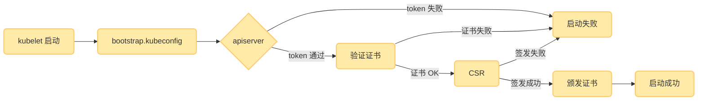
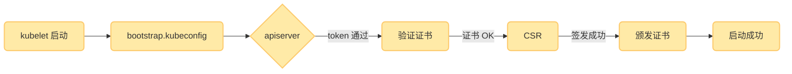

---
title: K8S 二进制集群搭建（一主两从）v1.37.2 版本
icon: circle-info
order: 1
category:
  - Linux
  - Docker
  - kubernetes
tag:
  - Linux
  - Docker
  - kubernetes
  - 运维
date: 2026-11-18
isOriginal: true
pageview: true
article: true
breadcrumb: false
comment: true
---

>👨‍🎓**博主简介**
>
>&emsp;&emsp;🏅[CSDN博客专家](https://blog.csdn.net/liu_chen_yang?type=blog)
>&emsp;&emsp;🏅[云计算领域优质创作者](https://blog.csdn.net/liu_chen_yang?type=blog)
>&emsp;&emsp;🏅[华为云开发者社区专家博主](https://bbs.huaweicloud.com/community/usersnew/id_1661843828089234)
>&emsp;&emsp;🏅[阿里云开发者社区专家博主](https://developer.aliyun.com/profile/7yu26jk3lfqxg)
>💊**交流社区：**[运维交流社区](https://bbs.csdn.net/forums/lcy) 欢迎大家的加入！
>🐋 希望大家多多支持，我们一起进步！😄
>🎉如果文章对你有帮助的话，欢迎 点赞 👍🏻 评论 💬 收藏 ⭐️ 加关注+💗

---


## 一、前言
### 1.1 温馨提示
> 内容比较多，请耐心观看，有不懂的可留言
> 请注意：所有涉及IP的需改为自己的集群IP，可复制出来到记事本等工具修改好再在服务器上操作；


### 1.2 Kubernetes v1.20.10 与 v1.37.2 版本主要变更

此前部署文档基于 Kubernetes v1.20.10，本次更新至 Kubernetes v1.37.2。两个版本之间经历了多次重要的架构调整和功能升级，主要变更包括：

1. **容器运行时调整**：Kubernetes 自 v1.24 起移除内置 dockershim，不再直接集成 Docker Engine。本次部署采用 containerd 作为容器运行时，通过 CRI 接口与 kubelet 通信。
2. **cgroup 资源管理升级**：Kubernetes 自 v1.25 起稳定支持 cgroup v2，并于 v1.35 弃用 cgroup v1，默认禁止 kubelet 在 cgroup v1 节点上启动。本次部署统一采用 cgroup v2，并使用 systemd 作为 cgroup 驱动。
3. **容器运行时接口升级**：新版本要求使用兼容的 CRI 容器运行时，需检查 containerd 版本、CRI 插件及 kubelet 配置之间的兼容性。
4. **网络组件与配置调整**：根据新版 Kubernetes 的要求，更新 CNI 网络插件、kube-proxy 及相关网络配置，确保与 Kubernetes v1.37.2 兼容。
5. **集群组件配置更新**：调整 kubeadm、kubelet、kube-apiserver、kube-controller-manager 和 kube-scheduler 等组件的配置，适配新版本参数及配置 API。
6. **安全机制与证书管理**：检查新版 Kubernetes 的证书有效期、TLS 配置、证书轮换机制及 API 访问控制要求，并适配相关安全配置。
7. **API 兼容性调整**：清理旧版本中已废弃或移除的 API，更新 Deployment、Ingress、CronJob 等资源配置，确保业务 YAML 文件兼容新版 Kubernetes。
8. **运维工具调整**：容器运行时由 Docker 切换为 containerd 后，节点容器排查主要使用 crictl、ctr 等工具，集群资源管理继续使用 kubectl。
### 1.3 常见 k8s 部署方式

* Mini kube
> Minikube是一个工具，可以在本地快速运行一个单节点微型K8s，仅用于学习预览K8s的一些特性使用。
> 官方部署地址: [https://kubernetes.io/zh-cn/docs/tasks/tools/](https://kubernetes.io/zh-cn/docs/tasks/tools/)

* Kubeadm

> Kubeadm也是一个工具，提供kubeadm init和kubeadm join，用于快速部署K8S集群，相对简单
> 官方部署地址：[https://kubernetes.io/zh-cn/docs/reference/setup-tools/kubeadm/](https://kubernetes.io/zh-cn/docs/reference/setup-tools/kubeadm/)


* 二进制安装部署

> 生产首选，从官方下载发行版的二进制包，手动部署每个组件和自签TLS证书，组成K8s集群，新手推荐
> 下载地址：[https://github.com/kubernetes/kubernetes/releases](https://github.com/kubernetes/kubernetes/releases)

---
> **小结**：kubeadm降低部署门槛，但屏蔽了很多细节，遇到问题很难排查，如果想更容易可控，推荐使用二进制包部署kubernetes集群，虽然手动部署麻烦点，期间可以学习很多工作原理，也利于后期维护。

### 1.4 参考文献

| 标题 | 链接 |
|--|--|
| Kubernetes 官方安装文档 | [https://kubernetes.io/zh-cn/docs/setup/](https://kubernetes.io/zh-cn/docs/setup/) |
| etcd 官方安装文档 | [https://etcd.io/docs/latest/install/](https://etcd.io/docs/latest/install/)  |
| Containerd 官方文档 | [https://containerd.io/docs/](https://containerd.io/docs/) |

### 1.5 所有插件/软件开源地址
| 插件/软件名称 |开源地址  |
|--|--|
| cfssl开源地址 |[https://github.com/cloudflare/cfssl](https://github.com/cloudflare/cfssl)  |
|  etcd开源地址| [https://github.com/etcd-io/etcd/](https://github.com/etcd-io/etcd/) |
|nerdctl开源地址  |  [https://github.com/containerd/nerdctl/](https://github.com/containerd/nerdctl/)|
|containerd开源地址  | [https://github.com/containerd/containerd/](https://github.com/containerd/containerd/) |
|containerd CNI插件开源地址  | [https://github.com/containernetworking/plugins/](https://github.com/containernetworking/plugins/) |
|calico 网络插件开源地址  | [https://github.com/projectcalico/calico](https://github.com/projectcalico/calico) |
| metrics-server插件开源地址 | [https://github.com/kubernetes-sigs/metrics-server](https://github.com/kubernetes-sigs/metrics-server) |


## 二、准备工作（所有节点）

> **<font color=red>温馨提示：</font>**
> 服务器需要可以访问外网，需要从网上拉取镜像。如果服务器不能上网，需要提前下载对应镜像并导入节点。

### 2.1 服务器配置

| 集群（一主两从） | IP 地址 | 主机名 | 配置（最低要求） | 安装所需组件 |
|--|--|--|--|--|
| 主 | 172.16.11.233 | k8s-master | 2C/4G/100G | cfssl、etcd、containerd、kubectl、kube-apiserver、kube-controller-manager、kube-scheduler、kubelet、kube-proxy |
| 从 | 172.16.11.234 | k8s-node1 | 2C/4G/100G | etcd、containerd、kubelet、kube-proxy |
| 从 | 172.16.11.236 | k8s-node2 | 2C/4G/100G | etcd、containerd、kubelet、kube-proxy |


---

**<font size=4>✅ 所需软件组件说明：</font>**

| 组件名称 | 说明 |
|----------|------|
| `cfssl` | 用于生成 TLS 证书  |
| `etcd` | 分布式键值数据库，存储集群所有数据 |
| `containerd` | 容器运行时（Kubernetes v1.24+ 推荐使用） |
|`nerdctl`|	containerd 的命令行管理工具，提供类似 Docker 的操作命令，用于管理容器、镜像及容器网络等资源|
| `kubectl` | 命令行工具，用于与集群交互 |
| `kube-apiserver` | Kubernetes API 服务，集群的统一入口 |
| `kube-controller-manager` | 控制器管理器，负责资源控制逻辑 |
| `kube-scheduler` | 调度器，负责 Pod 的调度 |
| `kubelet` | 节点代理，负责启动 Pod 和管理容器 |
| `kube-proxy` | 网络代理，负责服务发现和负载均衡 |

---

**<font size=4>✅ 软件版本说明：</font>**

| 软件 | 版本 |
|--|--|
| Linux |  Ubuntu 24.04（推荐使用支持 cgroup v2 的系统） |
| cfssl | 1.7.1  |
| etcd | v3.7.3  |
| containerd | v1.7.24  |
|runc|1.2.2|
|nerdctl|2.4.2|
| Kubernetes | v1.37.2  |
| Calico | v3.33.0 |
| CNI 插件 | v1.5.1+  |

> **关于操作系统说明**：Kubernetes v1.35 要求使用 **cgroup v2**，CentOS 7 默认使用 cgroup v1，如需在 CentOS 7 上安装需额外配置。推荐使用 Ubuntu 22.04/24.04、Rocky Linux 9 等默认 cgroup v2 的系统 。

---
**<font size=4> ✅ Kubernetes一主两从结构图</font>**
> **其他说明：**
> * 这里etcd为了节省机器，复用k8s节点；
> * `kubectl`是操作命令，因为只需要再master节点上操作，所以只需要再master节点安装`kubectl`就行；


---

**<font size=4>✅ 本文路径说明：</font>**

| 路径 | 说明 |
|--|--|
| `/software-cfssl` | 存放 cfssl 工具包，用于生成证书 |
| `/opt/packages/` | 存放 etcd、kubernetes 等二进制包 |
| `/opt/kubernetes/` | 存放 k8s 的配置文件、证书、日志等 |
| `/opt/etcd/` | 存放 etcd 的配置文件、证书、日志等 |
| `/opt/TLS/` | 存放自签证书的路径 |

### 2.2 关闭防火墙

```bash
systemctl stop firewalld && systemctl disable firewalld
```

如果在生产服务器之类的不能关闭防火墙，那就需要开启几个端口；（这里说的是k8所用到的端口及是否需要对外开放）


- master节点：

| 规则  | 端口  | 监听组件                 | 用途说明                                                                 | 使用者/访问方                          | 是否对外开放 |
|-------|-------|--------------------------|--------------------------------------------------------------------------|----------------------------------------|--------------|
| TCP   | 2379  | etcd                     | etcd client 端口（apiserver 读写数据）                                   | kube-apiserver                         | **<font color=gren>是</font>**（仅对控制面） |
| TCP   | 2380  | etcd                     | etcd peer 端口（集群内部选举、复制）                                     | 其他 etcd 节点                         | **<font color=gren>是</font>**（仅对 etcd 成员） |
| TCP   | 6443  | kube-apiserver           | Kubernetes API 入口                                                       | 所有外部/内部客户端                    | **<font color=gren>是</font>**       |
| TCP   | 179   | Calico/BIRD              | BGP 路由协议，用于节点间交换 Pod 网段路由                                | 集群内其他 Calico 节点                 | **<font color=gren>是</font>**           |
| TCP   | 9099  | calico/node              | Calico 健康检查 & metrics（liveness/readiness）                         | kubelet、Prometheus                    | 否           |
| TCP   | 10248 | kubelet                  | kubelet 健康检查端点 `/healthz`                                          | kubelet 自身、控制面                   | 否           |
| TCP   | 10249 | kube-proxy               | kube-proxy metrics 接口                                                  | Prometheus、HPA 控制器                 | 否           |
| TCP   | 10250 | kubelet                  | kubelet HTTPS API（logs/exec/metrics/csi）                               | kube-apiserver、metrics-server         | **<font color=gren>是</font>**       |
| TCP   | 10251 | kube-scheduler           | scheduler 指标与调试端点                                                 | 控制面组件、Prometheus                 | 否           |
| TCP   | 10252 | kube-controller-manager  | controller-manager 指标与调试端点                                        | 控制面组件、Prometheus                 | 否           |
| TCP   | 10255 | kubelet                  | **只读 HTTP** API（已弃用，默认关闭）                                    | 早期 heapster、监控组件                | **否**（建议关闭） |
| TCP   | 10256 | kube-proxy               | kube-proxy 健康检查 `/healthz`                                           | kubelet、负载均衡探针                  | 否           |
| TCP   | 10257 | kube-controller-manager  | **HTTPS** 安全指标与调试端点（--secure-port）                            | 控制面、Prometheus                     | 否           |
| TCP   | 10259 | kube-scheduler           | **HTTPS** 安全指标与调试端点（--secure-port）                            | 控制面、Prometheus                     | 否           |


- node节点：


| 规则  | 端口    | 监听组件        | 用途说明                                         | 使用者/访问方                           | 是否对外开放           |
| --- | ----- | ----------- | -------------------------------------------- | --------------------------------- | ---------------- |
| TCP   | 179   | Calico/BIRD              | BGP 路由协议，用于节点间交换 Pod 网段路由                                | 集群内其他 Calico 节点                 | **<font color=gren>是</font>**           |
| TCP   | 2379  | etcd                     | etcd client 端口（apiserver 读写数据）                                   | kube-apiserver                         | **<font color=gren>是</font>**（仅对控制面） |
| TCP   | 2380  | etcd                     | etcd peer 端口（集群内部选举、复制）                                     | 其他 etcd 节点                         | **<font color=gren>是</font>**（仅对 etcd 成员） |
| TCP | 9099  | calico/node | Calico 健康检查 & Prometheus 指标                  | kubelet、Prometheus                | 否                |
| TCP | 10248 | kubelet     | kubelet 自身 `/healthz` 健康探针                   | kubelet、控制面组件                     | 否                |
| TCP | 10249 | kube-proxy  | kube-proxy Prometheus 指标接口                   | Prometheus、HPA 控制器                | 否                |
| TCP | 10250 | kubelet     | **kubelet HTTPS API**（logs/exec/metrics/CSI） | **kube-apiserver**、metrics-server |  **<font color=gren>是</font>** （控制面需访问）    |
| TCP | 10255 | kubelet     | **只读 HTTP API**（已弃用，默认关闭）                    | 旧版 heapster、监控                    | 建议关闭             |
| TCP | 10256 | kube-proxy  | kube-proxy `/healthz` 健康检查                   | kubelet、LB 探针                     | 否                |


### 2.3 关闭 SELinux
临时关闭selinux（沙盒）；如需永久关闭selinux，需要修改配置为`sed -i 's/^SELINUX=enforcing$/SELINUX=disabled/' /etc/selinux/config`

```bash
# 查看默认selinux状态（如果报错没有命令就不用管了）
getenforce

# 临时关闭
setenforce 0

# 永久关闭
sed -i 's/^SELINUX=enforcing$/SELINUX=disabled/' /etc/selinux/config

#查看selinux是否关闭
getenforce
#如果是Disabled就是永久关闭，如果是permissive是临时关闭。
```

### 2.4 关闭交换分区 Swap

```bash
#临时关闭所有的交换分区
swapoff -a

#永久关闭所有的交换分区
sed -i '/swap/s/^\(.*\)$/#\1/g' /etc/fstab
```

### 2.5 修改三台集群的主机名：（每个主机限一条命令）
> 找到自己IP对应的主从；

```bash
# master 节点
hostnamectl set-hostname k8s-master

# node1 节点
hostnamectl set-hostname k8s-node1

# node2 节点
hostnamectl set-hostname k8s-node2
```
修改完成之后可以重新连接服务器；或执行命令`bash`，新连接一下；


### 2.6 所有节点添加集群 IP 与主机名到 hosts

```bash
cat >> /etc/hosts << EOF
172.16.11.233 k8s-master
172.16.11.234 k8s-node1
172.16.11.236 k8s-node2
EOF
```
添加完之后可以自行查看确保添加完成：`cat /etc/hosts`
<font color=red>注意：ip一定要改成自己的ip，不要直接复制粘贴</font>
### 2.7 配置内核参数
将桥接的 **IPv4** 流量传递到 **iptables** 的链

```bash
cat <<EOF > /etc/sysctl.d/k8s.conf
net.bridge.bridge-nf-call-ip6tables = 1
net.bridge.bridge-nf-call-iptables = 1
net.ipv4.ip_forward = 1
EOF

#让其生效
sysctl --system
```
> **配置此操作的作用**：是为了让 Linux 内核对桥接网络流量也使用 **iptables** 处理，确保 Kubernetes 的 Service、NetworkPolicy 和网络插件能正常工作。


### 2.8 三台机器时间同步

```bash
#安裝同步时间命令
apt -y install ntpdate

#同步时间
ntpdate cn.pool.ntp.org

#设置定时任务每五分钟同步一次时间
echo "*/5 * * * * root /usr/sbin/ntpdate cn.pool.ntp.org &>/dev/null" >> /etc/crontab
```

### 2.9 安装所需命令

```bash
apt-get update && apt install -y lrzsz wget conntrack ipvsadm ipset jq psmisc sysstat curl iptables net-tools gcc g++ software-properties-common lvm2 bash-completion ca-certificates gnupg
```

### 2.10 特殊说明

> 如果是虚拟机克隆的环境，建议执行 `rm -rf /etc/udev/*` 保证网卡 UUID 不同 


## 三、部署 etcd 集群
> ⚠️ 注意：
> &emsp;&emsp;下面操作都为主节点，只有到步骤 **3.11** 是各自执行，**3.12** 是全部执行；

### 3.1 etcd 简介

> Etcd 是一个`分布式键值存储系统`，主要被用来共享配置和服务发现；而Kubernetes默认使用的是`Etcd`进行数据存储；
> 所以先准备一个Etcd数据库，为解决Etcd单点故障，应采用集群方式部署，这里使用3台组建集群，可容忍1台机器故障，当然，你也可以使用5台组建集群，可容忍2台机器故障；

### 3.2 服务器规划

| 节点名称 | IP |
|--|--|
| etcd-1 | 172.16.11.233 |
| etcd-2 | 172.16.11.234 |
| etcd-3 | 172.16.11.236 |

**说明：**
为了节省机器，这里与k8s节点复用，也可以部署在k8s机器之外，只要apiserver能连接到就行。
### 3.3 cfssl 证书生成工具准备
>**cfssl简介:**
cfssl是一个开源的证书管理工具，使用json文件生成证书，相比openssl更方便使用。  
找任意一台服务器操作，这里用Master节点。

**为什么需要证书？**

K8s所有组件采用https加密通信，这些组件一般由两套根证书生成:K8S组件（apiserver）和Etcd。


按照需求分类来说，这里所有的服务组件`kube-controller-manager`、`kube-scheduler`、`kubelet`、`kube-proxy`、`kubectl` 都需要访问	`kube-apiserver`（也是图中的红线），所以，这里使用的是一套证书。而`kube-apiserver`访问`etcd集群`又是一套单独的证书（途中蓝线）。所以这里一共是2套不同的自签证书。

* cfssl证书生成工具准备

```bash
# 创建目录存放cfssl工具
mkdir /software-cfssl

# 下载 cfssl 1.7.1 版本 
wget https://github.com/cloudflare/cfssl/releases/download/v1.7.1/cfssl_1.7.1_linux_amd64 -P /software-cfssl/
wget https://github.com/cloudflare/cfssl/releases/download/v1.7.1/cfssljson_1.7.1_linux_amd64 -P /software-cfssl/
wget https://github.com/cloudflare/cfssl/releases/download/v1.7.1/cfssl-certinfo_1.7.1_linux_amd64 -P /software-cfssl/

cd /software-cfssl/
chmod +x *
cp -ar cfssl_1.7.1_linux_amd64 /usr/local/bin/cfssl
cp -ar cfssljson_1.7.1_linux_amd64 /usr/local/bin/cfssljson
cp -ar cfssl-certinfo_1.7.1_linux_amd64 /usr/local/bin/cfssl-certinfo
```


**说明:**  
如果下载失败,可以使用最后提供的网盘下载连接；

### 3.4 自签证书颁发机构（CA）
#### 3.4.1 创建工作目录
```bash
mkdir -p /opt/{etcd,kubernetes,TLS}
mkdir -p /opt/TLS/{etcd,kubernetes}
cd /opt/TLS/etcd
```


#### 3.4.2  生成自签 CA 配置

```bash
cat > ca-config.json << EOF
{
  "signing": {
    "default": {
      "expiry": "87600h"
    },
    "profiles": {
      "www": {
         "expiry": "87600h",
         "usages": [
            "signing",
            "key encipherment",
            "server auth",
            "client auth"
        ]
      }
    }
  }
}
EOF

cat > ca-csr.json << EOF
{
    "CN": "etcd CA",
    "key": {
        "algo": "rsa",
        "size": 2048
    },
    "names": [
        {
            "C": "CN",
            "L": "BeiJing",
            "ST": "BeiJing"
        }
    ],
  "ca": {
    "expiry": "87600h"
  }
}
EOF
```
#### 3.4.3 生成自签CA证书
```bash
cfssl gencert -initca ca-csr.json | cfssljson -bare ca -
```
执行以上命令会在当前目录下生成 `ca-key.pem`和`ca.pem`文件;


### 3.5 使用自签 CA 签发 etcd HTTPS 证书
#### 3.5.1 创建证书申请文件
```bash
cat > server-csr.json << EOF
{
    "CN": "etcd",
    "hosts": [
    "172.16.11.233",
    "172.16.11.234",
    "172.16.11.236",
    "172.16.11.232",
    "172.16.11.237"
    ],
    "key": {
        "algo": "rsa",
        "size": 2048
    },
    "names": [
        {
            "C": "CN",
            "L": "BeiJing",
            "ST": "BeiJing"
        }
    ]
}
EOF
```
**说明:**  
上述文件`hosts`字段中`ip`为所有`etcd节点`的集群内部通信ip，一个都不能少，为了方便后期扩容可以多写几个预留的ip。

#### 3.5.2 生成证书

```bash
cfssl gencert -ca=ca.pem -ca-key=ca-key.pem -config=ca-config.json -profile=www server-csr.json | cfssljson -bare server
```
执行以上命令会在当前目录下生成 `server-key.pem`和`server.pem`文件;


### 3.6 准备部署etcd集群 文件及路径
#### 3.6.1 下载etcd二进制文件
**下载地址**：[https://github.com/etcd-io/etcd/releases/download/v3.7.3/etcd-v3.7.3-linux-amd64.tar.gz](https://github.com/etcd-io/etcd/releases/download/v3.7.3/etcd-v3.7.3-linux-amd64.tar.gz)

**说明:**  
下载后上传到服务器任意位置即可，如果下载有问题，可使用附件中的文件。
也可以下载到和kubenetes的同级目录`/opt/packages/`，方便日后寻找或查看等，这里我就下载到这个路径吧。

---
> <font color=blue>以下操作在master上面操作，为简化操作，待会将master节点生成的所有文件拷贝到其他节点。</font>

#### 3.6.2 创建工作目录并解压二进制包

```bash
# 创建工作目录
mkdir -p /opt/etcd/{bin,cfg,ssl}
mkdir -p /opt/packages/

# 下载上传到 /opt/packages/ 下并进行解压
cd /opt/packages/
wget https://github.com/etcd-io/etcd/releases/download/v3.7.3/etcd-v3.7.3-linux-amd64.tar.gz
tar xf etcd-v3.7.3-linux-amd64.tar.gz
mv etcd-v3.7.3-linux-amd64/{etcd,etcdctl} /opt/etcd/bin/
```

### 3.7 创建 etcd 配置文件

```bash
cat > /opt/etcd/cfg/etcd.conf << EOF
#[Member]
ETCD_NAME="etcd-1"
ETCD_DATA_DIR="/opt/etcd/default.etcd"
ETCD_LISTEN_PEER_URLS="https://172.16.11.233:2380"
ETCD_LISTEN_CLIENT_URLS="https://172.16.11.233:2379"

#[Clustering]
ETCD_INITIAL_ADVERTISE_PEER_URLS="https://172.16.11.233:2380"
ETCD_ADVERTISE_CLIENT_URLS="https://172.16.11.233:2379"
ETCD_INITIAL_CLUSTER="etcd-1=https://172.16.11.233:2380,etcd-2=https://172.16.11.234:2380,etcd-3=https://172.16.11.236:2380"
ETCD_INITIAL_CLUSTER_TOKEN="etcd-cluster"
ETCD_INITIAL_CLUSTER_STATE="new"
EOF
```

**配置说明:**

*   `ETCD_NAME`： 节点名称,集群中唯一
*   `ETCD_DATA_DIR`：数据目录，<font color=red>如果后面需要升级etcd记得需要备份数据目录，否则会冲突报错；</font>
*   `ETCD_LISTEN_PEER_URLS`：集群通讯监听地址
*   `ETCD_LISTEN_CLIENT_URLS`：客户端访问监听地址
*   `ETCD_INITIAL_CLUSTER`：集群节点地址
*   `ETCD_INITIALCLUSTER_TOKEN`：集群Token
*   `ETCD_INITIALCLUSTER_STATE`：加入集群的状态：new是新集群,existing表示加入已有集群

### 3.8 systemd 管理 etcd

```bash
cat > /usr/lib/systemd/system/etcd.service << EOF
[Unit]
Description=Etcd Server
After=network.target
After=network-online.target
Wants=network-online.target

[Service]
Type=notify
EnvironmentFile=/opt/etcd/cfg/etcd.conf
ExecStart=/opt/etcd/bin/etcd \
--cert-file=/opt/etcd/ssl/server.pem \
--key-file=/opt/etcd/ssl/server-key.pem \
--peer-cert-file=/opt/etcd/ssl/server.pem \
--peer-key-file=/opt/etcd/ssl/server-key.pem \
--trusted-ca-file=/opt/etcd/ssl/ca.pem \
--peer-trusted-ca-file=/opt/etcd/ssl/ca.pem \
--logger=zap
Restart=on-failure
LimitNOFILE=65536

[Install]
WantedBy=multi-user.target
EOF
```
### 3.9 将CA签发的etcd证书复制到etcd的TLS里

```bash
# 将CA签发的证书复制到etcd的ssl目录里
cp -ar /opt/TLS/etcd/{ca-key.pem,ca.pem,server-key.pem,server.pem} /opt/etcd/ssl/
```
### 3.10 复制证书并同步到其他节点
> IP地址和后面的值根据自己的实际情况改变，默认没有做免密需要输入服务器密码。

```bash
for i in {4,6}; do
  scp -r /opt/etcd/ root@172.16.11.23$i:/opt/
  scp /usr/lib/systemd/system/etcd.service root@172.16.11.23$i:/usr/lib/systemd/system/
done
```

### 3.11 修改节点2，节点3 ,etcd.conf配置文件中的节点名称和当前服务器IP:
> 在`node1`和`node2`上分别执行
```bash
cd /opt/etcd/cfg/
vim etcd.conf
```

```bash
#[Member]
ETCD_NAME="etcd-1"  #节点2修改为: etcd-2 节点3修改为: etcd-3
ETCD_DATA_DIR="/opt/etcd/default.etcd"
ETCD_LISTEN_PEER_URLS="https://172.16.11.233:2380"		#修改为对应节点IP
ETCD_LISTEN_CLIENT_URLS="https://172.16.11.233:2379"	#修改为对应节点IP

#[Clustering]
ETCD_INITIAL_ADVERTISE_PEER_URLS="https://172.16.11.233:2380"	#修改为对应节点IP
ETCD_ADVERTISE_CLIENT_URLS="https://172.16.11.233:2379"			#修改为对应节点IP
ETCD_INITIAL_CLUSTER="etcd-1=https://172.16.11.233:2380,etcd-2=https://172.16.11.234:2380,etcd-3=https://172.16.11.236:2380"
ETCD_INITIAL_CLUSTER_TOKEN="etcd-cluster"
ETCD_INITIAL_CLUSTER_STATE="new"
```


### 3.12 启动etcd并设置开机自启（集群都启动）
**说明:**  
etcd须多个节点同时启动，不然执行`systemctl start etcd`会一直卡在前台，连接其他节点，建议通过批量管理工具，或者脚本同时启动etcd。

```bash
systemctl daemon-reload
systemctl enable --now etcd
systemctl status etcd
```

### 3.13 检查 etcd 集群状态

> IP 需改成自己 etcd 集群的这几台ip，以下执行方法二选一即可（先复制出来到记事本，然后进行修改ip）
```bash
ETCDCTL_API=3 /opt/etcd/bin/etcdctl --cacert=/opt/etcd/ssl/ca.pem --cert=/opt/etcd/ssl/server.pem --key=/opt/etcd/ssl/server-key.pem --endpoints="https://172.16.11.233:2379,https://172.16.11.234:2379,https://172.16.11.236:2379" endpoint health --write-out=table

# 二选一都行

ETCDCTL_API=3 /opt/etcd/bin/etcdctl \
  --cacert=/opt/etcd/ssl/ca.pem \
  --cert=/opt/etcd/ssl/server.pem \
  --key=/opt/etcd/ssl/server-key.pem \
  --endpoints="https://172.16.11.233:2379,https://172.16.11.234:2379,https://172.16.11.236:2379" \
  endpoint health --write-out=table
```


**所有节点 HEALTH 为 true 则部署成功。**

### 3.14 etcd部署完成

## 四、部署 containerd 及 nerdctl（所有节点）

> **⚠️ 重要说明**：Kubernetes v1.24 起已彻底移除 dockershim，不再支持 Docker 作为容器运行时。因此如果使用超过`1.24`版本就需要使用 containerd 作为容器运行时 。


> **⚠️ 重要提醒**：可以直接选择安装nerdctl服务，参考地址：[【云原生】nerdctl 部署及使用指南](https://liucy.blog.csdn.net/article/details/166486885)，这里的是安装的完整包，包括`containerd`、`buildctl`、`ctr`、`runc`、`nerdctl`等等；这里的`containerd`版本为：2.4.0，`runc`版本为：`1.5.1`，cni的安装路径在：`/usr/local/libexec/cni/`；
> 直接参考安装那个的话就是`containerd`、`runc`版本是固定的，如果需要其他`containerd`版本，我们可以看下面的进行安装。

### 4.1 安装 containerd

* 二进制安装（推荐）

> `apt`安装会少`CNI`网络插件，需要单独安装，使用二进制`cri-containerd-cni-XXX.tar.gz`插件是全的。
```bash
# node节点没有创建目录，先进行创建目录
mkdir -p /opt/packages/
cd /opt/packages/

# 下载 containerd 
wget https://github.com/containerd/containerd/releases/download/v1.7.24/cri-containerd-cni-1.7.24-linux-amd64.tar.gz
# 解压 containerd
tar -xzf cri-containerd-cni-1.7.24-linux-amd64.tar.gz -C /

# 查看版本号
containerd --version
```


**注意：containerd 1.7.24 两种二进制安装包的区别**

containerd 1.7.24 官方提供两种常见的二进制安装包：

- `containerd-1.7.24-linux-amd64.tar.gz`
- `cri-containerd-cni-1.7.24-linux-amd64.tar.gz`

**两者的核心区别：前者主要包含 containerd 自身的运行组件，后者是集成了 containerd、runc、CNI Plugins 等组件的组合安装包。**

**1. 安装包对比**

| 对比项 | containerd-1.7.24 | cri-containerd-cni-1.7.24 |
|---|---|---|
| containerd 主程序 | ✅ 包含 | ✅ 包含 |
| ctr 命令行工具 | ✅ 包含 | ✅ 包含 |
| containerd-shim | ✅ 包含 | ✅ 包含 |
| CRI 插件 | ✅ 内置 | ✅ 内置 |
| runc 容器运行时 | ❌ 需单独安装 | ✅ 包含 |
| CNI Plugins 网络插件 | ❌ 需单独安装 | ✅ 包含 |
| systemd 服务文件 | ❌ 需单独配置 | ✅ 包含 |
| Kubernetes 使用 | 需要补充依赖 | 更方便部署 |

**2. 各组件的作用**

- **containerd**：容器运行时，负责容器镜像管理及容器生命周期管理。
- **CRI**：容器运行时接口，使 Kubernetes 的 kubelet 能够调用 containerd 管理容器。
- **runc**：OCI 容器运行时，负责实际创建和启动容器。
- **CNI Plugins**：容器网络插件，负责配置容器网络接口、IP 地址及路由等。
- **systemd**：负责 containerd 服务的启动、停止和开机自启。

**3. 安装注意事项**

**① 使用 `containerd-1.7.24-linux-amd64.tar.gz`**

需要额外安装 `runc`、`CNI Plugins`，并配置 systemd 服务文件。

**② 使用 `cri-containerd-cni-1.7.24-linux-amd64.tar.gz`**

安装包已经集成 `runc` 和 `CNI Plugins`，正常完整解压安装后，无需重复安装这些组件。

可通过以下命令检查：

```bash
containerd --version
runc --version
ls -lh /opt/cni/bin/
```


### 4.2 生成containerd 配置文件并进行简单配置

```bash
# 生成默认配置
mkdir -p /etc/containerd
containerd config default > /etc/containerd/config.toml

# 修改配置：使用 systemd cgroup driver
sed -i 's/SystemdCgroup = false/SystemdCgroup = true/g' /etc/containerd/config.toml

# 修改 sandbox 镜像地址（国内加速）
sed -i 's|registry.k8s.io/pause:3.8|registry.cn-hangzhou.aliyuncs.com/google_containers/pause:3.9|g' /etc/containerd/config.toml
```

### 4.3 加载内核模块

```bash
cat <<EOF | sudo tee /etc/modules-load.d/containerd.conf
overlay
br_netfilter
EOF

modprobe overlay
modprobe br_netfilter
```

### 4.4 启动 containerd

```bash
systemctl daemon-reload
systemctl enable --now containerd
systemctl status containerd
```


### 4.5 部署 nerdctl  
* 简介：
> nerdctl 是 containerd 官方社区维护的一个 CLI 工具，定位是 “Docker 兼容的 containerd 命令行客户端”。简单来说，它让你能用几乎和 Docker 一模一样的命令去操作 containerd。

* 下载安装包：

> 由于我们上面已经部署了containerd服务，所以，就只需要下载：`nerdctl-<VERSION>-linux-amd64.tar.gz`的包就行，这里只有命令和两个脚本，我们只需要用命令就行。

```bash
cd /opt/packages/
# 下载安装包
wget https://github.com/containerd/nerdctl/releases/download/v2.4.2/nerdctl-2.4.2-linux-amd64.tar.gz
```
* 上传到服务器上解压并移动命令

```bash
# 解压安装包
tar xf nerdctl-2.4.2-linux-amd64.tar.gz

# 移动到/usr/local/bin/下
mv nerdctl /usr/local/bin/
```

* 查看 nerdctl 版本

```bash
nerdctl version
```


这个提示是因为没有安装 `buildctl`，它是 BuildKit 的命令行客户端，主要用于构建容器镜像，如果不需要可以不用安装，直接跳过，如果需要安装就需要使用`nerdctl-full-<VERSION>-linux-amd64.tar.gz`的安装包，可以单独下载这个，吧`buildctl`的单独复制出来进行安装。

### 4.6 配置默认查看镜像、容器的命名空间
> nerdctl 默认看的是default命名空间的镜像，我们要用k8s，可以直接吧`k8s.io`的设置为默认的，修改之后拉取镜像/容器、查看都在这个命名空间下；

* 创建nerdctl配置目录

```bash
mkdir -p /etc/nerdctl
```
* 创建配置文件并写入默认命名空间配置

```bash
cat > /etc/nerdctl/nerdctl.toml << EOF
namespace = "k8s.io"
EOF
```

### 4.7 containerd 配置镜像加速地址
> 既然docker都需要配置了，那么 **containerd** 和 **docker** 是同样的道理，拉取镜像都是从dockerhub里拉取，国内是拉取不到的，所以需要采用镜像加速源的方式来拉取镜像；
> 但不同的是，配置文件位置不同，**docker** 的配置文件在：`/etc/docker/daemon.json`，**containerd** 的配置文件在：`/etc/containerd/config.toml`


* 开始配置镜像加速地址

**4.7.1 修改主配置**

编辑 `/etc/containerd/config.toml`，把 `config_path` 从空值改成目录：

```bash
# 进入container配置文件
vim /etc/containerd/config.toml

# 找到 confing_path，默认应该在162行左右，然后配置是空的，修改为如下：
[plugins."io.containerd.grpc.v1.cri".registry]
  config_path = "/etc/containerd/certs.d"
```


**4.7.2 创建目录和文件**

```bash
mkdir -p /etc/containerd/certs.d/docker.io
vi /etc/containerd/certs.d/docker.io/hosts.toml
```
**4.7.3 将如下配置添加到配置文件里**

> 镜像加速地址可参考（长期维护）：
> * [【Docker】完美解决拉取镜像超时报错：ERROR: Get https://registry-1.docker.io/v2/](https://liucy.blog.csdn.net/article/details/129085538)
> * [【Docker】完美解决拉取镜像超时报错：ERROR: Get https://registry-1.docker.io/v2/ -ToLiucyLinux](https://www.liuchenyang.top/document/Docker/registry-1.docker.iov2.html#%E4%B8%89%E3%80%81%E8%A7%A3%E5%86%B3%E6%96%B9%E6%B3%951-%E6%9B%B4%E6%8D%A2docker%E4%B8%8B%E8%BD%BD%E6%BA%90)
> * [Docker 镜像加速地址 - 公众号标签（每个月都会更新）](https://mp.weixin.qq.com/mp/appmsgalbum?__biz=MzkwNzI2ODUwMg==&action=getalbum&album_id=4160135931510620166)
> <br>
> 可以按照上述任意一篇文章中的加速地址放到配置文件里进行修改，格式和Docker不一样，可参考下面写好的；

```bash
server = "https://registry-1.docker.io"

[host."https://docker.apiba.cn"]
  capabilities = ["pull", "resolve"]

[host."https://hub1.nat.tf"]
  capabilities = ["pull", "resolve"]

[host."https://docker.1panel.live"]
  capabilities = ["pull", "resolve"]

[host."https://dockerproxy.net"]
  capabilities = ["pull", "resolve"]

[host."https://hub3.nat.tf"]
  capabilities = ["pull", "resolve"]

[host."https://hub.1panel.dev"]
  capabilities = ["pull", "resolve"]

[host."https://docker.367231.xyz"]
  capabilities = ["pull", "resolve"]

[host."https://docker-registry.nmqu.com"]
  capabilities = ["pull", "resolve"]

[host."https://hub2.nat.tf"]
  capabilities = ["pull", "resolve"]

[host."https://docker.jsdelivr.fyi"]
  capabilities = ["pull", "resolve"]

[host."https://hub.rat.dev"]
  capabilities = ["pull", "resolve"]

[host."https://hub.fast360.xyz"]
  capabilities = ["pull", "resolve"]

[host."https://hub.amingg.com"]
  capabilities = ["pull", "resolve"]
```

**4.7.4 重启并验证**

```bash
# 加载配置文件
systemctl daemon-reload
# 重启containerd服务
systemctl restart containerd
# 拉取镜像
nerdctl pull nginx:1.24.0
```


> **两点提醒**
> **第一，`server` 字段的作用**：它指定回退的原始地址。当所有 `[host.*]` 都失败时，containerd 会尝试直连 `server` 指定的地址。保留 `https://registry-1.docker.io` 作为兜底是标准做法。
> **第二，地址顺序即尝试顺序**：containerd 会按 `hosts.toml` 中 `[host.*]` 出现的**从上到下**顺序依次尝试。所以建议把**实测最快、最稳定**的地址放在最前面，比如 Docker 里排第一的 `docker.apiba.cn`。如果某些地址已失效，containerd 会在超时后自动跳到下一个，但会拖慢首次拉取速度——建议定期清理失效地址。


## 五、部署 Master 节点

### 5.1 生成 kube-apiserver 证书
#### 5.1.1 自签证书颁发机构(CA)
```bash
cd /opt/TLS/kubernetes
```

生成 CA：

```bash
cat > ca-config.json << EOF
{
  "signing": {
    "default": {
      "expiry": "87600h"
    },
    "profiles": {
      "kubernetes": {
         "expiry": "87600h",
         "usages": [
            "signing",
            "key encipherment",
            "server auth",
            "client auth"
        ]
      }
    }
  }
}
EOF

cat > ca-csr.json << EOF
{
    "CN": "kubernetes",
    "key": {
        "algo": "rsa",
        "size": 2048
    },
    "names": [
        {
            "C": "CN",
            "L": "Beijing",
            "ST": "Beijing",
            "O": "k8s",
            "OU": "System"
        }
    ],
    "ca": {
        "expiry": "87600h"
    }
}
EOF
```
生成证书：
```bash
cfssl gencert -initca ca-csr.json | cfssljson -bare ca -
```
执行以上命令会在当前目录下生成 `ca-ket.pem` 和 `ca.pem`文件;


#### 5.1.2 使用自签CA签发kube-apiserver https证书

创建证书申请文件：

```bash
cat > server-csr.json << EOF
{
    "CN": "kubernetes",
    "hosts": [
      "10.0.0.1",
      "127.0.0.1",
      "172.16.11.233",
      "172.16.11.234",
      "172.16.11.236",
      "172.16.11.232",
      "172.16.11.237",
      "kubernetes",
      "kubernetes.default",
      "kubernetes.default.svc",
      "kubernetes.default.svc.cluster",
      "kubernetes.default.svc.cluster.local"
    ],
    "key": {
        "algo": "rsa",
        "size": 2048
    },
    "names": [
        {
            "C": "CN",
            "L": "BeiJing",
            "ST": "BeiJing",
            "O": "k8s",
            "OU": "System"
        }
    ]
}
EOF
```


**说明:**  

上述文件中hosts字段中IP为所有`Master/LB/VIP IP`，一个都不能少，为了方便后期扩容可以多写几个预留的IP。`172`的ip改为自己集群ip就行；

**生成证书:**

```bash
cfssl gencert -ca=ca.pem -ca-key=ca-key.pem -config=ca-config.json -profile=kubernetes server-csr.json | cfssljson -bare server
```
执行以上命令会在当前目录下生成 `server-key.pem`和`server.pem`文件;


### 5.2 安装kubectl命令

#### 5.2.1 下载Kubernetes二进制包

**Kubernetes下载地址 1.37 各版本下载地址：**[https://github.com/kubernetes/kubernetes/blob/master/CHANGELOG/CHANGELOG-1.37.md](https://github.com/kubernetes/kubernetes/blob/master/CHANGELOG/CHANGELOG-1.37.md)
这里我们选择 1.37.2 版本，找到`Server Binaries`，进去之后根据平台选择自己需要下载的文件；  


也可以直接在服务器上下载，这里是`1.37.2`版本：

```bash
cd /opt/packages/
wget https://dl.k8s.io/v1.37.2/kubernetes-server-linux-amd64.tar.gz
```

#### 5.2.2 解压二进制包并创建软件目录

上传刚才下载的 kubernetes 软件包到服务器上

```bash
# 创建kubernetes软件目录
mkdir -p /opt/kubernetes/{bin,cfg,ssl,logs} 
# 创建日志路径	
mkdir -p /opt/kubernetes/logs/{kube-apiserver,kube-controller-manager,kube-scheduler,kubelet,kube-proxy}
# 解压二进制包
tar xf kubernetes-server-linux-amd64.tar.gz
# 进入复制所需命令
cd kubernetes/server/bin
cp -ar kube-apiserver kube-scheduler kube-controller-manager /opt/kubernetes/bin
cp -ar kubectl /usr/bin/
# kubectl查看版本
kubectl version
```


这里看到这个报错先不用管，因为还没有部署`kube-apiserver`，它需要连接 `kube-apiserver` 才能查询集群信息，所以这里可以暂时不用管；
`The connection to the server localhost:8080 was refused - did you specify the right host or port?`

### 5.3 部署 kube-apiserver

#### 5.3.1 创建配置文件

```bash
cat > /opt/kubernetes/cfg/kube-apiserver.conf << EOF
KUBE_APISERVER_OPTS="--v=2 \\
--etcd-servers=https://172.16.11.233:2379,https://172.16.11.234:2379,https://172.16.11.236:2379 \\
--etcd-cafile=/opt/etcd/ssl/ca.pem \\
--etcd-certfile=/opt/etcd/ssl/server.pem \\
--etcd-keyfile=/opt/etcd/ssl/server-key.pem \\
--bind-address=172.16.11.233 \\
--secure-port=6443 \\
--advertise-address=172.16.11.233 \\
--allow-privileged=true \\
--service-cluster-ip-range=10.0.0.0/24 \\
--service-node-port-range=30000-32767 \\
--enable-admission-plugins=NamespaceLifecycle,LimitRanger,ServiceAccount,ResourceQuota,NodeRestriction \\
--authorization-mode=RBAC,Node \\
--enable-bootstrap-token-auth=true \\
--token-auth-file=/opt/kubernetes/cfg/token.csv \\
--tls-cert-file=/opt/kubernetes/ssl/server.pem  \\
--tls-private-key-file=/opt/kubernetes/ssl/server-key.pem \\
--client-ca-file=/opt/kubernetes/ssl/ca.pem \\
--service-account-issuer=https://kubernetes.default.svc.cluster.local \\
--service-account-key-file=/opt/kubernetes/ssl/server.pem \\
--service-account-signing-key-file=/opt/kubernetes/ssl/server-key.pem \\
--kubelet-client-certificate=/opt/kubernetes/ssl/server.pem \\
--kubelet-client-key=/opt/kubernetes/ssl/server-key.pem \\
--requestheader-client-ca-file=/opt/kubernetes/ssl/ca.pem \\
--proxy-client-cert-file=/opt/kubernetes/ssl/server.pem \\
--proxy-client-key-file=/opt/kubernetes/ssl/server-key.pem \\
--requestheader-allowed-names=kubernetes \\
--requestheader-extra-headers-prefix=X-Remote-Extra- \\
--requestheader-group-headers=X-Remote-Group \\
--requestheader-username-headers=X-Remote-User \\
--enable-aggregator-routing=true \\
--audit-log-path=/opt/kubernetes/logs/kube-apiserver/k8s-audit.log \\
--audit-log-maxage=30 \\
--audit-log-maxbackup=3 \\
--audit-log-maxsize=100"
EOF
```

**说明:**  
上面配置后面的两个`\\`第一个代表的是转义符，第二个代表的是换行符，用转义符是为了使用EOF保留换行符。


* [x] 日志相关

会配置到 kube-apiserver.service中，存储地址在：``/opt/kubernetes/logs/kube-apiserver/``中。

* [x] 连接 etcd 集群

| 参数                                                                                                | 含义                             |
| ------------------------------------------------------------------------------------------------- | ------------------------------ |
| `--etcd-servers=` | 后端 etcd 地址列表，**英文逗号分隔，不能有空格**。 |
| `--etcd-cafile=/opt/etcd/ssl/ca.pem`                                                              | 校验 etcd 服务端证书的 CA。             |
| `--etcd-certfile=/opt/etcd/ssl/server.pem`                                                        | apiserver 访问 etcd 时用的客户端证书。    |
| `--etcd-keyfile=/opt/etcd/ssl/server-key.pem`                                                     | 对应私钥。                          |

* [x] 监听与广告地址

| 参数                                  | 含义                                                                |
| ----------------------------------- | ----------------------------------------------------------------- |
| `--bind-address=172.16.11.233`      | 监听地址，apiserver 监听的 **本地 IP**（0.0.0.0 表示全部网卡）。                          |
| `--secure-port=6443`                | 提供 HTTPS 服务的端口，默认 6443。                                           |
| `--advertise-address=172.16.11.233` | **集群外组件**（kubelet、kube-proxy、外部 LB）应该连的 IP；多主场景通常写 VIP 或当前节点实 IP。 |

* [x] 功能开关

| 参数                        | 含义                                                  |
| ------------------------- | --------------------------------------------------- |
| `--allow-privileged=true` | 允许运行特权容器，必须开，否则 kube-proxy、Calico 等 DaemonSet 无法启动。 |

* [x]  Service 网段与 NodePort 范围

| 参数                                       | 含义                                                                     |
| ---------------------------------------- | ---------------------------------------------------------------------- |
| `--service-cluster-ip-range=10.0.0.0/24` | 集群 **Virtual IP** 段，Service 的 ClusterIP 从这里分配；**不要和 Pod CIDR、节点网络重叠**。 |
| `--service-node-port-range=30000-32767`  | NodePort 类型 Service 可使用的宿主机端口范围，可自定义。                                  |

* [x] 准入插件

| 参数                                                                                                       | 含义                                     |
| -------------------------------------------------------------------------------------------------------- | -------------------------------------- |
| `--enable-admission-plugins=NamespaceLifecycle,LimitRanger,ServiceAccount,ResourceQuota,NodeRestriction` | 启用的准入控制器，缺一个都可能导致集群异常；顺序也有影响，保持官方推荐即可。 |

* [x] 认证与授权

| 参数                                         | 含义                                                  |
| ------------------------------------------ | --------------------------------------------------- |
| `--authorization-mode=RBAC,Node`           | 授权顺序：先 RBAC，再 Node（kubelet 访问 apiserver 时用的专用授权器）。  |
| `--enable-bootstrap-token-auth=true`       | 允许使用 bootstrap token 自动签发 kubelet 证书，必需开，否则新节点无法注册。 |
| `--token-auth-file=/opt/kubernetes/cfg/token.csv` | 静态 token 文件（旧版 bootstrap 方式，可与 bootstrap token 并存）。 |

* [x] 服务端 TLS（对外）

| 参数                                                   | 含义                                                       |
| ---------------------------------------------------- | -------------------------------------------------------- |
| `--tls-cert-file=/opt/kubernetes/ssl/server.pem`            | apiserver 对外暴露的 HTTPS 证书（含 SAN，必须包含所有访问地址）。              |
| `--tls-private-key-file=/opt/kubernetes/ssl/server-key.pem` | 对应私钥。                                                    |
| `--client-ca-file=/opt/kubernetes/ssl/ca.pem`               | 校验 **客户端证书** 的 CA（kubectl、kubelet、controller-manager 等）。 |

* [x] 服务账户（ServiceAccount）相关

| 参数                                                               | 含义                                                                                                               |
| ---------------------------------------------------------------- | ---------------------------------------------------------------------------------------------------------------- |
| `--service-account-issuer=`                                   | 签发 ServiceAccount token 的 issuer 字段，任意字符串，但要与 kube-controller-manager 的 `--service-account-private-key-file` 对应。 |
| `--service-account-key-file=/opt/kubernetes/ssl/server.pem`             | 用来给 SA token **签名** 的私钥（老用法，可用单独 RSA 密钥）。                                                                        |
| `--service-account-signing-key-file=/opt/kubernetes/ssl/server-key.pem` | 新版 SA JWT 签名私钥，**与上面可以复用同一密钥**，但建议单独生成。                                                                          |

* [x] 连接 kubelet 的客户端证书

| 参数                                                     | 含义                                               |
| ------------------------------------------------------ | ------------------------------------------------ |
| `--kubelet-client-certificate=/opt/kubernetes/ssl/server.pem` | apiserver 访问 kubelet（exec/logs/metrics）时用的客户端证书。 |
| `--kubelet-client-key=/opt/kubernetes/ssl/server-key.pem`     | 对应私钥。                                            |

* [x] 聚合层（Aggregator）（供 Metrics-Server、Custom-Metrics-API 使用）

| 参数                                                    | 含义                                                                                                 |
| ----------------------------------------------------- | -------------------------------------------------------------------------------------------------- |
| `--requestheader-client-ca-file=/opt/kubernetes/ssl/ca.pem`  | 校验 **前端代理**（如 metrics-server）证书的 CA。                                                               |
| `--proxy-client-cert-file=/opt/kubernetes/ssl/server.pem`    | apiserver 当**反向代理**时，自己用的客户端证书，去向后端扩展 API Server 认证。                                               |
| `--proxy-client-key-file=/opt/kubernetes/ssl/server-key.pem` | 对应私钥。                                                                                              |
| `--requestheader-allowed-names=kubernetes`            | 代理证书里的 CN 必须等于 `kubernetes`，否则拒接。                                                                  |
| `--requestheader-*-headers`                           | 告诉 apiserver 从 HTTP 头里取真实用户名/组/扩展字段，防止伪造。                                                          |
| `--enable-aggregator-routing=true`                    | 让 apiserver 把对 `/apis/metrics.k8s.io/*` 等请求**直接转发**到扩展服务，而不是让客户端自己去寻址；必需开，否则 metrics-server 会 503。 |

* [x] 审计日志

| 参数                                             | 含义                 |
| ---------------------------------------------- | ------------------ |
| `--audit-log-path=/opt/kubernetes/logs/kube-apiserver/k8s-audit.log` | 审计日志输出文件。          |
| `--audit-log-maxage=30`                        | 保留 30 天。           |
| `--audit-log-maxbackup=3`                      | 最多保留 3 个旧文件。       |
| `--audit-log-maxsize=100`                      | 单个文件达到 100 MB 就轮转。 |

---
---
* [x] 易错点提醒
- etcd 地址**不能有空格**，否则 apiserver 启动会报 `invalid argument`。
- 所有证书路径**必须可读**，否则启动直接 fail。
- `--service-cluster-ip-range` 一旦设定**不可更改**，除非重建集群。
- 多主高可用时，`--advertise-address` 写**当前节点实 IP** 或**VIP**，不要写 127.0.0.1。
- 聚合层证书可以复用同一套，但生产建议单独生成一对，权限更小。

把上面参数都检查一遍，确认路径、IP、逗号无误后，就可以进行下一步了。

---
---
#### 5.3.2 将CA签发的k8s证书复制到kubernetes的TLS里

```bash
# 复制生成的一些证书到/opt/kubernetes/ssl下
cp -ar /opt/TLS/kubernetes/{ca-key.pem,ca.pem,server-key.pem,server.pem} /opt/kubernetes/ssl/

# 检查是否成功复制并且齐全，一共4个：ca-key.pem,ca.pem,server-key.pem,server.pem
ll /opt/kubernetes/ssl
```


#### 5.3.3 启用TLS bootstrapping机制

`TLS Bootstraping`：`Master apiserver`启用TLS认证后，Node节点`kubelet`和`kube-proxy`要与`kube-apiserver`进行通信，必须使用CA签发的有效证书才可以，当Node节点很多时，这种客户端证书颁发需要大量工作，同样也会增加集群扩展复杂度。为了简化流程，Kubernetes引入了`TLS bootstraping`机制来自动颁发客户端证书，kubelet会以一个低权限用户自动向`apiserver`申请证书，kubelet 的证书由`apiserver`动态签署。所以强烈建议在Node上使用这种方式，目前主要用于kubelet，kube-proxy还是由我们统一颁发一个证书。  

**TLS bootstraping 工作流程：**  



<br>
全部正常工作流程：



<br>
创建上述配置文件中token文件：

```bash
cat > /opt/kubernetes/cfg/token.csv << EOF
4e9b7fca01cb85ee20e192950926ff1b,kubelet-bootstrap,10001,"system:node-bootstrapper"
EOF
```

> token文件格式：`token,用户名,UID,用户组`，格式是固定的 4 段，用英文逗号隔开。

token也可自行生成替换（以下命令是随机生成16位字符）：

```bash
head -c 16 /dev/urandom | od -An -t x | tr -d ' '
```

#### 5.3.4 systemd管理apiserver

```bash
cat > /usr/lib/systemd/system/kube-apiserver.service << EOF
[Unit]
Description=Kubernetes API Server
Documentation=https://github.com/kubernetes/kubernetes

[Service]
EnvironmentFile=/opt/kubernetes/cfg/kube-apiserver.conf
ExecStart=/opt/kubernetes/bin/kube-apiserver \$KUBE_APISERVER_OPTS
Restart=on-failure
RestartSec=5
LimitNOFILE=65536

StandardOutput=append:/opt/kubernetes/logs/kube-apiserver/kube-apiserver.log
StandardError=append:/opt/kubernetes/logs/kube-apiserver/kube-apiserver.log

[Install]
WantedBy=multi-user.target
EOF
```
> `StandardOutput`、`StandardError`为普通运行日志存储路径
#### 5.3.5 启动并设置开机启动

```bash
systemctl daemon-reload
systemctl enable --now kube-apiserver 
systemctl status kube-apiserver
```
### 5.4 部署 kube-controller-manager

#### 5.4.1 创建配置文件

```bash
cat > /opt/kubernetes/cfg/kube-controller-manager.conf << EOF
KUBE_CONTROLLER_MANAGER_OPTS="--v=2 \\
--leader-elect=true \\
--kubeconfig=/opt/kubernetes/cfg/kube-controller-manager.kubeconfig \\
--bind-address=127.0.0.1 \\
--allocate-node-cidrs=true \\
--cluster-cidr=10.244.0.0/16 \\
--service-cluster-ip-range=10.0.0.0/24 \\
--cluster-signing-cert-file=/opt/kubernetes/ssl/ca.pem \\
--cluster-signing-key-file=/opt/kubernetes/ssl/ca-key.pem  \\
--root-ca-file=/opt/kubernetes/ssl/ca.pem \\
--service-account-private-key-file=/opt/kubernetes/ssl/server-key.pem \\
--cluster-signing-duration=87600h0m0s"
EOF
```
配置文件说明：
* [x] 日志相关

会配置到 kube-controller-manager.service中，存储地址在：``/opt/kubernetes/logs/kube-controller-manager/``中。

* [x] 高可用开关


| 内容                     | 含义                                |
| --------------------- | --------------------------------- |
| `--leader-elect=true` | 多主场景必须开，让各实例通过 etcd 选主；单主可关但建议保留。 |

* [x] 身份与连接

|  内容                                                                     | 含义                                                                     |
| --------------------------------------------------------------------- | ---------------------------------------------------------------------- |
| `--kubeconfig=/opt/kubernetes/cfg/kube-controller-manager.kubeconfig` | 自带 **apiserver 地址 + 客户端证书 + CA**，用于与 apiserver 通信；**文件必须存在且证书未过期**。 ⚠️ |
| `--bind-address=127.0.0.1`                                            | 控制器监听 **仅本机** 的 metrics 端口（10252/10257）；多主监控需改成 `0.0.0.0` 或实 IP。 ⚠️    |

* [x] 网络段分配

| 内容                                        | 含义                                                                   |
| ---------------------------------------- | -------------------------------------------------------------------- |
| `--allocate-node-cidrs=true`             | 让 **Node IPAM** 生效，必须为 true，否则 controller 不会给 Node 分配 PodCIDR。 ⚠️    |
| `--cluster-cidr=10.244.0.0/16`           | 整个集群 **Pod 网段**，与 kube-proxy、CNI、kubelet 的 `--cluster-cidr` 保持一致。 ⚠️ |
| `--service-cluster-ip-range=10.0.0.0/24` | **Service VIP 范围**，必须和 **apiserver** 的同名参数完全一致。 ⚠️                   |

* [x] 证书自动签发（CA 与期限）

| 内容                                                        | 含义                                                         |
| ----------------------------------------------------------- | ------------------------------------------------------------ |
| `--cluster-signing-cert-file=/opt/kubernetes/ssl/ca.pem`    | 给 **Node、CSR、ServiceAccount** 签证书的 **CA 证书**。自动为kubelet颁发证书的CA,apiserver保持一致 |
| `--cluster-signing-key-file=/opt/kubernetes/ssl/ca-key.pem` | 自动为kubelet颁发证书的CA,apiserver保持一致                  |
| `--cluster-signing-duration=87600h0m0s`                     | 签出的证书有效期 **10 年**，生产可缩短（如 8760h）。         |


* [x] 根 CA & ServiceAccount JWT

| 内容                                                         | 含义                                                         |
| ------------------------------------------------------------ | ------------------------------------------------------------ |
| `--root-ca-file=/opt/kubernetes/ssl/ca.pem`                  | 注入到 **每个 ServiceAccount** 的 `/var/run/secrets/kubernetes.io/serviceaccount/ca.crt`；与 apiserver 的 `--client-ca-file` 保持一致。 ⚠️ |
| `--service-account-private-key-file=/opt/kubernetes/ssl/server-key.pem` | 给 **SA token** 签名的私钥；与 apiserver 的 `--service-account-signing-key-file` 必须 **同一对密钥**，否则 token 验证失败。 ⚠️ |


#### 5.4.2 生成kube-controller-manager证书

```bash
# 切换工作目录
cd /opt/TLS/kubernetes

# 创建证书请求文件
cat > kube-controller-manager-csr.json << EOF
{
  "CN": "system:kube-controller-manager",
  "hosts": [],
  "key": {
    "algo": "rsa",
    "size": 2048
  },
  "names": [
    {
      "C": "CN",
      "L": "BeiJing", 
      "ST": "BeiJing",
      "O": "system:masters",
      "OU": "System"
    }
  ]
}
EOF
```
**生成证书:**

```bash
cfssl gencert -ca=ca.pem -ca-key=ca-key.pem -config=ca-config.json -profile=kubernetes kube-controller-manager-csr.json | cfssljson -bare kube-controller-manager
```

执行以上命令会在当前目录下生成 `kube-controller-manager-key.pem`和`kube-controller-manager.pem`文件;


#### 5.4.3 生成 kube-controller-manager 的 kubeconfig 文件
> 以下内容是在命令行直接执行的，需要注意`生成的kubeconfig文件路径`、所有`pem`的位置、及`IP`地址，如果不一样记得修改；

```bash
KUBE_CONFIG="/opt/kubernetes/cfg/kube-controller-manager.kubeconfig"
KUBE_APISERVER="https://172.16.11.233:6443"

kubectl config set-cluster kubernetes \
  --certificate-authority=/opt/kubernetes/ssl/ca.pem \
  --embed-certs=true \
  --server=${KUBE_APISERVER} \
  --kubeconfig=${KUBE_CONFIG}
  
kubectl config set-credentials kube-controller-manager \
  --client-certificate=/opt/TLS/kubernetes/kube-controller-manager.pem \
  --client-key=/opt/TLS/kubernetes/kube-controller-manager-key.pem \
  --embed-certs=true \
  --kubeconfig=${KUBE_CONFIG}
  
kubectl config set-context default \
  --cluster=kubernetes \
  --user=kube-controller-manager \
  --kubeconfig=${KUBE_CONFIG}
  
kubectl config use-context default --kubeconfig=${KUBE_CONFIG}
```
生成完之后会在`/opt/kubernetes/cfg/`目录下有一个`kube-controller-manager.conf`和`kube-controller-manager.kubeconfig`文件；


#### 5.4.4 systemd管理controller-manager

```bash
cat > /usr/lib/systemd/system/kube-controller-manager.service << EOF
[Unit]
Description=Kubernetes Controller Manager
Documentation=https://github.com/kubernetes/kubernetes

[Service]
EnvironmentFile=/opt/kubernetes/cfg/kube-controller-manager.conf
ExecStart=/opt/kubernetes/bin/kube-controller-manager \$KUBE_CONTROLLER_MANAGER_OPTS

Restart=on-failure
RestartSec=5
LimitNOFILE=65536

StandardOutput=append:/opt/kubernetes/logs/kube-controller-manager/kube-controller-manager.log
StandardError=append:/opt/kubernetes/logs/kube-controller-manager/kube-controller-manager.log

[Install]
WantedBy=multi-user.target
EOF
```
#### 5.4.5 启动并设置开机自启

> 需确保`kube-apiserver`服务起来，否则`kube-controller-manager`会启动失败；
```bash
systemctl daemon-reload
systemctl enable --now kube-controller-manager
systemctl status kube-controller-manager
```

### 5.5 部署 kube-scheduler

#### 5.5.1 创建配置文件

```bash
cat > /opt/kubernetes/cfg/kube-scheduler.conf << EOF
KUBE_SCHEDULER_OPTS="--v=2 \
--leader-elect \\
--kubeconfig=/opt/kubernetes/cfg/kube-scheduler.kubeconfig \\
--bind-address=127.0.0.1"
EOF
```

*   \-\-kubeconfig ：连接apiserver配置文件
*   \-\-leader-elect ：当该组件启动多个时,自动选举(HA)。

#### 5.5.2 生成kube-scheduler证书 
```bash
# 切换工作目录
cd /opt/TLS/kubernetes

# 创建证书请求文件
cat > kube-scheduler-csr.json << EOF
{
  "CN": "system:kube-scheduler",
  "hosts": [],
  "key": {
    "algo": "rsa",
    "size": 2048
  },
  "names": [
    {
      "C": "CN",
      "L": "BeiJing",
      "ST": "BeiJing",
      "O": "system:masters",
      "OU": "System"
    }
  ]
}
EOF
```
**生成证书**

```bash
cfssl gencert -ca=ca.pem -ca-key=ca-key.pem -config=ca-config.json -profile=kubernetes kube-scheduler-csr.json | cfssljson -bare kube-scheduler
```
执行以上命令会在当前目录下生成 `kube-scheduler-key.pem`和`kube-scheduler.pem`文件;


#### 5.5.3 生成 kube-scheduler 的 kubeconfig 文件

> 以下内容是在命令行直接执行的，需要注意`生成的kubeconfig文件路径`、所有`pem`的位置、及`IP`地址，如果不一样记得修改；


```bash
KUBE_CONFIG="/opt/kubernetes/cfg/kube-scheduler.kubeconfig"
KUBE_APISERVER="https://172.16.11.233:6443"

kubectl config set-cluster kubernetes \
  --certificate-authority=/opt/kubernetes/ssl/ca.pem \
  --embed-certs=true \
  --server=${KUBE_APISERVER} \
  --kubeconfig=${KUBE_CONFIG}
  
kubectl config set-credentials kube-scheduler \
  --client-certificate=/opt/TLS/kubernetes/kube-scheduler.pem \
  --client-key=/opt/TLS/kubernetes/kube-scheduler-key.pem \
  --embed-certs=true \
  --kubeconfig=${KUBE_CONFIG}
  
kubectl config set-context default \
  --cluster=kubernetes \
  --user=kube-scheduler \
  --kubeconfig=${KUBE_CONFIG}
  
kubectl config use-context default --kubeconfig=${KUBE_CONFIG}
```
生成完之后会在`/opt/kubernetes/cfg/`目录下有一个`kube-scheduler.conf`和`kube-scheduler.kubeconfig`文件；


#### 5.5.4 systemd管理scheduler

```bash
cat > /usr/lib/systemd/system/kube-scheduler.service << EOF
[Unit]
Description=Kubernetes Scheduler
Documentation=https://github.com/kubernetes/kubernetes

[Service]
EnvironmentFile=/opt/kubernetes/cfg/kube-scheduler.conf
ExecStart=/opt/kubernetes/bin/kube-scheduler \$KUBE_SCHEDULER_OPTS
Restart=on-failure
RestartSec=5

LimitNOFILE=65536
StandardOutput=append:/opt/kubernetes/logs/kube-scheduler/kube-scheduler.log
StandardError=append:/opt/kubernetes/logs/kube-scheduler/kube-scheduler.log

[Install]
WantedBy=multi-user.target
EOF
```

#### 5.5.5 启动并设置开机启动
> 需确保`kube-apiserver`、`kube-controller-manager`服务起来了，否则`kube-scheduler`会启动失败；
```bash
systemctl daemon-reload
systemctl enable --now kube-scheduler
systemctl status kube-scheduler
```

### 5.6 查看集群状态
#### 5.6.1 生成kubectl连接集群的证书

```bash
# 切换工作目录
cd /opt/TLS/kubernetes

# 创建证书请求文件
cat > admin-csr.json <<EOF
{
  "CN": "admin",
  "hosts": [],
  "key": {
    "algo": "rsa",
    "size": 2048
  },
  "names": [
    {
      "C": "CN",
      "L": "BeiJing",
      "ST": "BeiJing",
      "O": "system:masters",
      "OU": "System"
    }
  ]
}
EOF
```
**生成证书**

```bash
cfssl gencert -ca=ca.pem -ca-key=ca-key.pem -config=ca-config.json -profile=kubernetes admin-csr.json | cfssljson -bare admin
```
执行以上命令会在当前目录下生成 `admin-key.pem`和`admin.pem`文件;


#### 5.6.2 生成 kubectl 的 kubeconfig 文件
> 以下内容是在命令行直接执行的，需要注意`生成的kubeconfig文件路径`、所有`pem`的位置、及`IP`地址，如果不一样记得修改；

```bash
mkdir /root/.kube

KUBE_CONFIG="/root/.kube/config"
KUBE_APISERVER="https://172.16.11.233:6443"

kubectl config set-cluster kubernetes \
  --certificate-authority=/opt/kubernetes/ssl/ca.pem \
  --embed-certs=true \
  --server=${KUBE_APISERVER} \
  --kubeconfig=${KUBE_CONFIG}
  
kubectl config set-credentials cluster-admin \
  --client-certificate=/opt/TLS/kubernetes/admin.pem \
  --client-key=/opt/TLS/kubernetes/admin-key.pem \
  --embed-certs=true \
  --kubeconfig=${KUBE_CONFIG}
  
kubectl config set-context default \
  --cluster=kubernetes \
  --user=cluster-admin \
  --kubeconfig=${KUBE_CONFIG}
  
kubectl config use-context default --kubeconfig=${KUBE_CONFIG}
```
生成完之后会在`/root/.kube/`目录下有一个`config`文件；


#### 5.6.3 通过kubectl工具查看当前集群组件状态 

```bash
root@k8s-master:~/.kube# kubectl get cs
Warning: v1 ComponentStatus is deprecated in v1.19+
NAME                 STATUS    MESSAGE   ERROR
scheduler            Healthy   ok        
controller-manager   Healthy   ok        
etcd-0               Healthy   ok      
```

> `kubectl get cs` 里的 **cs** 是 **componentstatus** 的缩写，即“**组件状态**”。  
> 这条命令用来**快速查看 Kubernetes 控制平面四大核心组件的健康状况**：
> - scheduler  
> - controller-manager  
> - etcd-0  
> - （1.19 之后 apiserver 不再列出，因为 apiserver 自己就是接口提供者）
> - （这里为什么只展示`etcd-0`，不展示其他的了？
> 答：Kubernetes 维护者的回复是：由于 ComponentStatus 已经弃用，大约在1.25版本的一次维护变更了内容，导致不展示，但不计划修复这一显示问题。
> 解：我在部署1.20.10的时候可以，现在部署1.37.2版本是不会展示其他的etcd了，如果需要看etcd集群的状态，可使用命令（在 **3.13 检查 etcd 集群状态**）：`ETCDCTL_API=3 /opt/etcd/bin/etcdctl --cacert=/opt/etcd/ssl/ca.pem --cert=/opt/etcd/ssl/server.pem --key=/opt/etcd/ssl/server-key.pem --endpoints="https://172.16.11.233:2379,https://172.16.11.234:2379,https://172.16.11.236:2379" endpoint health --write-out=table`）


如上`STATUS`都是`Healthy`说明Master节点所有组件运行正常。
更明显的可以看后面的`MESSAGE`都是`ok`，那么也可以说明Master节点所有组件运行正常。

#### 5.6.4 授权kubelet-bootstrap用户允许请求证书

```bash
kubectl create clusterrolebinding kubelet-bootstrap \
--clusterrole=system:node-bootstrapper \
--user=kubelet-bootstrap
```
验证：

```bash
kubectl get clusterrolebinding kubelet-bootstrap -o wide
```


## 六、Master节点部署Node
### 6.1 复制kubelet及kube-proxy命令

```bash
# 进入复制所需命令
cd /opt/packages/kubernetes/server/bin
cp -ar kubelet kube-proxy /opt/kubernetes/bin
```
### 6.2 部署kubelet

#### 6.2.1 创建kubelet配置文件

```bash
cat > /opt/kubernetes/cfg/kubelet.conf << EOF
KUBELET_OPTS="--v=2 \\
--hostname-override=k8s-master \\
--kubeconfig=/opt/kubernetes/cfg/kubelet.kubeconfig \\
--bootstrap-kubeconfig=/opt/kubernetes/cfg/bootstrap.kubeconfig \\
--config=/opt/kubernetes/cfg/kubelet-config.yml \\
--cert-dir=/opt/kubernetes/ssl \\
EOF
```
**个别参数解析：**

*   `--hostname-override` ：显示名称,集群唯一(不可重复)。
*   `--kubeconfig` ： 空路径,会自动生成,后面用于连接apiserver。
*   `--bootstrap-kubeconfig` ：首次启动向apiserver申请证书。
*   `--config` ：配置文件参数。
*   `--cert-dir` ：kubelet证书目录。

#### 6.2.2 配置kubelet参数文件

```bash
cat > /opt/kubernetes/cfg/kubelet-config.yml << EOF
kind: KubeletConfiguration
apiVersion: kubelet.config.k8s.io/v1beta1

address: 0.0.0.0
port: 10250
readOnlyPort: 0

cgroupDriver: systemd

clusterDNS:
- 10.0.0.2
clusterDomain: cluster.local 

failSwapOn: true

authentication:
  anonymous:
    enabled: false
  webhook:
    cacheTTL: 2m0s
    enabled: true
  x509:
    clientCAFile: /opt/kubernetes/ssl/ca.pem 
    
authorization:
  mode: Webhook
  webhook:
    cacheAuthorizedTTL: 5m0s
    cacheUnauthorizedTTL: 30s
    
evictionHard:
  imagefs.available: 15%
  memory.available: 100Mi
  nodefs.available: 10%
  nodefs.inodesFree: 5%
  
maxOpenFiles: 1000000
maxPods: 110

serializeImagePulls: false

rotateCertificates: true

containerRuntimeEndpoint: unix:///run/containerd/containerd.sock
EOF
```
**个别参数解析：**

*  `imagefs.available: 15%`  ： **镜像存储**剩余 <15% 开始驱离 Pod（按镜像用量排序）。        
* `memory.available: 100Mi` ： **节点可用内存**<100Mi 立即驱离，最敏感指标；可酌情调到 200~500Mi。
*  `nodefs.available: 10%` / `nodefs.inodesFree: 5%`：**根分区**空间/索引耗尽保护；**/var/lib/kubelet** 必须在此分区。 
*  `maxOpenFiles: 1000000`： 给 **kubelet 进程**的 ulimit；容器太多时防止 “too many open files”。                     
*  `maxPods: 110` ：本节点 **最大 Pod 数**，与 kube-scheduler 的 `NodeAllocatable` 一致；受 CNI/网卡/CPU 限制，可向下调。 

#### 6.2.3 生成kubelet初次加入集群引导kubeconfig文件

```bash
KUBE_CONFIG="/opt/kubernetes/cfg/bootstrap.kubeconfig"
KUBE_APISERVER="https://172.16.11.233:6443" # apiserver IP:PORT
TOKEN="4e9b7fca01cb85ee20e192950926ff1b" # 与token.csv里保持一致  /opt/kubernetes/cfg/token.csv 

# 生成 kubelet bootstrap kubeconfig 配置文件
kubectl config set-cluster kubernetes \
  --certificate-authority=/opt/kubernetes/ssl/ca.pem \
  --embed-certs=true \
  --server=${KUBE_APISERVER} \
  --kubeconfig=${KUBE_CONFIG}
  
kubectl config set-credentials "kubelet-bootstrap" \
  --token=${TOKEN} \
  --kubeconfig=${KUBE_CONFIG}
  
kubectl config set-context default \
  --cluster=kubernetes \
  --user="kubelet-bootstrap" \
  --kubeconfig=${KUBE_CONFIG}
  
kubectl config use-context default --kubeconfig=${KUBE_CONFIG}
```

#### 6.2.4 systemd管理kubelet

```bash
cat > /usr/lib/systemd/system/kubelet.service << EOF
[Unit]
Description=Kubernetes Kubelet
Documentation=https://kubernetes.io/docs/
After=network-online.target containerd.service
Wants=network-online.target
Requires=containerd.service

[Service]
EnvironmentFile=/opt/kubernetes/cfg/kubelet.conf
ExecStart=/opt/kubernetes/bin/kubelet \$KUBELET_OPTS

Restart=always
RestartSec=5
LimitNOFILE=65536

StandardOutput=append:/opt/kubernetes/logs/kubelet/kubelet.log
StandardError=append:/opt/kubernetes/logs/kubelet/kubelet.log

[Install]
WantedBy=multi-user.target
EOF
```

#### 6.2.5 启动并设置开机启动

```bash
systemctl daemon-reload
systemctl enable --now kubelet
systemctl status kubelet
```

> 这里注意，如果服务器的`cgroup`使用的是V1或者是混合模式，是起不来服务的；可以看 kubelet 服务日志，如果出现如下：`E1111 14:26:13.780317   28791 run.go:72] "command failed" err="failed to validate kubelet configuration, error: kubelet is configured to not run on a host using cgroup v1. cgroup v1 support is unsupported and will be removed in a future release, path: &TypeMeta{Kind:,APIVersion:,}"`
> 就是`cgroup`的问题，这时候可以选择加配置强制使用v1或者是修改系统使用v2。具体操作可看最后的问题解决；
#### 6.2.6 允许kubelet证书申请并加入集群

> 注意：如果`kubectl get csr`刚开始查看的时候里面是空的，需要检查`kubelet`是否启动正常；

```bash
#查看kubelet证书请求
root@k8s-master:/opt/kubernetes/cfg# kubectl get csr
NAME        AGE   SIGNERNAME                                    REQUESTOR           REQUESTEDDURATION   CONDITION
csr-ct4dl   8s    kubernetes.io/kube-apiserver-client-kubelet   kubelet-bootstrap   <none>              Pending

#允许kubelet节点申请
root@k8s-master:/opt/kubernetes/cfg# kubectl certificate approve csr-ct4dl
certificatesigningrequest.certificates.k8s.io/csr-ct4dl approved

#查看申请
root@k8s-master:/opt/kubernetes/cfg# kubectl get csr
NAME        AGE    SIGNERNAME                                    REQUESTOR           REQUESTEDDURATION   CONDITION
csr-ct4dl   48s   kubernetes.io/kube-apiserver-client-kubelet   kubelet-bootstrap   <none>              Approved,Issued

#查看节点（刚开始是NotReady，但过一分钟可能就变成了Ready）
root@k8s-master:/opt/kubernetes/cfg#  kubectl get nodes
NAME         STATUS   ROLES    AGE   VERSION
k8s-master   Ready    <none>   2m2s   v1.37.2
```


**问题说明：**  
&emsp;&emsp;正常`kubectl get nodes`查看的时候`STATUS`应该是`NoReady`的，但是目前是`Ready`，这是为什么？
**解答：**
&emsp;&emsp;因为前面部署`containerd`，默认带的有`cni`网络插件，所以状态就会展示`Ready`；但是网络插件`calico`我们还是需要部署的，为了避免`calico`和`cni`的配置冲突（插件不冲突），这里，我们先把`cni`的配置进行备份，备份之后再次查看node节点就会变成：`NotReady`；

<font color=red>**所有节点都需要执行进行备份**</font>
<font color=red>**所有节点都需要执行进行备份**</font>
<font color=red>**所有节点都需要执行进行备份**</font>


```bash
# 查看cni配置位置，正常是在/etc/cni/net.d/下
ls /etc/cni/net.d/

# 创建备份目录并进行备份
mkdir -p /etc/cni/backup
mv /etc/cni/net.d/10-containerd-net.conflist /etc/cni/backup/

# 查看node节点状态（master节点执行）需要等一会就会变成 NotReady
kubectl get nodes
```


### 6.3 部署kube-proxy

#### 6.3.1 创建配置文件

```bash
cat > /opt/kubernetes/cfg/kube-proxy.conf <<'EOF'
KUBE_PROXY_OPTS="--v=2 \
--config=/opt/kubernetes/cfg/kube-proxy-config.yml"
EOF
```

#### 6.3.2 配置参数文件

```bash
cat > /opt/kubernetes/cfg/kube-proxy-config.yml <<'EOF'
kind: KubeProxyConfiguration
apiVersion: kubeproxy.config.k8s.io/v1alpha1

# 监听地址
bindAddress: 0.0.0.0

# Prometheus监控指标监听地址
metricsBindAddress: 127.0.0.1:10249

# kube-proxy访问API Server的认证配置
clientConnection:
  kubeconfig: /opt/kubernetes/cfg/kube-proxy.kubeconfig

# 当前节点名称
hostnameOverride: k8s-master

# Pod网络地址段
clusterCIDR: 10.244.0.0/16

# Service代理模式
mode: iptables
EOF
```

#### 6.3.3 生成kube-proxy证书文件

```bash
# 切换工作目录
cd /opt/TLS/kubernetes

# 创建证书请求文件
cat > kube-proxy-csr.json << EOF
{
  "CN": "system:kube-proxy",
  "hosts": [],
  "key": {
    "algo": "rsa",
    "size": 2048
  },
  "names": [
    {
      "C": "CN",
      "L": "BeiJing",
      "ST": "BeiJing",
      "O": "k8s",
      "OU": "System"
    }
  ]
}
EOF
```
**生成证书**

```bash
cfssl gencert -ca=ca.pem -ca-key=ca-key.pem -config=ca-config.json -profile=kubernetes kube-proxy-csr.json | cfssljson -bare kube-proxy
```
执行以上命令会在当前目录下生成 `kube-proxy` 相关的证书文件;


#### 6.3.4 生成kube-proxy.kubeconfig文件

```bash
KUBE_CONFIG="/opt/kubernetes/cfg/kube-proxy.kubeconfig"
KUBE_APISERVER="https://172.16.11.233:6443"

kubectl config set-cluster kubernetes \
  --certificate-authority=/opt/kubernetes/ssl/ca.pem \
  --embed-certs=true \
  --server=${KUBE_APISERVER} \
  --kubeconfig=${KUBE_CONFIG}
  
kubectl config set-credentials kube-proxy \
  --client-certificate=./kube-proxy.pem \
  --client-key=./kube-proxy-key.pem \
  --embed-certs=true \
  --kubeconfig=${KUBE_CONFIG}
  
kubectl config set-context default \
  --cluster=kubernetes \
  --user=kube-proxy \
  --kubeconfig=${KUBE_CONFIG}
  
kubectl config use-context default --kubeconfig=${KUBE_CONFIG}
```
#### 6.3.5 systemd管理kube-proxy

```bash
cat > /usr/lib/systemd/system/kube-proxy.service << EOF
[Unit]
Description=Kubernetes Proxy
Documentation=https://kubernetes.io/docs/reference/command-line-tools-reference/kube-proxy/
After=network-online.target
Wants=network-online.target

[Service]
EnvironmentFile=/opt/kubernetes/cfg/kube-proxy.conf
ExecStart=/opt/kubernetes/bin/kube-proxy \$KUBE_PROXY_OPTS

Restart=always
RestartSec=5
LimitNOFILE=65536

StandardOutput=append:/opt/kubernetes/logs/kube-proxy/kube-proxy.log
StandardError=append:/opt/kubernetes/logs/kube-proxy/kube-proxy.log

[Install]
WantedBy=multi-user.target
EOF
```

#### 6.3.6 启动并设置开机自启

```bash
systemctl daemon-reload
systemctl enable --now kube-proxy
systemctl status kube-proxy
```

### 6.4 部署网络组件(Calico)

Calico是一个纯三层的数据中心网络方案，是目前Kubernetes主流的集群网络方案。

* 拉取`calico.yaml`文件

```bash
# 创建calico目录
mkdir /opt/kubernetes/calico
cd /opt/kubernetes/calico
# 拉趣 3.33.0 版本calico yaml文件
curl -fL -o calico.yaml https://raw.githubusercontent.com/projectcalico/calico/v3.33.0/manifests/calico.yaml
```
* 创建并启动网络服务
```bash
kubectl apply -f calico.yaml
# 查看创建的网络服务
kubectl get pods -n kube-system
```
> 第一次创建很慢，因为要拉取镜像，可以使用`kubectl describe pod -n kube-system calico-node-lmhb8` 查看详细创建过程，如果是卡到了拉取镜像这里，那就可能是`containerd`的镜像加速地址失效了，可以参考如下文章，每个月都会更新docker镜像加速地址，然后替换到`containerd 配置（/etc/containerd/certs.d/docker.io/hosts.toml）`中即可；
>docker镜像加速文章地址：[https://liucy.blog.csdn.net/article/details/129085538](https://liucy.blog.csdn.net/article/details/129085538)

等`Calico Pod`的`READY`都为`1/1`或者`STATUS`是`Running`的时候，就是正常启动成功了；节点也会准备就绪。

```bash
root@k8s-master:/opt/kubernetes/calico# kubectl get pods -n kube-system
NAME                                       READY   STATUS    RESTARTS   AGE
calico-kube-controllers-846669895c-m7rl9   1/1     Running   0          7m4s
calico-node-lmhb8                          1/1     Running   0          7m4s

# 再次查看nodes节点的状态，为Ready即可；
root@k8s-master:/opt/kubernetes/cfg# kubectl get nodes 
NAME         STATUS   ROLES    AGE   VERSION
k8s-master   Ready    <none>   2d    v1.37.2
```


---
`calico`默认拉取的镜像都有如下：
查看命令：`crictl images | grep calico` 或 `nerdctl images | grep calico`


---

### 6.5 授权apiserver访问kubelet

>**为什么让apiserver访问kubelete？**<br>
> 需要**让 kube-apiserver 有权限去调用 kubelet 的 “只读” 接口（`/logs`、`/metrics`、`/exec`、`/portforward`…）相当于给“apiserver 自己”签发一张 RBAC 通行证**，让它有资格替用户去 kubelet 拿数据，这样 `kubectl logs`、`kubectl exec`等命令才能正常工作。如果没有它，`kubectl logs/exec/portforward/` 全部会卡在 **Forbidden**。

> **应用场景**：如`kubectl logs`、`kubectl exec `、`kubectl cp`等。

```bash
# 进入专门写yaml的地方
mkdir -p /opt/kubernetes/yaml
cd /opt/kubernetes/yaml
```

```bash
cat > apiserver-to-kubelet-rbac.yaml << EOF
apiVersion: rbac.authorization.k8s.io/v1
kind: ClusterRole
metadata:
  annotations:
    rbac.authorization.kubernetes.io/autoupdate: "true"
  labels:
    kubernetes.io/bootstrapping: rbac-defaults
  name: system:kube-apiserver-to-kubelet
rules:
  - apiGroups:
      - ""
    resources:
      - nodes/proxy
      - nodes/stats
      - nodes/log
      - nodes/spec
      - nodes/metrics
      - pods/log
    verbs:
      - "*"
---
apiVersion: rbac.authorization.k8s.io/v1
kind: ClusterRoleBinding
metadata:
  name: system:kube-apiserver
  namespace: ""
roleRef:
  apiGroup: rbac.authorization.k8s.io
  kind: ClusterRole
  name: system:kube-apiserver-to-kubelet
subjects:
  - apiGroup: rbac.authorization.k8s.io
    kind: User
    name: kubernetes
EOF
```

```bash
# 创建并运行
kubectl apply -f apiserver-to-kubelet-rbac.yaml
```
* 验证

```bash
# 看 ClusterRole
kubectl get clusterrole system:kube-apiserver-to-kubelet

# 看 ClusterRoleBinding
kubectl get clusterrolebinding system:kube-apiserver

# 查看详情
kubectl describe clusterrole system:kube-apiserver-to-kubelet
kubectl describe clusterrolebinding system:kube-apiserver
```
只要两条 `get` 都能拿到资源，且 `describe` 里规则、subjects 无误，就说明 **YAML 语法层面成功**。


* 命令实测
```bash
# 查看pod状态
kubectl get pods -n kube-system
# 找任意 Pod 查看日志
kubectl logs -n <ns> <pod>
kubectl logs -n kube-system calico-node-lmhb8
```
- 若 RBAC 没配，会报错  
  `Error from server: Forbidden (user kubernetes cannot get nodes/proxy)`  
- 若成功返回日志，则 **授权链路 100% 生效**。

> **总结验证是否成功**：先用 `kubectl get clusterrole/clusterrolebinding` 看对象是否存在，再用 `kubectl logs/exec/top` 等命令实测功能；两者都通过即可确认“此 YAML 已成功生效”。

### 6.6 部署 Metrics-Server 实现 `kubectl top` 与自动伸缩

（解决 `error: Metrics API not available`，为 HPA/VPA 提供 CPU/内存指标）

> **为什么必须装 Metrics-Server？**  
> `kubectl top`、HPA、VPA、调度器评分等都需要实时 CPU/内存数据；Metrics-Server 把这些指标聚合并暴露成 **Metrics API (`v1beta1.metrics.k8s.io`)**，缺了它集群就“看不见”资源用量。

> **应用场景**：`kubectl top nodes/pods`、HPA 自动伸缩、调度器优选、kube-scheduler 打分。

* 版本对照表

> 版本对照表为个人推理，不代表官方结论，请理性使用。

| Metrics-Server 版本 | 兼容 Kubernetes 版本       | 备注                                     |
| ----------------- | --------------- | -------------------------------------- |
| v0.3.x            | 1.8 – 1.17      | 老版本，镜像仍在 gcr.io，国内拉取困难                 |
| v0.4.x            | 1.16 – 1.19     | 末代 v1beta1 单版本 API                     |
| v0.5.x            | 1.19 – 1.22     | 开始支持 autoscaling/v2beta1；需 TLS 校验      |
| v0.6.x        | 1.20 – 1.25 | **1.20 推荐版本**；支持 autoscaling/v2；国内镜像可用 |
| v0.7.x            | 1.26+           | 默认使用 v1 API，最低要求 1.26                  |
| v0.8.x            | 1.31+            | 	适配新版 Kubernetes API；增强兼容性与稳定性          |
| v0.9.x            | 1.37+        | 1.37 推荐候选版本；适配新版本集群，需核实官方兼容性 |


* 1、安装：下载官方 YAML
> 下载不下来看最后附件链接里面都有，这里我直接使用最新版本；
```bash
wget https://github.com/kubernetes-sigs/metrics-server/releases/download/v0.9.1/components.yaml
```
* 2、修改为国内镜像源 + 参数
```bash
sed -i 's|registry.k8s.io/metrics-server|registry.cn-hangzhou.aliyuncs.com/google_containers|g' components.yaml

# 在 args 区追加两行
sed -i '/args:/a\        - --kubelet-insecure-tls' components.yaml
sed -i '/args:/a\        - --kubelet-preferred-address-types=InternalIP,Hostname,ExternalIP' components.yaml
```
 

* 3、部署 & 等待 Ready
```bash
kubectl apply -f components.yaml

# 看 Pod
kubectl get pods -n kube-system | grep metrics-server
```
等待状态 `Running` `1/1` 即成功；


* 4、验证 API 注册成功
```bash
kubectl get apiservice | grep metrics
# 出现 v1beta1.metrics.k8s.io True 即注册完成
```


* 5、验证 `kuberctl top`
```bash
kubectl top nodes
```
如下输出正常，则成功；


### 6.7 kubernetes强化tab（安装之后会tab可以补全命令及参数）

```bash
echo 'source  <(kubectl  completion  bash)' >> ~/.bashrc
```
>1、退出连接，重新连接；
> 2、或者`bash`更新环境就可以使用了。

## 七、新增加Work Node（其他两个node节点）

### 7.1 拷贝Master节点已部署好的相关文件到node节点

在`Master`节点将`Work Node`涉及文件拷贝到其他新节点 `172.16.11.234`/`172.16.11.236`

```bash
for i in {4,6}; do scp -r /opt/kubernetes root@172.16.11.23$i:/opt/; done

for i in {4,6}; do scp -r /usr/lib/systemd/system/{kubelet,kube-proxy}.service root@172.16.11.23$i:/usr/lib/systemd/system; done
```

### 7.2 删除不需要的配置和证书（其他node节点）
> <font color=red>**注意：不要删错了，是删除拷贝过去的node节点，不是master节点；**</font>
> <font color=red>**注意：不要删错了，是删除拷贝过去的node节点，不是master节点；**</font>
> <font color=red>**注意：不要删错了，是删除拷贝过去的node节点，不是master节点；**</font>
#### 7.2.1 删除 kube-apiserver、kube-controller-manager、kube-scheduler 配置

```bash
cd /opt/kubernetes/cfg/
rm -rf kube-apiserver.conf kube-controller-manager.* kube-scheduler.*
```

#### 7.2.2 删除 kubelet 证书和生成的kubeconfig文件

```bash
rm -f /opt/kubernetes/cfg/kubelet.kubeconfig 
rm -f /opt/kubernetes/ssl/kubelet*
```

**说明:**  
这几个文件是证书申请审批后自动生成的，每个Node不同，必须删除。

删除完剩余这几个；


### 7.3 修改kubelet和kubeproxy配置中的主机名
> `node1` 和 `node2`分别进行修改；
```bash
# ---------------------node1---------------------
vi /opt/kubernetes/cfg/kubelet.conf
--hostname-override=k8s-node1

vi /opt/kubernetes/cfg/kube-proxy-config.yml
hostnameOverride: k8s-node1

# ---------------------node2---------------------
vi /opt/kubernetes/cfg/kubelet.conf
--hostname-override=k8s-node2

vi /opt/kubernetes/cfg/kube-proxy-config.yml
hostnameOverride: k8s-node2
```

### 7.4 启动并设置开机自启

```bash
systemctl daemon-reload
systemctl enable --now kubelet kube-proxy
systemctl status kubelet kube-proxy
```

### 7.5 在Master节点上同意新的Node kubelet证书申请
> 这里也是，如果执行`kubectl get csr`没有看到新的内容，请检查两台node `kubelet`服务的状态；
```bash
#查看证书请求
root@k8s-master:~# kubectl get csr
NAME        AGE     SIGNERNAME                                    REQUESTOR           REQUESTEDDURATION   CONDITION
csr-2p5q4   2m14s   kubernetes.io/kube-apiserver-client-kubelet   kubelet-bootstrap   <none>              Pending
csr-ct4dl   68m     kubernetes.io/kube-apiserver-client-kubelet   kubelet-bootstrap   <none>              Approved,Issued
csr-n6zn6   2m14s   kubernetes.io/kube-apiserver-client-kubelet   kubelet-bootstrap   <none>              Pending

#同意新的node请求
root@k8s-master:~# kubectl certificate approve csr-2p5q4 csr-n6zn6
certificatesigningrequest.certificates.k8s.io/csr-2p5q4 approved
certificatesigningrequest.certificates.k8s.io/csr-n6zn6 approved

# 查看申请
root@k8s-master:~# kubectl get csr
NAME        AGE     SIGNERNAME                                    REQUESTOR           REQUESTEDDURATION   CONDITION
csr-2p5q4   4m41s   kubernetes.io/kube-apiserver-client-kubelet   kubelet-bootstrap   <none>              Approved,Issued
csr-ct4dl   70m     kubernetes.io/kube-apiserver-client-kubelet   kubelet-bootstrap   <none>              Approved,Issued
csr-n6zn6   4m41s   kubernetes.io/kube-apiserver-client-kubelet   kubelet-bootstrap   <none>              Approved,Issued
```


### 7.6 查看Node节点的状态
> 要稍等会才`STATUS`会变成`Ready`，因为需要再node节点上下载一些初始化`calico`镜像，当然两台node节点的镜像加速地址也需要为可用的，否则会下载失败导致起不来；

```bash
root@k8s-master:~# kubectl get node
NAME         STATUS     ROLES    AGE     VERSION
k8s-master   Ready      <none>   72m     v1.37.2
k8s-node1    NotReady   <none>   2m26s   v1.37.2
k8s-node2    NotReady   <none>   2m21s   v1.37.2
```
可用使用命令查看所有的pods，会自动多出来两个`calico`的pod，这会在新增的节点中自动创建并运行calico网络插件，使用`-o wide`可用看清楚这个pod再哪个节点上运行着；

```bash
root@k8s-master:~# kubectl get pods -n kube-system -o wide  | grep calico-node
calico-node-4dpx4                          1/1     Running   0               82m     172.16.11.233     k8s-master   <none>           <none>
calico-node-8hscp                          1/1     Running   0               50m     172.16.11.236     k8s-node2    <none>           <none>
calico-node-9scvp                          1/1     Running   0               50m     172.16.11.234     k8s-node1    <none>           <none>
```

所有`calico-node-*`的`READY `都为`1/1`或者`STATUS`状态都为`Running`，说明都起来了， 这时候就可以再次检查`node`节点的状态了。

```bash
root@k8s-master:~# kubectl get nodes
NAME         STATUS   ROLES    AGE    VERSION
k8s-master   Ready    <none>   127m   v1.37.2
k8s-node1    Ready    <none>   57m    v1.37.2
k8s-node2    Ready    <none>   57m    v1.37.2
```


---
两台node节点上`calico`服务默认拉取的镜像都有如下：


确保这三个都有，pod的`calico`的状态就会正常运行；

---


## 八、问题：

### 8.1 服务器重启请检查这些服务状态
* 服务端：
* [x] `containerd.service`： 存储镜像与容器数据
* [x] `etcd.service`：K8s集群数据存储，集群模式可容忍(N-1)/2台故障
* [x] `kube-apiserver.service`：K8s API入口，所有组件通信中枢
* [x] `kube-controller-manager.service`：控制平面控制器，管理Node生命周期
* [x] `kube-scheduler.service`：Pod调度器，负责资源分配决策
* [x] `kubelet.service`：节点代理，管理Pod生命周期及资源上报
* [x] `kube-proxy.service `：网络代理，维护Service的IPtables/IPVS规则

```bash
systemctl status containerd.service etcd.service kube-apiserver.service kube-controller-manager.service kube-scheduler.service kubelet.service kube-proxy.service 
```

* 客户端
* [x] `containerd.service`： 存储镜像与容器数据
* [x] `etcd.service`：K8s集群数据存储，集群模式可容忍(N-1)/2台故障
* [x] `kubelet.service`：节点代理，管理Pod生命周期及资源上报
* [x] `kube-proxy.service `：网络代理，维护Service的IPtables/IPVS规则

```bash
systemctl status containerd.service etcd.service kubelet.service kube-proxy.service
```

* master节点查看组件状态

```bash
kubectl get cs
```

* master节点查看节点状态

```bash
kubectl get nodes
```
* master节点查看 `cert-manager、kube-system`的pod状态

```bash
# 证书管理组件（自动签发SSL证书）
kubectl get pods -n cert-manager
# 核心系统组件（网络、监控、DNS）
kubectl get pods -n kube-system
```

### 8.2 查看csr无数据

```bash
kubectl get csr
```
> 在允许kubelet证书申请并加入集群的时候发现没有数据，返回`No resources found`，这时候请检查
> 1、`KUBE_APISERVER`的IP地址是否正确
> 2、`TOKEN`是否与`/opt/kubernetes/cfg/token.csv`中是否一致 ；
> 修改完之后重新执行 “生成 kubelet bootstrap kubeconfig 配置文件” 以下的命令，并重启`kubelet`服务，这时候在执行`kubectl get csr`就可以看到有证书请求了；

### 8.3 执行 runc --version 报错
报错内容：

```bash
root@k8s-node2:/opt/packages# runc --version
runc: symbol lookup error: runc: undefined symbol: seccomp_notify_respond
```
问题排查及解决

```bash
# 查看 libseccomp2 版本
dpkg -l libseccomp2
# 版本需要大于等于2.5.1版本，如果小于，进行单独更新

apt -y install libseccomp2
```


### 8.4 cgroup 默认修改
#### 8.4.1 让kubelet强制使用cgoup v1
在kubelet配置文件上面添加此参数：

```yaml
failCgroupV1: false
```

```bash
# 进入kublet配置文件
vim /opt/kubernetes/cfg/kubelet-config.yml

# 在配置文件的顶层添加：
apiVersion: kubelet.config.k8s.io/v1beta1
kind: KubeletConfiguration

failCgroupV1: false
```


```bash
# 添加完保存退出重启kubelet
systemctl restart kubelet
# 查看服务状态
systemctl status kubelet
```

这是临时兼容方案，不需要修改 GRUB，也不需要重启服务器。


#### 8.4.2 服务器永久切换为 cgroup v2
> 可以通过修改 GRUB 内核启动参数切换。

1. 查看当前 cgroup 版本

```bash
stat -fc %T /sys/fs/cgroup
```

| 输出          | 说明                  |
| ----------- | ------------------- |
| `cgroup2fs` | cgroup v2           |
| `tmpfs`     | 通常为 cgroup v1 或混合模式 |

进一步检查（看看有没有cgroup v2，如果有就是支持）：

```bash
mount | grep cgroup
```
2. 切换 cgroup v2（需要重启）

编辑 GRUB 配置：

```bash
vim /etc/default/grub
```

找到：

```bash
GRUB_CMDLINE_LINUX=""
```

如果你原本已经配置了其他内核参数，保留原有参数，在末尾追加：

```bash
systemd.unified_cgroup_hierarchy=1
```


然后更新 GRUB：

```bash
update-grub
```


重启服务器：

```bash
reboot
```

注意： 这是系统级修改，重启后才生效。它会影响服务器上所有使用 cgroup 的容器运行时，不只是 kubelet。建议在节点没有业务容器运行时操作。

3. 重启后验证

```bash
stat -fc %T /sys/fs/cgroup
```

预期：

```bash
cgroup2fs
```

再检查：

```bash
cat /proc/cmdline
```

确认包含：

```bash
systemd.unified_cgroup_hierarchy=1
```

最后启动或检查相关服务：

```bash
systemctl status containerd
systemctl status kubelet
```

## 九、总结

### 9.1 附加：网盘链接

> 网盘链接：[k8s1.37.2集群所需包](https://pan.baidu.com/s/1peNCCxsOFQuzPOrKazjbsQ?pwd=k8s2)
### 9.2 日志存储路径

*  Kubernetes 集群日志存储路径

| 组件 / 服务                 | 日志存储路径                                          | 说明                             |
| ----------------------- | ----------------------------------------------- | ------------------------------ |
| kube-apiserver          | `/opt/kubernetes/logs/kube-apiserver/`          | API Server 运行日志及审计日志           |
| kube-controller-manager | `/opt/kubernetes/logs/kube-controller-manager/` | 控制器管理器运行日志                     |
| kube-scheduler          | `/opt/kubernetes/logs/kube-scheduler/`          | 调度器运行日志                        |
| kubelet                 | `/opt/kubernetes/logs/kubelet/`                 | kubelet 日志目录                   |
| kube-proxy              | `/opt/kubernetes/logs/kube-proxy/`              | kube-proxy 日志目录                |
| etcd                    | `journalctl -u etcd`                            | 通过 systemd journal 查看运行日志      |
| containerd              | `journalctl -u containerd`                      | 通过 systemd journal 查看容器运行时日志   |
| Calico                  | `/var/log/calico/`                              | Calico 组件日志目录                  |
| Pod 日志                  | `/var/log/pods/`                                | Pod 内各容器的实际日志文件                |
| 容器日志                    | `/var/log/containers/`                          | 容器日志符号链接，通常指向 `/var/log/pods/` |
| systemd journal         | `/var/log/journal/`                             | systemd 持久化日志存储目录              |
| 系统日志                    | `/var/log/syslog`                               | Ubuntu 系统及部分服务日志               |
| 内核日志                    | `/var/log/kern.log`                             | Linux 内核相关日志                   |
| 认证日志                    | `/var/log/auth.log`                             | SSH 登录、sudo 等认证日志              |


### 9.3 所有插件/软件开源地址
| 插件/软件名称 |开源地址  |
|--|--|
| cfssl开源地址 |[https://github.com/cloudflare/cfssl](https://github.com/cloudflare/cfssl)  |
|  etcd开源地址| [https://github.com/etcd-io/etcd/](https://github.com/etcd-io/etcd/) |
|nerdctl开源地址  |  [https://github.com/containerd/nerdctl/](https://github.com/containerd/nerdctl/)|
|containerd开源地址  | [https://github.com/containerd/containerd/](https://github.com/containerd/containerd/) |
|containerd CNI插件开源地址  | [https://github.com/containernetworking/plugins/](https://github.com/containernetworking/plugins/) |
|calico 网络插件开源地址  | [https://github.com/projectcalico/calico](https://github.com/projectcalico/calico) |
| metrics-server插件开源地址 | [https://github.com/kubernetes-sigs/metrics-server](https://github.com/kubernetes-sigs/metrics-server) |

### 9.4 证书有效期
> 依据本文部署的所有的证书有效期默认为10年，包括`ca`证书和`server`证书；
> `kubelet Server` 证书（kubelet.crt）除外，该证书由 `kubelet` 自动生成，默认有效期为 `1` 年，通常由 `kubelet` 自身管理和更新，虽然是自动更新，但也要定期检查，不可大意。
> 如需查询可参考本文：[Kubernetes 查询证书有效期及续签证书（适用于二进制部署）](https://liucy.blog.csdn.net/article/details/170984459)，在此文的 `1.5 证书有效期检查总结：Kubernetes 集群 证书统一检查（包含有效期预警）`部分。