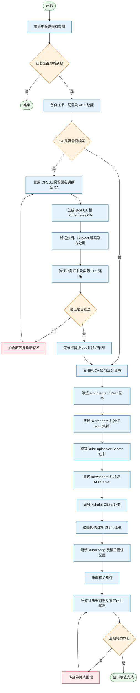

---
title: Kubernetes 查询证书有效期及续签证书（适用于二进制部署）
icon: circle-info
order: 1
category:
  - Linux
  - Docker
  - kubernetes
tag:
  - Linux
  - Docker
  - kubernetes
  - 运维
date: 2026-11-27
isOriginal: true
pageview: true
article: true
breadcrumb: false
comment: true
---


>👨‍🎓**博主简介**
>
>&emsp;&emsp;🏅[CSDN博客专家](https://blog.csdn.net/liu_chen_yang?type=blog)
>&emsp;&emsp;🏅[云计算领域优质创作者](https://blog.csdn.net/liu_chen_yang?type=blog)
>&emsp;&emsp;🏅[华为云开发者社区专家博主](https://bbs.huaweicloud.com/community/usersnew/id_1661843828089234)
>&emsp;&emsp;🏅[阿里云开发者社区专家博主](https://developer.aliyun.com/profile/7yu26jk3lfqxg)
>💊**交流社区：**[运维交流社区](https://bbs.csdn.net/forums/lcy) 欢迎大家的加入！
>🐋 希望大家多多支持，我们一起进步！😄
>🎉如果文章对你有帮助的话，欢迎 点赞 👍🏻 评论 💬 收藏 ⭐️ 加关注+💗

---


## 前言

适用于二进制部署，如果是按照我的这两篇文章部署的，可以直接使用，如果不是，需要注意二进制配置、证书的位置；

我的部署文档：

|文章名称|文章链接  |
|--|--|
|K8S 二进制集群搭建（一主两从）1.20.10 版本  |[https://liucy.blog.csdn.net/article/details/151709127](https://liucy.blog.csdn.net/article/details/151709127)  |
| K8S 二进制集群搭建（一主两从）v1.37.2 版本| [https://liucy.blog.csdn.net/article/details/164026745](https://liucy.blog.csdn.net/article/details/164026745) |


名词解析
* `SAN`：（Subject Alternative Name，主题备用名称） 是 SSL/TLS 证书中的一个扩展字段，用来指定这张证书允许用于哪些 IP 地址或域名。


## 证书更新流程图


## 一、查看 Kubernetes 证书什么时候到期
> 由于使用的是 `cfssl` 二进制部署，不是 `kubeadm`，所以不适合直接使用 `kubeadm certs check-expiration` 管理这套集群证书，那么下面就是教大家如何查看`cfssl`二进制部署的证书有效期。

### 1.1 查看主要证书有效期

在 Master 节点执行：

```bash
# Kubernetes CA
openssl x509 -in /opt/kubernetes/ssl/ca.pem -noout -subject -issuer -dates

# API Server
openssl x509 -in /opt/kubernetes/ssl/server.pem -noout -subject -issuer -dates

# etcd CA
openssl x509 -in /opt/etcd/ssl/ca.pem -noout -subject -issuer -dates

# etcd 服务端证书
openssl x509 -in /opt/etcd/ssl/server.pem -noout -subject -issuer -dates

# kubelet 当前客户端证书
openssl x509 -in /opt/kubernetes/ssl/kubelet-client-current.pem -noout -subject -issuer -dates
```


其中：

- `notBefore`：证书生效时间。
- `notAfter`：证书到期时间。
- `GMT`：UTC 时间，比北京时间晚 8 小时。

### 1.2 批量检查所有主要证书

这条命令会扫描 Kubernetes 和 etcd 证书目录并把证书有效期展示出来：

```bash
find /opt/kubernetes/ssl /opt/etcd/ssl \
  -type f \( -name "*.pem" -o -name "*.crt" \) \
  ! -name "*-key.pem" \
  -print | sort | while read -r file
do
  if openssl x509 -in "$file" -noout >/dev/null 2>&1; then

    case "$file" in
      /opt/kubernetes/ssl/ca.pem)
        name="Kubernetes CA"
        ;;
      /opt/kubernetes/ssl/server.pem)
        name="kube-apiserver server"
        ;;
      /opt/kubernetes/ssl/kubelet-client*)
        name="kubelet client"
        ;;
      /opt/kubernetes/ssl/kubelet.crt)
        name="kubelet server"
        ;;
      /opt/etcd/ssl/ca.pem)
        name="etcd CA"
        ;;
      /opt/etcd/ssl/server.pem)
        name="etcd server"
        ;;
      *)
        name="$(basename "$file" | sed -E 's/\.(pem|crt)$//')"
        ;;
    esac

    echo "========================================"
    echo "${name}证书："
    echo "证书文件：$file"
    echo "证书名称：$(openssl x509 -in "$file" -noout -subject -nameopt RFC2253 | sed 's/^subject=//')"
    echo "颁发机构：$(openssl x509 -in "$file" -noout -issuer -nameopt RFC2253 | sed 's/^issuer=//')"
    echo "生效时间：$(openssl x509 -in "$file" -noout -startdate | cut -d= -f2-)"
    echo "到期时间：$(openssl x509 -in "$file" -noout -enddate | cut -d= -f2-)"
    echo
  fi
done
```


### 1.3 检查未来 30 天内是否到期

* 检查单个证书30天内是否到期

```bash
openssl x509 -in /opt/kubernetes/ssl/server.pem \
  -checkend 2592000 -noout
```

> 返回 `Certificate will expire` 表示未来 30 天内会到期，退出码为非零。
> 返回 `Certificate will not expire` 表示未来 30 天内不会到期，退出码为零。


* 批量检查证书30天内是否到期

```bash
find /opt/kubernetes/ssl /opt/etcd/ssl \
  -type f \( -name "*.pem" -o -name "*.crt" \) \
  ! -name "*-key.pem" \
  -print | sort | while read -r file
do
  if openssl x509 -in "$file" -noout >/dev/null 2>&1; then

    case "$file" in
      /opt/kubernetes/ssl/ca.pem)
        name="Kubernetes CA"
        ;;
      /opt/kubernetes/ssl/server.pem)
        name="kube-apiserver server"
        ;;
      /opt/kubernetes/ssl/kubelet-client*)
        name="kubelet client"
        ;;
      /opt/kubernetes/ssl/kubelet.crt)
        name="kubelet server"
        ;;
      /opt/etcd/ssl/ca.pem)
        name="etcd CA"
        ;;
      /opt/etcd/ssl/server.pem)
        name="etcd server"
        ;;
      *)
        name="$(basename "$file" | sed -E 's/\.(pem|crt)$//')"
        ;;
    esac

    echo "========================================"
    echo "${name}证书："
    echo "证书文件：$file"
    echo "到期时间：$(openssl x509 -in "$file" -noout -enddate | cut -d= -f2-)"

    if openssl x509 -in "$file" -checkend 0 -noout >/dev/null 2>&1; then
      if openssl x509 -in "$file" -checkend 2592000 -noout >/dev/null 2>&1; then
        echo "检查结果：正常（未来30天内不会到期）"
      else
        echo "检查结果：警告（未来30天内即将到期）"
      fi
    else
      echo "检查结果：严重（证书已过期）"
    fi

    echo
  fi
done
```


### 1.4 查看 kubeconfig 中的客户端证书有效期

有些证书并不是单独存储为 `.pem` 文件，而是以 Base64 格式嵌入 kubeconfig。

1. 需要检查哪些 kubeconfig？

| 组件                      | kubeconfig 路径                                            | 主要用途              | 检查建议                          |
| ----------------------- | -------------------------------------------------------- | ----------------- | ----------------------------- |
| kubectl Admin           | `/root/.kube/config`                                     | 管理员访问 API Server  | 必查                            |
| kube-controller-manager | `/opt/kubernetes/cfg/kube-controller-manager.kubeconfig` | 控制器访问 API Server  | 必查                            |
| kube-scheduler          | `/opt/kubernetes/cfg/kube-scheduler.kubeconfig`          | 调度器访问 API Server  | 必查                            |
| kube-proxy              | `/opt/kubernetes/cfg/kube-proxy.kubeconfig`              | 网络代理访问 API Server | 必查                            |
| kubelet                 | `/opt/kubernetes/cfg/kubelet.kubeconfig`                 | 节点访问 API Server   | 必查                            |
| kubelet Bootstrap       | `/opt/kubernetes/cfg/bootstrap.kubeconfig`               | kubelet 首次申请证书    | 检查配置及 Token，不属于 X.509 客户端证书检查 |

其中：

- Master 节点：检查 Admin、controller-manager、scheduler、kube-proxy、kubelet。
- Node1、Node2 节点：检查 kube-proxy、kubelet。
- Bootstrap 配置：通常使用 Token 认证，没有客户端证书的有效期可供检查。

上面列的是本文部署的证书路径，实际应以你的证书路径、组件启动参数和配置文件为准。

2. 查看单个 kubeconfig 客户端证书有效期

```bash
kubectl config view \
  --kubeconfig=/opt/kubernetes/cfg/kube-proxy.kubeconfig \
  --raw \
  -o jsonpath='{.users[0].user.client-certificate-data}' \
  | base64 -d \
  | openssl x509 -noout -subject -issuer -dates
```


3. 批量检查所有 kubeconfig 客户端证书

不需要逐个执行 `kubectl config view`，可以使用下面这条命令，自动检查五种 kubeconfig，并兼容两种情况：

- 证书以 Base64 格式嵌入 kubeconfig。
- kubeconfig 引用外部证书文件，例如 `kubelet-client-current.pem`。

```bash
for item in \
  "kubectl Admin|/root/.kube/config" \
  "kube-controller-manager|/opt/kubernetes/cfg/kube-controller-manager.kubeconfig" \
  "kube-scheduler|/opt/kubernetes/cfg/kube-scheduler.kubeconfig" \
  "kube-proxy|/opt/kubernetes/cfg/kube-proxy.kubeconfig" \
  "kubelet client|/opt/kubernetes/cfg/kubelet.kubeconfig"
do
  name="${item%%|*}"
  file="${item#*|}"

  echo "========================================"
  echo "${name}证书："
  echo "配置文件：$file"

  if [ ! -f "$file" ]; then
    echo "检查结果：配置文件不存在"
    echo
    continue
  fi

  cert_data=$(kubectl config view \
    --kubeconfig="$file" \
    --raw \
    -o jsonpath='{.users[0].user.client-certificate-data}')

  cert_file=$(kubectl config view \
    --kubeconfig="$file" \
    --raw \
    -o jsonpath='{.users[0].user.client-certificate}')

  if [ -n "$cert_data" ]; then
    cert=$(mktemp)
    if ! printf '%s' "$cert_data" | base64 -d > "$cert"; then
      echo "检查结果：证书解码失败"
      rm -f "$cert"
      echo
      continue
    fi
    echo "证书来源：kubeconfig 内嵌证书"
  elif [ -n "$cert_file" ]; then
    case "$cert_file" in
      /*) cert="$cert_file" ;;
      *) cert="$(dirname "$file")/$cert_file" ;;
    esac
    echo "证书来源：$cert"
  else
    echo "检查结果：未配置 X.509 客户端证书（可能使用 Token）"
    echo
    continue
  fi

  if [ ! -f "$cert" ] || ! openssl x509 -in "$cert" -noout >/dev/null 2>&1; then
    echo "检查结果：证书文件不存在或格式无效"
  else
    echo "证书名称：$(openssl x509 -in "$cert" -noout -subject -nameopt RFC2253 | sed 's/^subject=//')"
    echo "颁发机构：$(openssl x509 -in "$cert" -noout -issuer -nameopt RFC2253 | sed 's/^issuer=//')"
    echo "生效时间：$(openssl x509 -in "$cert" -noout -startdate | cut -d= -f2-)"
    echo "到期时间：$(openssl x509 -in "$cert" -noout -enddate | cut -d= -f2-)"

    if ! openssl x509 -in "$cert" -checkend 0 -noout >/dev/null 2>&1; then
      echo "检查结果：严重（证书已过期）"
    elif ! openssl x509 -in "$cert" -checkend 2592000 -noout >/dev/null 2>&1; then
      echo "检查结果：警告（未来30天内即将到期）"
    else
      echo "检查结果：正常（未来30天内不会到期）"
    fi
  fi

  if [ -n "$cert_data" ]; then
    rm -f "$cert"
  fi

  echo
done
```


<div id=1.5> </div>


### 1.5 证书有效期检查总结：Kubernetes 集群证书统一检查（包含有效期预警）

1. 检查范围

| 组件                      | 证书类型          | 检查位置                                                     |
| ----------------------- | ------------- | -------------------------------------------------------- |
| Kubernetes CA           | CA            | `/opt/kubernetes/ssl/ca.pem`                             |
| kube-apiserver          | Server        | `/opt/kubernetes/ssl/server.pem`                         |
| kubelet                 | Client        | `/opt/kubernetes/ssl/kubelet-client-*.pem`               |
| kubelet                 | Server        | `/opt/kubernetes/ssl/kubelet.crt`                        |
| etcd CA                 | CA            | `/opt/etcd/ssl/ca.pem`                                   |
| etcd                    | Server / Peer | `/opt/etcd/ssl/server.pem`                               |
| kubectl Admin           | Client        | `/root/.kube/config`                                     |
| kube-controller-manager | Client        | `/opt/kubernetes/cfg/kube-controller-manager.kubeconfig` |
| kube-scheduler          | Client        | `/opt/kubernetes/cfg/kube-scheduler.kubeconfig`          |
| kube-proxy              | Client        | `/opt/kubernetes/cfg/kube-proxy.kubeconfig`              |
| kubelet                 | Client        | `/opt/kubernetes/cfg/kubelet.kubeconfig`                 |

对于 kubeconfig，脚本同时检查其中的 客户端证书和 CA 证书。如果证书是 Base64 内嵌格式，会自动解码；如果是外部文件路径，则读取对应文件。

`bootstrap.kubeconfig` 通常使用 Bootstrap Token，不属于 X.509 客户端证书，因此不会按客户端证书有效期进行判断。

2. 创建统一检查脚本


> 此脚本放到服务端、客户端都通用。


在服务器上创建一件检查脚本：

```bash
cat > /usr/local/bin/check-k8s-certs.sh <<'EOF'
#!/bin/bash

WARNING_DAYS=30
WARNING_SECONDS=$((WARNING_DAYS * 86400))
K8S_CA=/opt/kubernetes/ssl/ca.pem
TOTAL=0 NORMAL=0 WARNING=0 EXPIRED=0 ERROR=0 SKIPPED=0 CA_MISMATCH=0
set -o pipefail
for cmd in openssl base64 awk sed grep find sort date mktemp cut dirname basename rm hostname; do
    command -v "$cmd" >/dev/null 2>&1 || { echo "检查失败：缺少命令 $cmd"; exit 2; }
done
fingerprint() { openssl x509 -in "$1" -noout -fingerprint -sha256 | cut -d= -f2-; }
K8S_CA_FP=$(fingerprint "$K8S_CA" 2>/dev/null) || K8S_CA_FP=""
report_error() {
    TOTAL=$((TOTAL+1)); ERROR=$((ERROR+1))
    printf '========================================\n%s证书：\n证书来源：%s\n检查结果：异常（%s）\n\n' "$1" "$2" "$3"
}
check_cert() {
    local name="$1" cert="$2" source="$3" compare="${4:-false}"
    local fp start end timestamp mismatch=0
    if [ ! -f "$cert" ]; then report_error "$name" "$source" '证书文件不存在'; return; fi
    if ! openssl x509 -in "$cert" -noout >/dev/null 2>&1; then report_error "$name" "$source" '证书格式无效'; return; fi
    TOTAL=$((TOTAL+1))
    echo '========================================'
    echo "${name}证书："
    echo "证书来源：$source"
    echo "证书名称：$(openssl x509 -in "$cert" -noout -subject -nameopt RFC2253 | sed 's/^subject=//')"
    echo "颁发机构：$(openssl x509 -in "$cert" -noout -issuer -nameopt RFC2253 | sed 's/^issuer=//')"
    start=$(openssl x509 -in "$cert" -noout -startdate | cut -d= -f2-)
    end=$(openssl x509 -in "$cert" -noout -enddate | cut -d= -f2-)
    fp=$(fingerprint "$cert")
    echo "生效时间：$start"
    echo "到期时间：$end"
    echo "SHA256指纹：$fp"
    if [ "$compare" = true ]; then
        if [ -z "$K8S_CA_FP" ]; then
            echo '检查结果：异常（无法读取本地 Kubernetes CA）'; ERROR=$((ERROR+1)); echo; return
        elif [ "$fp" = "$K8S_CA_FP" ]; then
            echo 'CA一致性检查：正常（与本地 Kubernetes CA 一致）'
        else
            echo 'CA一致性检查：异常（与本地 Kubernetes CA 不一致）'
            CA_MISMATCH=$((CA_MISMATCH+1)); mismatch=1
        fi
    fi
    if ! timestamp=$(LC_ALL=C date -d "$start" +%s 2>/dev/null); then
        echo '检查结果：异常（无法解析生效时间）'; ERROR=$((ERROR+1))
    elif [ "$timestamp" -gt "$(date +%s)" ]; then
        echo '检查结果：异常（证书尚未生效）'; ERROR=$((ERROR+1))
    elif ! openssl x509 -in "$cert" -checkend 0 -noout >/dev/null 2>&1; then
        echo '检查结果：严重（证书已过期）'; EXPIRED=$((EXPIRED+1))
    elif ! openssl x509 -in "$cert" -checkend "$WARNING_SECONDS" -noout >/dev/null 2>&1; then
        echo "检查结果：警告（未来${WARNING_DAYS}天内即将到期）"; WARNING=$((WARNING+1))
    elif [ "$mismatch" -eq 1 ]; then
        echo '检查结果：警告（CA 证书不一致）'; WARNING=$((WARNING+1))
    else
        echo "检查结果：正常（未来${WARNING_DAYS}天内不会到期）"; NORMAL=$((NORMAL+1))
    fi
    echo
}
echo; echo '========== 一、Kubernetes / etcd 证书文件 =========='; echo
[ -f "$K8S_CA" ] || report_error 'Kubernetes CA' "$K8S_CA" '证书文件不存在'
while IFS= read -r -d '' file; do
    case "$file" in
        /opt/kubernetes/ssl/ca.pem) name='Kubernetes CA';;
        /opt/kubernetes/ssl/server.pem) name='kube-apiserver server';;
        /opt/kubernetes/ssl/kubelet-client*) name='kubelet client';;
        /opt/kubernetes/ssl/kubelet.crt) name='kubelet server';;
        /opt/etcd/ssl/ca.pem) name='etcd CA';;
        /opt/etcd/ssl/server.pem) name='etcd server / peer';;
        *) name=$(basename "$file" | sed -E 's/\.(pem|crt)$//');;
    esac
    check_cert "$name" "$file" "$file"
done < <(for dir in /opt/kubernetes/ssl /opt/etcd/ssl; do
    if [ -d "$dir" ]; then
        find "$dir" -maxdepth 1 \( -type f -o -type l \) \( -name '*.pem' -o -name '*.crt' \) ! -name '*-key.pem' ! -name 'kubelet-client-current.pem' ! -name 'ca-renew.pem' -print0
    fi
done | sort -z)
# 标准 kubectl 生成的单集群、单用户 YAML；不统计 context 中的 user 引用。
get_config_value() {
    awk -v key="$2" '$1 == key ":" {sub(/^[[:space:]]*[^:]+:[[:space:]]*/, ""); sub(/[[:space:]]+$/, ""); print; exit}' "$1" | sed -e 's/^"//' -e 's/"$//' -e "s/^'//" -e "s/'$//"
}
check_kubeconfig() {
    local name="$1" file="$2" type="$3" required="${4:-false}"
    local data path temp compare=false data_key path_key
    if [ ! -f "$file" ]; then
        if [ "$required" = true ]; then report_error "$name $type" "$file" '配置文件不存在'; else
            printf '========================================\n%s %s证书：\n配置文件：%s\n检查结果：配置文件不存在（跳过）\n\n' "$name" "$type" "$file"; SKIPPED=$((SKIPPED+1)); fi
        return
    fi
    if [ ! -r "$file" ]; then report_error "$name $type" "$file" '配置文件无法读取'; return; fi
    if [ "$(grep -cE '^[[:space:]]*server:' "$file")" -gt 1 ] || [ "$(grep -cE '^[[:space:]]*(-[[:space:]]*)?user:[[:space:]]*$' "$file")" -gt 1 ]; then
        report_error "$name $type" "$file" '存在多个集群或用户，需使用 YAML 解析工具检查'; return
    fi
    if [ "$type" = Client ]; then data_key=client-certificate-data; path_key=client-certificate; else data_key=certificate-authority-data; path_key=certificate-authority; compare=true; fi
    if ! data=$(get_config_value "$file" "$data_key") || ! path=$(get_config_value "$file" "$path_key"); then report_error "$name $type" "$file" '配置解析失败'; return; fi
    if [ -n "$data" ]; then
        if ! temp=$(mktemp); then report_error "$name $type" "$file" '无法创建临时文件'; return; fi
        if printf '%s' "$data" | base64 -d > "$temp" 2>/dev/null; then
            check_cert "$name $type" "$temp" "$file（内嵌证书）" "$compare"
        else report_error "$name $type" "$file" '内嵌证书解码失败'; fi
        rm -f "$temp"
    elif [ -n "$path" ]; then
        case "$path" in /*) ;; *) path="$(dirname "$file")/$path";; esac
        check_cert "$name $type" "$path" "$file -> $path" "$compare"
    elif [ "$type" = Client ] && grep -qE '^[[:space:]]*(token|tokenFile):[[:space:]]*[^[:space:]]' "$file"; then
        printf '========================================\n%s %s证书：\n配置文件：%s\n检查结果：使用 Token 认证（跳过 X.509 检查）\n\n' "$name" "$type" "$file"; SKIPPED=$((SKIPPED+1))
    else report_error "$name $type" "$file" '未读取到对应的 X.509 证书配置'; fi
}
echo; echo '========== 二、kubeconfig 客户端及 CA 证书 =========='; echo
for item in 'kubectl Admin|/root/.kube/config' 'kube-controller-manager|/opt/kubernetes/cfg/kube-controller-manager.kubeconfig' 'kube-scheduler|/opt/kubernetes/cfg/kube-scheduler.kubeconfig' 'kube-proxy|/opt/kubernetes/cfg/kube-proxy.kubeconfig' 'kubelet|/opt/kubernetes/cfg/kubelet.kubeconfig'; do
    name=${item%%|*}; file=${item#*|}; required=false
    case "$name" in kube-proxy|kubelet) required=true;; esac
    check_kubeconfig "$name" "$file" Client "$required"
    check_kubeconfig "$name" "$file" CA "$required"
done
check_kubeconfig bootstrap /opt/kubernetes/cfg/bootstrap.kubeconfig CA true
echo '========================================'
echo '             证书检查汇总'
echo '========================================'
printf '检查节点：%s\n检查时间：%s\n预警阈值：%s天\n检查总数：%s\n正常数量：%s\n警告数量：%s\n已经过期：%s\n异常数量：%s\n跳过数量：%s\nCA不一致：%s\n' "$(hostname)" "$(date '+%F %T %Z')" "$WARNING_DAYS" "$TOTAL" "$NORMAL" "$WARNING" "$EXPIRED" "$ERROR" "$SKIPPED" "$CA_MISMATCH"
echo '========================================'
if [ "$EXPIRED" -gt 0 ] || [ "$ERROR" -gt 0 ]; then exit 2; elif [ "$WARNING" -gt 0 ]; then exit 1; else exit 0; fi
EOF
```
3. 给脚本执行权限

```bash
chmod +x /usr/local/bin/check-k8s-certs.sh
```

4. 执行证书检查

```bash
/usr/local/bin/check-k8s-certs.sh
```

如需保存检查结果（保存路径可以自定义，默认为/root/）：

```bash
/usr/local/bin/check-k8s-certs.sh > /root/k8s-cert-check.log 2>&1
```

5. 查看结果（或者下载下来查看）：

```bash
cat /root/k8s-cert-check.log
```


## 二、证书有效期与续签方式


| 证书类型                           | 位置或来源                                                    | 续签方式                                                    |
| ------------------------------ | -------------------------------------------------------- | ------------------------------------------------------- |
| Kubernetes CA                  | `/opt/kubernetes/ssl/ca.pem`                             | CA 轮换，需要更新相关组件的信任配置                                     |
| kube-apiserver Server          | `/opt/kubernetes/ssl/server.pem`                         | 使用原 Kubernetes CA 重新签发                                  |
| etcd CA                        | `/opt/etcd/ssl/ca.pem`                                   | CA 轮换，需要更新 etcd 集群及 API Server 的信任配置                    |
| etcd Server / Peer             | `/opt/etcd/ssl/server.pem`                               | 使用原 etcd CA 重新签发，逐节点更新                                  |
| kubelet Client                 | `/opt/kubernetes/ssl/kubelet-client-current.pem`         | 开启 `rotateCertificates: true` 后支持自动轮换，需确保 CSR 审批和签发机制正常 |
| kubelet Server                 | `/opt/kubernetes/ssl/kubelet.crt`                        | 当前自签名证书通常由 kubelet 自行管理；如改用 CA 签发，需配置服务端证书轮换及 CSR 审批    |
| kube-proxy Client              | `/opt/kubernetes/cfg/kube-proxy.kubeconfig`              | 使用原 Kubernetes CA 重新签发，更新 kubeconfig                    |
| kube-controller-manager Client | `/opt/kubernetes/cfg/kube-controller-manager.kubeconfig` | 使用原 Kubernetes CA 重新签发，更新 kubeconfig                    |
| kube-scheduler Client          | `/opt/kubernetes/cfg/kube-scheduler.kubeconfig`          | 使用原 Kubernetes CA 重新签发，更新 kubeconfig                    |
| kubectl Admin Client           | `/root/.kube/config`                                     | 使用原 Kubernetes CA 重新签发管理员证书，更新 kubeconfig               |
| ServiceAccount Token           | API Server 签名密钥                                          | 不属于 X.509 证书，需按 Token 和签名密钥轮换机制管理                       |
| Bootstrap Token                | `/opt/kubernetes/cfg/bootstrap.kubeconfig`、`token.csv`   | 不属于 X.509 证书，按 Token 认证配置管理                             |

**续签说明**

1\. CA 证书：Kubernetes CA 和 etcd CA 是两套独立的证书体系。CA 过期后不能仅通过重新签发 Server 证书解决，需要规划 CA 轮换、信任链更新及组件重启。

2\. Server 证书：API Server、etcd Server / Peer 证书可以使用原 CA 重新签发。签发时必须保留正确的 SAN、证书用途及对应的密钥配置。

3\. Client 证书：Admin、kube-proxy、kube-controller-manager、kube-scheduler 等证书通过 cfssl 手动签发，续签后需要更新对应 kubeconfig 中的证书内容。如果使用 `--embed-certs=true`，仅替换原始 `.pem` 文件不会自动更新已经生成的 kubeconfig。

4\. kubelet 证书：kubelet Client 支持自动轮换；你当前的 `kubelet.crt` 是 kubelet Server 自签名证书，与 Client 证书不是同一套续签机制。

5\. 证书有效期：你当前 Kubernetes CA 和 etcd CA 均在 2031 年到期，而部分 Server 证书在 2036 年到期。实际验证时需要同时考虑 CA 和业务证书的有效期，建议提前规划 CA 轮换。

6\. ServiceAccount 签名密钥：你当前复用了 API Server 的 `server-key.pem` 进行 Token 签名。续签 API Server 证书时，如果更换该私钥，可能影响已有 ServiceAccount Token 的验证，因此需要单独规划密钥轮换。

## 三、如何续签 Kubernetes 证书？
本节适用于 Kubernetes 二进制部署环境。证书由 cfssl 签发，Kubernetes 和 etcd 使用独立的 CA。
### 3.1 续签前检查与备份

先检查 Kubernetes CA、etcd CA 和业务证书的有效期：

可以使用上面 【[1.5 证书有效期检查总结：Kubernetes 集群证书统一检查（包含有效期预警）](#1.5)】检查证书有效期。

确认签发配置、路径是否正确：

```bash
# 先确认文件是否存在
ll /opt/TLS/kubernetes/ | grep -E "ca-config.json|server-csr.json"
ll /opt/TLS/etcd/ | grep -E "ca-config.json|server-csr.json"

# 再确认文件内容是否正确
cat /opt/TLS/kubernetes/ca-config.json
cat /opt/TLS/kubernetes/server-csr.json

cat /opt/TLS/etcd/ca-config.json
cat /opt/TLS/etcd/server-csr.json
```

备份etcd证书、kubernetes证书、原始签发文件和 kubeconfig配置：

```bash
# 创建备份目录
mkdir -p /root/k8s-cert-backup-20261117

# 备份 k8s 正在使用的证书
cp -ar /opt/kubernetes/ssl \
  /root/k8s-cert-backup-20261117/kubernetes-ssl

# 备份 etcd 正在使用的证书
cp -ar /opt/etcd/ssl \
  /root/k8s-cert-backup-20261117/etcd-ssl

# 备份k8s的配置及kubeconfig
cp -ar /opt/kubernetes/cfg \
  /root/k8s-cert-backup-20261117/kubernetes-cfg

# 备份所有证书的原始签发文件
cp -ar /opt/TLS \
  /root/k8s-cert-backup-20261117/TLS
```

备份目录包含 CA 私钥、组件私钥及认证凭据，必须限制访问权限：

```bash
chmod 700 /root/k8s-cert-backup-20261117
```


### 3.2 CA 证书续签与轮换（先处理 CA，再处理 Server / Client）

> **重要说明：本节适用于前言所述的 cfssl 二进制部署。CA 更新是高风险维护操作，必须在维护窗口完成，先备份并验证，再逐节点切换。**
>
> 本文的 Kubernetes CA 与 etcd CA 相互独立。它们的私钥、证书和信任关系不能混用。
>
> **先准备 CA，不等于先覆盖正在运行的 CA。** 需要先确定是“保留 CA 私钥重新签发”还是“更换 CA 私钥进行轮换”，然后按相应流程操作。

#### 3.2.1 先检查 CA 及相关证书

在 Master 节点执行：

```bash
# Kubernetes CA
## 检查CA 的基本信息、有效期和指纹
openssl x509 -in /opt/kubernetes/ssl/ca.pem -noout -subject -issuer -dates -fingerprint -sha256
## 检查 CA 是否具有签发证书的权限,CA:TRUE 则是有权限
openssl x509 -in /opt/kubernetes/ssl/ca.pem -noout -text | grep -A 5 'Basic Constraints'

# etcd CA
## 检查CA 的基本信息、有效期和指纹
openssl x509 -in /opt/etcd/ssl/ca.pem -noout -subject -issuer -dates -fingerprint -sha256
## 检查 CA 是否具有签发证书的权限,CA:TRUE 则是有权限
openssl x509 -in /opt/etcd/ssl/ca.pem -noout -text | grep -A 5 'Basic Constraints'

# 查看原始 CA 签发文件，主要检查信息是否正确
cat /opt/TLS/kubernetes/ca-csr.json
cat /opt/TLS/etcd/ca-csr.json

# 确认原始签发目录中的 CA 与实际使用的 CA 是否一致
sha256sum /opt/TLS/kubernetes/ca.pem /opt/kubernetes/ssl/ca.pem
sha256sum /opt/TLS/etcd/ca.pem /opt/etcd/ssl/ca.pem
```

**注意：** 如果只是 `server.pem` 等业务证书到期，而 CA 仍然有效，通常不必更新 CA，直接按照后续章节使用原 CA 重新签发即可。若 CA 即将到期，应先规划 CA 更新，否则新签发的业务证书也可能受到旧 CA 到期时间的限制。

在执行 3.1 的备份后，建议额外备份 etcd 数据快照，并将备份复制到安全的异机位置。检查三台节点及各组件实际使用的证书参数：

```bash
# 查看 systemd 中实际生效的服务参数
systemctl cat etcd kube-apiserver kube-controller-manager kubelet --no-pager

# 查看 kubeconfig 是否内嵌旧 CA
kubectl config view --kubeconfig=/root/.kube/config --raw -o jsonpath='{.clusters[0].cluster.certificate-authority-data}' | base64 -d | openssl x509 -noout -fingerprint -sha256

# etcd 数据快照（需要 etcdctl 能正常连接集群）会备份整个集群的信息
ETCDCTL_API=3 /opt/etcd/bin/etcdctl \
  --endpoints=https://172.16.11.233:2379 \
  --cacert=/opt/etcd/ssl/ca.pem \
  --cert=/opt/etcd/ssl/server.pem \
  --key=/opt/etcd/ssl/server-key.pem \
  snapshot save /root/k8s-cert-backup-20261117/etcd-before-ca.db
```

上述 `172.16.11.233` 是本文示例地址，实际环境应按 etcd 客户端访问地址调整。快照只需从健康的 etcd 集群获取，不应在未验证健康状态时盲目恢复。

#### 3.2.2 保留原 CA 私钥，重新签发 CA 证书（适用于原私钥可信的情况）

这种方式使用 CFSSL 沿用原 CA 私钥，重新签发有效期更长的 CA 证书，属于 CA 证书续签，而不是完整的 CA 密钥轮换。
由于本文原始 CA 证书通过 CFSSL 生成，因此续签时也使用 CFSSL，尽可能保持新旧 CA 证书的主体信息及编码方式一致。

> **注意：** 使用 OpenSSL 手动指定 `-subj` 重新签发 CA 时，即使新旧 CA 的 Subject 内容、公钥完全一致，也可能因为 ASN.1 字符串编码不同，导致 etcd、Kubernetes 等使用 Go 语言开发的组件无法正确验证证书。
>
> 本文曾出现 OpenSSL 验证返回 `OK`，但 etcd 实际通信报错 `x509: certificate signed by unknown authority` 的情况。
>
> 因此，本节统一使用 CFSSL 重新签发 CA，并在正式替换之前进行实际 TLS 连接验证。

以下命令仅生成待验证的候选 CA 文件，不会覆盖正在使用的 CA 证书及私钥。

##### 3.2.2.1 续签 etcd CA

```bash
# 进入需要签发ca的路径
cd /opt/TLS/etcd/

# 复制一份 CA 签发配置，用于本次续签
cp -ar /opt/TLS/etcd/ca-csr.json /opt/TLS/etcd/ca-renew-csr.json

# 使用原 CA 私钥重新签发 CA 证书
cfssl gencert -initca -ca-key=/opt/TLS/etcd/ca-key.pem /opt/TLS/etcd/ca-renew-csr.json | cfssljson -bare /opt/TLS/etcd/ca-renew

# 查看生成的文件
ls -lh /opt/TLS/etcd/ca-renew*
```
一共会生成有三个文件，复制了一个文件：`ca-renew-csr.json`，生成两个文件：`ca-renew.csr`和`ca-renew.pem`；


主要文件说明：

| 文件                  | 说明            |
| ------------------- | ------------- |
| `ca-renew-csr.json` | 本次续签使用的 CA 配置 |
| `ca-renew.csr`      | CA 证书签名请求     |
| `ca-renew.pem`      | 重新签发后的 CA 证书  |
| `ca-key.pem`        | 原始 CA 私钥，保持不变 |


检查新 CA 证书有效期：

```bash
openssl x509 -in /opt/TLS/etcd/ca-renew.pem -noout -subject -issuer -dates
```


可以看到日期已经是今天的了，那就没问题了。

> 注意：如果当前 CFSSL 版本不支持通过 `-initca -ca-key` 使用原私钥，应停止操作，不要为了生成成功而删除 `-ca-key` 参数，否则可能生成新的 CA 私钥。

##### 3.2.2.2 续签 Kubernetes CA

```bash
# 进入需要签发ca的路径
cd /opt/TLS/kubernetes/

# 复制一份 CA 签发配置，用于本次续签
cp -ar /opt/TLS/kubernetes/ca-csr.json /opt/TLS/kubernetes/ca-renew-csr.json

# 使用原 CA 私钥重新签发 CA 证书
cfssl gencert -initca -ca-key=/opt/TLS/kubernetes/ca-key.pem /opt/TLS/kubernetes/ca-renew-csr.json | cfssljson -bare /opt/TLS/kubernetes/ca-renew

# 查看生成的文件
ls -lh /opt/TLS/kubernetes/ca-renew*
```
一共会生成有三个文件，复制了一个文件：`ca-renew-csr.json`，生成两个文件：`ca-renew.csr`和`ca-renew.pem`；


主要文件说明：

| 文件                  | 说明            |
| ------------------- | ------------- |
| `ca-renew-csr.json` | 本次续签使用的 CA 配置 |
| `ca-renew.csr`      | CA 证书签名请求     |
| `ca-renew.pem`      | 重新签发后的 CA 证书  |
| `ca-key.pem`        | 原始 CA 私钥，保持不变 |


检查新 CA 证书有效期：

```bash
openssl x509 -in /opt/TLS/kubernetes/ca-renew.pem -noout -subject -issuer -dates
```


可以看到日期已经是今天的了，那就没问题了。

> 注意：如果当前 CFSSL 版本不支持通过 `-initca -ca-key` 使用原私钥，应停止操作，不要为了生成成功而删除 `-ca-key` 参数，否则可能生成新的 CA 私钥。


至此，etcd CA 与 Kubernetes CA 候选证书已生成，原 CA 私钥及线上使用的 CA 证书均未修改。


##### 3.2.2.3 验证候选 CA 证书

```bash
# 检查有效期、CA:TRUE 等扩展
openssl x509 -in /opt/TLS/etcd/ca-renew.pem -noout -subject -issuer -dates
openssl x509 -in /opt/TLS/etcd/ca-renew.pem -noout -text | grep -A 5 'Basic Constraints'
openssl x509 -in /opt/TLS/kubernetes/ca-renew.pem -noout -subject -issuer -dates
openssl x509 -in /opt/TLS/kubernetes/ca-renew.pem -noout -text | grep -A 5 'Basic Constraints'

# 候选 CA 自身是否可验证
openssl verify -CAfile /opt/TLS/etcd/ca-renew.pem /opt/TLS/etcd/ca-renew.pem
openssl verify -CAfile /opt/TLS/kubernetes/ca-renew.pem /opt/TLS/kubernetes/ca-renew.pem

# 使用候选 CA 验证当前业务证书（至少检查服务端及客户端用途）
openssl verify -CAfile /opt/TLS/etcd/ca-renew.pem -purpose sslserver /opt/etcd/ssl/server.pem
openssl verify -CAfile /opt/TLS/etcd/ca-renew.pem -purpose sslclient /opt/etcd/ssl/server.pem
openssl verify -CAfile /opt/TLS/kubernetes/ca-renew.pem -purpose sslserver /opt/kubernetes/ssl/server.pem

# 检查新旧 CA Subject 及编码类型
## etcd 原 CA
openssl x509 -in /opt/etcd/ssl/ca.pem -noout -subject -nameopt sep_multiline,show_type
## etcd 新 CA
openssl x509 -in /opt/TLS/etcd/ca-renew.pem -noout -subject -nameopt sep_multiline,show_type
## Kubernetes 原 CA
openssl x509 -in /opt/kubernetes/ssl/ca.pem -noout -subject -nameopt sep_multiline,show_type
## Kubernetes 新 CA
openssl x509 -in /opt/TLS/kubernetes/ca-renew.pem -noout -subject -nameopt sep_multiline,show_type

# 确认候选 CA 与原 CA 的公钥一致
openssl x509 -in /opt/etcd/ssl/ca.pem -pubkey -noout | openssl pkey -pubin -outform DER | sha256sum
openssl x509 -in /opt/TLS/etcd/ca-renew.pem -pubkey -noout | openssl pkey -pubin -outform DER | sha256sum
openssl x509 -in /opt/kubernetes/ssl/ca.pem -pubkey -noout | openssl pkey -pubin -outform DER | sha256sum
openssl x509 -in /opt/TLS/kubernetes/ca-renew.pem -pubkey -noout | openssl pkey -pubin -outform DER | sha256sum
```

**验证重点：** 
1、有效期为生成当日，少8小时，可以自己手动+8小时，看看和现在时间是否一致；
2、`CA:TRUE`，都应该`=true`；
3、上述 `openssl verify` 应返回 `OK`；
4、原 CA 和新 CA `Subject 及编码类型` 需一致；
5、原 CA 与新 CA 的公钥`SHA256`值一致；

以上只要任一项失败，就应停止直接替换方案，改为分阶段信任迁移或重新签发相关业务证书。


* 验证 kubernetes 集群证书

在正式替换 Kubernetes CA 证书之前，使用 `kubectl` 临时指定新生成的候选 CA 证书，验证其是否能够正常访问当前 Kubernetes 集群。

```bash
# 使用候选 CA 验证 Node 节点状态
kubectl --kubeconfig=/root/.kube/config \
  --certificate-authority=/opt/TLS/kubernetes/ca-renew.pem \
  --insecure-skip-tls-verify=false \
  get nodes -o wide

# 使用候选 CA 验证 Pod 运行状态
kubectl --kubeconfig=/root/.kube/config \
  --certificate-authority=/opt/TLS/kubernetes/ca-renew.pem \
  --insecure-skip-tls-verify=false \
  get pods -A
```


参数说明：

| 参数                                 | 说明                      |
| ---------------------------------- | ----------------------- |
| `--kubeconfig`                     | 指定当前正在使用的 kubeconfig 文件 |
| `--certificate-authority`          | 临时指定新生成的候选 CA 证书        |
| `--insecure-skip-tls-verify=false` | 确保开启 TLS 证书验证           |

如果能够正常获取 Node 节点及 Pod 信息，说明候选 CA 可以正常验证当前 API Server 的服务端证书。

> 注意：此步骤仅验证 kubectl 使用新 CA 验证现有 API Server 服务端证书的能力。正式替换后，还需要验证 API Server 对现有客户端证书的认证是否正常。


##### 3.2.2.4 验证通过后替换 etcd CA 证书
etcd 集群有三个节点：

| 节点     | IP            |
| ------ | ------------- |
| etcd-1 | 172.16.11.233 |
| etcd-2 | 172.16.11.234 |
| etcd-3 | 172.16.11.236 |

本次只替换 `ca.pem`，**不修改**`ca-key.pem`**、**`server.pem` **和**`server-key.pem`。

**第一步：在 Master 节点替换 etcd CA**

先确认原始签发目录中的 CA 私钥与候选 CA 匹配，并确保备份已完成。

```bash
# 备份正在使用的 etcd CA
cp -ar /opt/etcd/ssl/ca.pem /opt/etcd/ssl/ca.pem.bak-20261124

# 替换正在使用的 CA
cp -ar /opt/TLS/etcd/ca-renew.pem /opt/etcd/ssl/ca.pem

# 检查有效期
openssl x509 -in /opt/etcd/ssl/ca.pem -noout -subject -issuer -dates
```

确认新 CA 生效日期、到期日期正确后，重启本节点 etcd：

```bash
systemctl restart etcd

systemctl status etcd --no-pager

journalctl -u etcd -n 100 --no-pager
```

检查集群健康：

```bash
ETCDCTL_API=3 /opt/etcd/bin/etcdctl --cacert=/opt/etcd/ssl/ca.pem --cert=/opt/etcd/ssl/server.pem --key=/opt/etcd/ssl/server-key.pem --endpoints="https://172.16.11.233:2379,https://172.16.11.234:2379,https://172.16.11.236:2379" endpoint health --write-out=table

# 二选一都行

ETCDCTL_API=3 /opt/etcd/bin/etcdctl \
  --cacert=/opt/etcd/ssl/ca.pem \
  --cert=/opt/etcd/ssl/server.pem \
  --key=/opt/etcd/ssl/server-key.pem \
  --endpoints="https://172.16.11.233:2379,https://172.16.11.234:2379,https://172.16.11.236:2379" \
  endpoint health --write-out=table
```


三个 etcd 节点均为 `true`，说明 etcdctl 可以使用候选 CA 验证当前 etcd 服务端证书。

**第二步：在 Node 节点替换 etcd CA**

> 接下来，替换 etcd 2、3 的CA证书；
> 需确认证书地址是否一致，如果不一致复制到文本进行修改在粘贴服务器；

```bash
# 备份node节点的etcd CA证书（两节点可同时执行）
cp -ar /opt/etcd/ssl/ca.pem /opt/etcd/ssl/ca.pem.bak-20261124

# 从master节点复制到其他etcd集群节点（node）
for i in {4,6};do scp /opt/etcd/ssl/ca.pem root@172.16.11.23$i:/opt/etcd/ssl/; done

# 替换完成重启etcd服务
systemctl restart etcd

# 查看etcd服务状态（如果状态异常请检查）
systemctl status etcd --no-pager
```
检查集群健康：

```bash
ETCDCTL_API=3 /opt/etcd/bin/etcdctl --cacert=/opt/etcd/ssl/ca.pem --cert=/opt/etcd/ssl/server.pem --key=/opt/etcd/ssl/server-key.pem --endpoints="https://172.16.11.233:2379,https://172.16.11.234:2379,https://172.16.11.236:2379" endpoint health --write-out=table

# 二选一都行

ETCDCTL_API=3 /opt/etcd/bin/etcdctl \
  --cacert=/opt/etcd/ssl/ca.pem \
  --cert=/opt/etcd/ssl/server.pem \
  --key=/opt/etcd/ssl/server-key.pem \
  --endpoints="https://172.16.11.233:2379,https://172.16.11.234:2379,https://172.16.11.236:2379" \
  endpoint health --write-out=table
```


三个 etcd 节点均为 `true`，说明 CA 证书确认没问题。

##### 3.2.2.5 验证通过后替换 Kubernetes CA 证书

Kubernetes 集群有三个节点：

| 节点     | IP            |
| ------ | ------------- |
| k8s-master | 172.16.11.233 |
| k8s-node1 | 172.16.11.234 |
| k8s-node2| 172.16.11.236 |

本次只替换 `ca.pem`，**不修改**`ca-key.pem`**、**`server.pem` **和**`server-key.pem`。

**第一步：在 Master 节点替换 kubernetes CA**

**（1）先确认原始签发目录中的 CA 私钥与候选 CA 匹配，并确保备份已完成。**

```bash
# 备份正在使用的 kubernetes CA
cp -ar /opt/kubernetes/ssl/ca.pem /opt/kubernetes/ssl/ca.pem.bak-20261124

# 替换正在使用的 CA
cp -ar /opt/TLS/kubernetes/ca-renew.pem /opt/kubernetes/ssl/ca.pem

# 检查有效期
openssl x509 -in /opt/kubernetes/ssl/ca.pem -noout -subject -issuer -dates
```

确认新 CA 生效日期、到期日期正确后，更新 kubectl 使用的 kubeconfig 配置。

```bash
# 备份 kubectl 配置文件
cp -an /root/.kube/config /root/.kube/config.bak-20261124

# 查看 kubeconfig 中的集群名称
kubectl config get-clusters --kubeconfig=/root/.kube/config

# 更新 kubeconfig 中内嵌的 CA 证书
kubectl config set-cluster kubernetes \
  --certificate-authority=/opt/kubernetes/ssl/ca.pem \
  --embed-certs=true \
  --kubeconfig=/opt/kubernetes/cfg/kubelet.kubeconfig
```
> 本文 kubeconfig 中的集群名称为 `kubernetes`，如果实际环境中的名称不一致，需要根据查询结果进行修改。

检查 Master 节点其他组件使用的 kubeconfig 文件是否内嵌 CA 的kubeconfig：

```bash
ls -l /opt/kubernetes/cfg/*kubeconfig*
# 查询这些配置有没有内嵌
grep -H -oE 'certificate-authority-data:|certificate-authority:' /opt/kubernetes/cfg/*kubeconfig*
```

| 字段                           | 说明                  | 是否需要更新 kubeconfig |
| ---------------------------- | ------------------- | ----------------- |
| `certificate-authority-data` | 内嵌 Base64 编码的 CA 证书 | **需要**            |
| `certificate-authority`      | 引用外部 CA 证书文件        | 如果引用路径不变，则不需要     |


那么嵌入了哪些都需要更新（具体看输出的`kubeconfig`文件名）

| 配置文件                                 | 使用组件                    | 内嵌 CA 时是否需要更新 |
| ------------------------------------ | ----------------------- | ------------- |
| `bootstrap.kubeconfig`               | kubelet TLS Bootstrap   | 是             |
| `kube-controller-manager.kubeconfig` | kube-controller-manager | 是             |
| `kubelet.kubeconfig`                 | kubelet                 | 是             |
| `kube-proxy.kubeconfig`              | kube-proxy              | 是             |
| `kube-scheduler.kubeconfig`          | kube-scheduler          | 是             |
| `/root/.kube/config`                 | kubectl                 | 是             |

**（2）备份各组件 kubeconfig 配置文件**
```bash
# 备份 bootstrap 配置
cp -an /opt/kubernetes/cfg/bootstrap.kubeconfig /opt/kubernetes/cfg/bootstrap.kubeconfig.bak-20261124

# 备份 kube-controller-manager 配置
cp -an /opt/kubernetes/cfg/kube-controller-manager.kubeconfig /opt/kubernetes/cfg/kube-controller-manager.kubeconfig.bak-20261124

# 备份 kube-scheduler 配置
cp -an /opt/kubernetes/cfg/kube-scheduler.kubeconfig /opt/kubernetes/cfg/kube-scheduler.kubeconfig.bak-20261124

# 备份 kubelet 配置
cp -an /opt/kubernetes/cfg/kubelet.kubeconfig /opt/kubernetes/cfg/kubelet.kubeconfig.bak-20261124

# 备份 kube-proxy 配置
cp -an /opt/kubernetes/cfg/kube-proxy.kubeconfig /opt/kubernetes/cfg/kube-proxy.kubeconfig.bak-20261124
```

* 确认是否备份成功

```bash
ls -l /opt/kubernetes/cfg/*kubeconfig*-20261124
```


**（3）更新各组件 kubeconfig 内嵌 CA 证书**

* 先查询各 kubeconfig 当前使用的集群名称
```bash
for file in /root/.kube/config /opt/kubernetes/cfg/*.kubeconfig; do
    echo "========== $file =========="

    kubectl config view --kubeconfig="$file" \
      --minify \
      -o jsonpath='{.contexts[0].context.cluster}'

    echo
done
```


> 不同组件的 kubeconfig 集群名称可能不同。本文中手动生成的 kubeconfig 集群名称为 `kubernetes`，而 kubelet 通过 TLS Bootstrap 自动生成的 kubeconfig 集群名称为 `default-cluster`。因此，更新 CA 证书时必须使用各配置文件实际使用的集群名称，否则可能创建新的集群配置项，导致原有 CA 证书未被更新。

需要使用对应的集群名称
```bash
# 更新 bootstrap CA
kubectl config set-cluster kubernetes \
  --certificate-authority=/opt/kubernetes/ssl/ca.pem \
  --embed-certs=true \
  --kubeconfig=/opt/kubernetes/cfg/bootstrap.kubeconfig

# 更新 kube-controller-manager CA
kubectl config set-cluster kubernetes \
  --certificate-authority=/opt/kubernetes/ssl/ca.pem \
  --embed-certs=true \
  --kubeconfig=/opt/kubernetes/cfg/kube-controller-manager.kubeconfig

# 更新 kube-scheduler CA
kubectl config set-cluster kubernetes \
  --certificate-authority=/opt/kubernetes/ssl/ca.pem \
  --embed-certs=true \
  --kubeconfig=/opt/kubernetes/cfg/kube-scheduler.kubeconfig

# 更新 kubelet CA
kubectl config set-cluster default-cluster \
  --certificate-authority=/opt/kubernetes/ssl/ca.pem \
  --embed-certs=true \
  --kubeconfig=/opt/kubernetes/cfg/kubelet.kubeconfig

# 更新 kube-proxy CA
kubectl config set-cluster kubernetes \
  --certificate-authority=/opt/kubernetes/ssl/ca.pem \
  --embed-certs=true \
  --kubeconfig=/opt/kubernetes/cfg/kube-proxy.kubeconfig
```
> 本次操作仅更新 kubeconfig 中的 `certificate-authority-data`，不会重新签发 Client 证书，也不会修改原有客户端私钥及 Bootstrap Token。

**（4）检查各组件 kubeconfig 内嵌 CA 有效期**

```bash
for file in /opt/kubernetes/cfg/*.kubeconfig /root/.kube/config; do
    echo "========== $file =========="

    kubectl config view --kubeconfig="$file" \
      --raw --minify --flatten \
      -o jsonpath='{.clusters[0].cluster.certificate-authority-data}' \
      | base64 -d \
      | openssl x509 -noout -subject -issuer -dates -fingerprint -sha256

    echo
done
```


**（5） 检查各 kubeconfig 内嵌 CA 的有效期及 SHA256 指纹是否与新 CA 一致**

```bash
openssl x509 -in /opt/kubernetes/ssl/ca.pem -noout -subject -issuer -dates -fingerprint -sha256
```

**（6）重启 Master 节点 Kubernetes 组件**

首先重启 kube-apiserver：

```bash
systemctl restart kube-apiserver

systemctl status kube-apiserver --no-pager

# 检查 kube-apiserver 的就绪状态（Readiness），判断 API Server 是否已经完成初始化，并且能够正常对外提供服务
# 正常情况下所有检查项都应该为 ok，最后显示 readyz check passed。
kubectl get --raw='/readyz?verbose'
```


确认 API Server 正常后，再依次重启其他组件：

```bash
systemctl restart kube-controller-manager kube-scheduler kubelet kube-proxy
```

查看各组件服务状态：

```bash
systemctl status kube-apiserver kube-controller-manager kube-scheduler kubelet kube-proxy --no-pager
```

> `bootstrap.kubeconfig` 不是独立运行的服务，因此不需要单独重启 Bootstrap 服务。

**（7）检查 Kubernetes 集群状态**

```bash
# 查看 Node 节点状态
kubectl get nodes -o wide

# 查看所有命名空间下的 Pod 状态
kubectl get pods -A -o wide

# 查看 API Server 健康状态
kubectl get --raw='/readyz?verbose'

# 查看 CSR 证书签发状态
kubectl get csr

# 查看节点 Lease 是否正常更新
kubectl get lease -n kube-node-lease
```

如果 API Server 健康检查正常，各节点均为 `Ready`，节点 Lease 正常更新，Pod 运行状态正常，且各组件日志中没有出现 TLS 证书认证错误，则可以继续更新 Node 节点。


**第二步：在 Node 节点替换 Kubernetes CA**

> 接下来替换 k8s-node1、k8s-node2 节点的 CA 证书。
>
> 需确认各节点证书存放路径是否一致，如果不一致，请根据实际路径修改命令。建议逐节点替换、逐节点验证，避免同时重启所有节点的组件。

**（1）备份 Node 节点 CA 证书**

在两个 Node 节点分别执行：

```bash
cp -an /opt/kubernetes/ssl/ca.pem /opt/kubernetes/ssl/ca.pem.bak-20261124
```

**（2）分发新 CA 证书**

在 Master 节点执行：

```bash
for i in {4,6};do
    scp /opt/kubernetes/ssl/ca.pem \
      root@172.16.11.23$i:/opt/kubernetes/ssl/ca-renew.pem
done
```

**（3）替换 Node 节点 CA 证书**

先在 k8s-node1 节点执行，验证正常后，再到 k8s-node2 节点执行相同操作。

```bash
# 替换 Kubernetes CA
cp -a /opt/kubernetes/ssl/ca-renew.pem /opt/kubernetes/ssl/ca.pem

# 检查 CA 证书有效期（确认日期没问题）
openssl x509 -in /opt/kubernetes/ssl/ca.pem -noout -subject -issuer -dates
```

**（4）检查 Node 节点 kubeconfig 配置**

```bash
# 查看 kubeconfig 文件
ls -l /opt/kubernetes/cfg/*.kubeconfig

# 检查是否内嵌 CA
grep -H -oE 'certificate-authority-data:|certificate-authority:' /opt/kubernetes/cfg/*.kubeconfig
```


正常情况下，本文 Node 节点需要检查以下三个 kubeconfig 文件：

```bash
/opt/kubernetes/cfg/bootstrap.kubeconfig
/opt/kubernetes/cfg/kubelet.kubeconfig
/opt/kubernetes/cfg/kube-proxy.kubeconfig
```

**（5）备份 Node 节点 kubeconfig 配置**

```bash
# 备份 bootstrap 配置
cp -an /opt/kubernetes/cfg/bootstrap.kubeconfig /opt/kubernetes/cfg/bootstrap.kubeconfig.bak-20261124

# 备份 kubelet 配置
cp -an /opt/kubernetes/cfg/kubelet.kubeconfig /opt/kubernetes/cfg/kubelet.kubeconfig.bak-20261124

# 备份 kube-proxy 配置
cp -an /opt/kubernetes/cfg/kube-proxy.kubeconfig /opt/kubernetes/cfg/kube-proxy.kubeconfig.bak-20261124
```

**（6）更新 Node 节点 kubeconfig 内嵌 CA**

由于 Node 节点没有安装 kubectl，因此在 Master 节点完成 kubeconfig 中的 CA 更新，再将配置文件分发到 Node 节点。

前提是各节点的 `bootstrap.kubeconfig`、`kube-proxy.kubeconfig` 原本就是统一生成并分发的，使用相同的 API Server 地址和认证信息。

在 Master 节点执行：

```bash
# 分发 bootstrap.kubeconfig
for i in {4,6};do
    scp /opt/kubernetes/cfg/bootstrap.kubeconfig \
      root@172.16.11.23$i:/opt/kubernetes/cfg/
done

# 分发 kube-proxy.kubeconfig
for i in {4,6};do
    scp /opt/kubernetes/cfg/kube-proxy.kubeconfig \
      root@172.16.11.23$i:/opt/kubernetes/cfg/
done
```

> Master 节点中的上述两个 kubeconfig 已经在第一步完成 CA 更新，因此这里无需再次执行 `kubectl config set-cluster`。
>
> 如果各节点的认证信息或 API Server 地址不同，则不能直接覆盖，需要分别更新原有文件。

**（7）重新生成 kubelet.kubeconfig**

首先确认 kubelet 启动配置中启用了 TLS Bootstrap：

```bash
grep -nE 'bootstrap-kubeconfig|--kubeconfig|--cert-dir' \
  /opt/kubernetes/cfg/kubelet.conf
```

也可以查看 systemd 服务配置：

```bash
systemctl cat kubelet
```

确认包含类似以下配置：

```bash
--bootstrap-kubeconfig=/opt/kubernetes/cfg/bootstrap.kubeconfig
--kubeconfig=/opt/kubernetes/cfg/kubelet.kubeconfig
--cert-dir=/opt/kubernetes/ssl
```

确认 Bootstrap Token 有效、证书签发机制正常、原 kubeconfig 已经备份后，在 k8s-node 两个节点执行：

```bash
# 停止 kubelet
systemctl stop kubelet

# 删除原有 kubelet.kubeconfig
rm -f /opt/kubernetes/cfg/kubelet.kubeconfig

# 启动 kubelet
systemctl start kubelet

# 查看 kubelet 运行状态
systemctl status kubelet --no-pager

# 检查kubelet.kubeconfig是否重新生成
ll -rht /opt/kubernetes/cfg/ | grep kubelet.kubeconfig
```
在 Master 节点查看 CSR：

```bash
kubectl get csr
```

如果出现新的 `Pending` 状态 CSR，确认申请者身份、节点名称和证书用途正确后，再进行审批：

```bash
kubectl certificate approve <CSR名称>
```

如果 kubelet 复用了原有客户端证书，则可能不会产生新的 CSR，这也是正常的。


> 注意：本次只是更新 CA，不需要删除 kubelet 原有的 Client 证书和私钥。


**（8）检查 kubeconfig 内嵌 CA 有效期**

```bash
for file in /opt/kubernetes/cfg/*.kubeconfig; do
    echo "========== $file =========="

    awk '$1=="certificate-authority-data:" {print $2}' "$file" \
      | base64 -d \
      | openssl x509 -noout -subject -issuer -dates -fingerprint -sha256

    echo
done
```
该命令适用于本文使用单行 Base64 内嵌 CA 的 kubeconfig，不依赖 kubectl。

查看当前 CA 证书有效期及指纹：


```bash
openssl x509 -in /opt/kubernetes/ssl/ca.pem -noout -subject -issuer -dates -fingerprint -sha256
```

确认三个 kubeconfig 内嵌 CA 的有效期及 SHA256 指纹均与新 CA 一致。


**（9）重启 kube-proxy 组件**

由于前面已经重新启动 kubelet，因此这里只需要重启 kube-proxy。

```bash
# 重启 kube-proxy
systemctl restart kube-proxy

# 查看组件状态
systemctl status kubelet kube-proxy --no-pager
```

 **（10）在 Master 节点检查集群状态**

```bash
# 查看 API Server 就绪状态
kubectl get --raw='/readyz?verbose'

# 查看节点状态
kubectl get nodes -o wide

# 查看 Pod 运行状态
kubectl get pods -A -o wide

# 查看 CSR 状态
kubectl get csr

# 查看节点 Lease
kubectl get lease -n kube-node-lease
```

确认都没问题，则替换成功。

##### 3.2.2.6 删除原ca及备份证书、kubeconfig
**1、TLS**
* etcd TLS

```bash
# 删除etcd TLS 原ca证书，替换为新的
cd /opt/TLS/etcd/
# 确认都有那些带renew的
ll *renew*
# 删除源文件
rm -rf ca.pem ca.csr ca-csr.json
# 进行替换
mv ca-renew.csr ca.csr
mv ca-renew-csr.json ca-csr.json
mv ca-renew.pem ca.pem
# 替换完成进行检查
ll ca*
```
* kubernetes TLS

```bash
# 删除kubernetes TLS 原ca证书，替换为新的
cd /opt/TLS/kubernetes/
# 确认都有那些带renew的
ll *renew*
# 删除源文件
rm -rf ca.pem ca.csr ca-csr.json
# 进行替换
mv ca-renew.csr ca.csr
mv ca-renew-csr.json ca-csr.json
mv ca-renew.pem ca.pem
# 替换完成进行检查
ll ca*
```
**2、ssl**

* etcd ssl

```bash
cd /opt/etcd/ssl
# 删除备份文件
rm -rf ca.pem.bak-20261124
# 检查是否删除
ll -rht
```

* Kubernetes ssl

```bash
cd /opt/kubernetes/ssl
# 删除备份文件
rm -rf ca.pem.bak-20261124
# 检查是否删除
ll -rht
```

**3、kubeconfig**

* Kubernetes 的 kubeconfig

```bash
# 进入k8s配置目录
cd /opt/kubernetes/cfg
# 检查都有哪些是备份的
ll -rht *bak*
# 删除备份的kubeconfig
rm -rf *bak-20261124
# 检查
ll -rht
```

### 3.3 续签 etcd Server / Peer 证书

> 当前使用 cfssl 签发证书，原始证书和 CA 文件位于 `/opt/TLS/etcd/`。

#### 3.3.1 确认 etcd 证书配置及有效期

> 确认 etcd 证书配置位置，**重点确认配置的证书位置及证书是否是相同的**

在三台服务器分别执行如下命令（查看etcd配置文件）：

```bash
cat /opt/etcd/cfg/etcd.conf
```
如果配置文件中没有指定证书路径，则检查 systemd 服务配置：

```bash
systemctl cat etcd
```


如果按照本文前言中的部署文档搭建 etcd 集群，那么三个 etcd 节点使用的是相同的证书及私钥，Server 和 Peer 共用 `server.pem`。
`server-key.pem`等私钥文件本身没有 X.509 证书有效期，但仍需要妥善保管，并根据安全要求进行密钥轮换。

检查原证书有效期、SAN、用途：

```bash
openssl x509 -in /opt/etcd/ssl/server.pem \
  -noout -subject -issuer -dates -ext subjectAltName -ext extendedKeyUsage
```


新证书必须满足：

- [x] 使用当前生效的 etcd CA 签发。
- [x] 保留原证书的主体信息（Subject）。
- [x] 包含原有的必要 SAN，尤其是三台 etcd 节点的 IP 地址。
- [x] 同时具备 `TLS Web Server Authentication` 和 `TLS Web Client Authentication` 用途。
- [x] 保留原有 Server 私钥。
- [x] 证书有效期应符合预期，且不应超过 CA 的有效期。

#### 3.3.2 检查证书备份及当前 CA

**（1）确认证书是否已经备份**

按照前面的备份步骤，正常情况下 etcd 证书及签发配置均已备份。

在 Master 节点执行：

```bash
ls -l /root/k8s-cert-backup-20261117/TLS/etcd/

ls -l /root/k8s-cert-backup-20261117/etcd-ssl/
```


> 如果没有备份，记得备份。


**（2）检查当前 etcd CA 证书有效期**


```bash
openssl x509 -in /opt/etcd/ssl/ca.pem \
  -noout -subject -issuer -dates -fingerprint -sha256
```

检查原始签发目录中的 CA：

```bash
openssl x509 -in /opt/TLS/etcd/ca.pem \
  -noout -subject -issuer -dates -fingerprint -sha256
```

两张 CA 证书的 SHA256 指纹必须一致。

**（3）确认 CA 证书与 CA 私钥匹配**

检查 CA 证书公钥：

```bash
openssl x509 -in /opt/TLS/etcd/ca.pem \
  -pubkey -noout \
  | openssl pkey -pubin -outform DER \
  | sha256sum
```

检查 CA 私钥对应的公钥：

```bash
openssl pkey -in /opt/TLS/etcd/ca-key.pem \
  -pubout -outform DER \
  | sha256sum
```

两条命令输出的 SHA256 值必须一致。

**（4）检查 etcd 集群当前健康状态**

```bash
ETCDCTL_API=3 /opt/etcd/bin/etcdctl \
  --cacert=/opt/etcd/ssl/ca.pem \
  --cert=/opt/etcd/ssl/server.pem \
  --key=/opt/etcd/ssl/server-key.pem \
  --endpoints="https://172.16.11.233:2379,https://172.16.11.234:2379,https://172.16.11.236:2379" \
  endpoint health -w table
```

确认三个 etcd 节点的 `HEALTH` 均为 `true`，再进行后续操作。

#### 3.3.3 使用原 Server 私钥生成新的 CSR

本次续签继续使用原来的 `server-key.pem`，不重新生成私钥。

首先确认原证书的 Subject：

```bash
openssl x509 -in /opt/etcd/ssl/server.pem -noout -subject
```

为了避免手动填写 Subject 时出现遗漏，可以直接从原证书生成新的 CSR。

```bash
openssl x509 -x509toreq \
  -in /opt/etcd/ssl/server.pem \
  -signkey /opt/etcd/ssl/server-key.pem \
  -out /opt/TLS/etcd/server-renew.csr
```
> 会在 `/opt/TLS/etcd/`生成一个文件：`server-renew.csr`；

参数说明：

| 参数           | 作用                  |
| ------------ | ------------------- |
| `-x509toreq` | 将现有 X.509 证书转换为 CSR |
| `-in`        | 指定原有 Server 证书      |
| `-signkey`   | 使用原 Server 私钥签署 CSR |
| `-out`       | 指定生成的 CSR 文件路径      |

这种方式不需要重新手动填写 `-subj`，能够沿用原证书的主体信息。

注意，原证书的 SAN 等扩展不能假定会自动保留，后续需要在 CFSSL 签发时明确指定。

查看生成的 CSR：

```bash
ls -lh /opt/TLS/etcd/server-renew.csr
```

检查 CSR 的主体信息及签名：

```bash
openssl req \
  -in /opt/TLS/etcd/server-renew.csr \
  -noout -subject -verify
```

正常情况下签名验证应返回 `verify OK` 或对应版本的验证成功提示。

#### 3.3.4 使用当前 etcd CA 重新签发 Server / Peer 证书

**（1）检查原签发配置**

```bash
cat /opt/TLS/etcd/ca-config.json
```

确认 `ca-config.json` 中存在用于 etcd 证书签发的 profile。

本文使用的 profile 名称为 `www`，配置示例如下：


配置说明：

| 配置项                | 作用        |
| ------------------ | --------- |
|`www`|profiles名称|
| `expiry`           | 证书签发有效期   |
| `signing`          | 数字签名用途    |
| `key encipherment` | 密钥加密用途    |
| `server auth`      | TLS 服务端认证 |
| `client auth`      | TLS 客户端认证 |

`87600h` 为 3650 天，约 10 年。

需要注意的是，Server / Peer 证书的实际可用期限仍受 CA 证书有效期限制。如果 CA 剩余有效期不足 10 年，应根据实际情况调整签发期限。

如果原配置已经满足要求，则不需要修改 `ca-config.json`。

**（2）确认原证书 SAN**

```bash
openssl x509 -in /opt/etcd/ssl/server.pem -noout -ext subjectAltName
```


本文 etcd 集群节点如下：

| 节点                 | IP 地址         |
| ------------------ | ------------- |
| etcd-1（k8s-master） | 172.16.11.233 |
| etcd-2（k8s-node1）  | 172.16.11.234 |
| etcd-3（k8s-node2）  | 172.16.11.236 |

除此之外，原证书还包含 `127.0.0.1`、`172.16.11.232`、`172.16.11.237`。

本次续签保留原有 SAN，避免影响现有访问方式。

**（3）签发新的 Server / Peer 证书**

在 Master 节点执行：

```bash
cd /opt/TLS/etcd/

cfssl sign \
  -ca=/opt/TLS/etcd/ca.pem \
  -ca-key=/opt/TLS/etcd/ca-key.pem \
  -config=/opt/TLS/etcd/ca-config.json \
  -profile=www \
  -hostname="127.0.0.1,172.16.11.233,172.16.11.234,172.16.11.236,172.16.11.232,172.16.11.237" \
  /opt/TLS/etcd/server-renew.csr \
  | cfssljson -bare /opt/TLS/etcd/server-renew
```

参数说明：

| 参数                 | 作用                   |
| ------------------ | -------------------- |
| `-ca`              | 指定当前 etcd CA 证书      |
| `-ca-key`          | 指定原 CA 私钥            |
| `-config`          | 指定 CFSSL 签发策略        |
| `-profile=www`     | 使用 www 签发策略          |
| `-hostname`        | 指定证书 SAN             |
| `server-renew.csr` | 使用原 Server 私钥生成的 CSR |
| `cfssljson -bare`  | 将签发结果输出为证书文件         |

执行完成后查看文件：

```bash
ls -lh /opt/TLS/etcd/server-renew*
```

执行完成后生成：

```bash
/opt/TLS/etcd/server-renew.csr
/opt/TLS/etcd/server-renew.pem
```


由于本次使用已有私钥生成 CSR，因此不需要重新生成 `server-key.pem`。

#### 3.3.5 验证新签发的 Server / Peer 证书

**（1）检查证书基本信息及有效期**

```bash
openssl x509 -in /opt/TLS/etcd/server-renew.pem  -noout -subject -issuer -dates
```

确认 Subject、Issuer 正确，且证书有效期符合预期。


**（2）检查 SAN**

```bash
openssl x509 -in /opt/TLS/etcd/server-renew.pem \
  -noout -ext subjectAltName
```

确认原有必要 IP 地址均已包含。


**（3）检查证书用途**

```bash
openssl x509 -in /opt/TLS/etcd/server-renew.pem \
  -noout -ext extendedKeyUsage
```

预期包含`TLS Web Server Authentication`、`TLS Web Client Authentication`：


**（4）验证证书链**

使用当前 etcd 运行目录中的 CA 验证新证书。

验证 Server 用途：

```bash
openssl verify \
  -CAfile /opt/etcd/ssl/ca.pem \
  -purpose sslserver \
  /opt/TLS/etcd/server-renew.pem
```

验证 Client 用途：

```bash
openssl verify \
  -CAfile /opt/etcd/ssl/ca.pem \
  -purpose sslclient \
  /opt/TLS/etcd/server-renew.pem
```

两条命令均应返回`OK`：


**（5）验证新证书与原 Server 私钥是否匹配**

检查新证书公钥：

```bash
openssl x509 -in /opt/TLS/etcd/server-renew.pem \
  -pubkey -noout \
  | openssl pkey -pubin -outform DER \
  | sha256sum
```

检查原私钥对应的公钥：

```bash
openssl pkey -in /opt/etcd/ssl/server-key.pem \
  -pubout -outform DER \
  | sha256sum
```

两条命令输出的 SHA256 必须一致。


**（6）使用新证书进行实际 TLS 连接验证**

正式替换之前，使用新签发的 Server / Peer 证书作为客户端证书，访问当前正在运行的 etcd 集群。

```bash
ETCDCTL_API=3 /opt/etcd/bin/etcdctl \
  --cacert=/opt/etcd/ssl/ca.pem \
  --cert=/opt/TLS/etcd/server-renew.pem \
  --key=/opt/etcd/ssl/server-key.pem \
  --endpoints="https://172.16.11.233:2379,https://172.16.11.234:2379,https://172.16.11.236:2379" \
  endpoint health -w table
```


如果三个节点均为 `true`，说明当前 etcd 集群能够正常接受新签发的客户端证书。

> 此步骤不会替换任何线上证书，也不会修改 etcd 服务配置。新证书作为 Server 和 Peer 证书的实际通信能力，仍需在正式替换后验证。

#### 3.3.6 替换 Master 节点 etcd 证书

确认新证书验证通过后，开始逐节点替换。

任意节点替换失败，立即停止后续节点操作并进行回退。

**（1）备份并替换证书**

```bash
# 备份旧证书
cp -an /opt/etcd/ssl/server.pem /opt/etcd/ssl/server.pem.bak-20261126

# 替换为新签发的证书
cp -a /opt/TLS/etcd/server-renew.pem /opt/etcd/ssl/server.pem
```

检查替换后的证书有效期：

```bash
openssl x509 -in /opt/etcd/ssl/server.pem -noout -subject -issuer -dates -fingerprint -sha256
```


**（2）重启 etcd 服务**

```bash
systemctl restart etcd

systemctl status etcd --no-pager
```

检查 etcd 服务日志（确保没有报错输出）：

```bash
journalctl -u etcd -n 100 --no-pager
```

重点确认没有出现以下证书相关错误：

```bash
x509: certificate signed by unknown authority
x509: certificate has expired or is not yet valid
tls: bad certificate
tls: private key does not match public key
```

**（3）检查 etcd 集群健康状态**

```bash
ETCDCTL_API=3 /opt/etcd/bin/etcdctl \
  --cacert=/opt/etcd/ssl/ca.pem \
  --cert=/opt/etcd/ssl/server.pem \
  --key=/opt/etcd/ssl/server-key.pem \
  --endpoints="https://172.16.11.233:2379,https://172.16.11.234:2379,https://172.16.11.236:2379" \
  endpoint health -w table
```

确认三个 etcd 节点的 `HEALTH` 均为 `true`，并确认集群状态正常后，再继续更新其他节点。

#### 3.3.7 替换 Node1 和 Node2 节点 etcd 证书

这里分为两种情况。

**情况一：三台 etcd 节点使用完全相同的证书及私钥（本文采用此方式）**


**（1）分发新签发的 Server 证书**

在 Master 节点执行：

```bash
for i in {4,6}; do
    scp /opt/TLS/etcd/server-renew.pem root@172.16.11.23$i:/opt/etcd/ssl/server-renew.pem
done
```

这里只分发候选证书，不直接覆盖正在运行的证书。

**（2）替换 Node1 节点证书**

在 k8s-node1（172.16.11.234）执行：

```bash
# 备份原证书
cp -an /opt/etcd/ssl/server.pem /opt/etcd/ssl/server.pem.bak-20261126

# 替换证书
cp -a /opt/etcd/ssl/server-renew.pem /opt/etcd/ssl/server.pem

# 检查证书有效期
openssl x509 -in /opt/etcd/ssl/server.pem -noout -dates -fingerprint -sha256
```


```bash
# 重启 etcd 服务
systemctl restart etcd

# 查看服务状态
systemctl status etcd --no-pager

# 查看服务日志
journalctl -u etcd -n 100 --no-pager
```

检查 etcd 集群健康状态：

```bash
ETCDCTL_API=3 /opt/etcd/bin/etcdctl \
  --cacert=/opt/etcd/ssl/ca.pem \
  --cert=/opt/etcd/ssl/server.pem \
  --key=/opt/etcd/ssl/server-key.pem \
  --endpoints="https://172.16.11.233:2379,https://172.16.11.234:2379,https://172.16.11.236:2379" \
  endpoint health -w table
```


**（4）替换 Node2 节点证书**

确认 Node1 替换成功，且三个 etcd 节点均为健康状态后，再登录 k8s-node2（172.16.11.236），重复上述 Node1 的替换及验证操作。

> 注意：三个节点的 etcd 服务不能同时重启，必须逐节点替换、逐节点验证，避免集群失去多数派。

**情况二：三个 etcd 节点使用不同的 Server 私钥**

如果三个节点的私钥公钥 SHA256 不一致，则不能直接将 Master 节点的 `server-renew.pem` 分发给其他节点使用。

需要在各节点分别使用原有 `server.pem` 和 `server-key.pem` 生成 CSR，再将 CSR 传输至 CA 签发节点，由同一个 etcd CA 分别签发。

每张证书都必须包含对应节点所需的 SAN，并与该节点原有的私钥匹配。

不需要将各节点的私钥传输到 Master 节点。

#### 3.3.8 检查最终续签结果

**（1）检查 etcd 集群状态**

在 Master 节点执行：

```bash
ETCDCTL_API=3 /opt/etcd/bin/etcdctl \
  --cacert=/opt/etcd/ssl/ca.pem \
  --cert=/opt/etcd/ssl/server.pem \
  --key=/opt/etcd/ssl/server-key.pem \
  --endpoints="https://172.16.11.233:2379,https://172.16.11.234:2379,https://172.16.11.236:2379" \
  endpoint status -w table
```

```bash
ETCDCTL_API=3 /opt/etcd/bin/etcdctl \
  --cacert=/opt/etcd/ssl/ca.pem \
  --cert=/opt/etcd/ssl/server.pem \
  --key=/opt/etcd/ssl/server-key.pem \
  --endpoints="https://172.16.11.233:2379,https://172.16.11.234:2379,https://172.16.11.236:2379" \
  endpoint health -w table
```

确认三个节点均为 `true`。


**（2）检查三个节点实际使用的证书**

在三个节点分别执行：

```bash
openssl x509 -in /opt/etcd/ssl/server.pem \
  -noout -subject -issuer -dates -fingerprint -sha256
```

由于本文三个节点共用同一张 Server / Peer 证书，因此三个节点的证书有效期及 SHA256 指纹必须完全一致。

**（3）检查 Kubernetes API Server 与 etcd 的通信**

在 Master 节点执行：

```bash
kubectl get --raw='/readyz?verbose'
```

确认其中包含：`[+]etcd ok`，并且最终显示：`readyz check passed`


再 master节点 检查 Kubernetes pod的运行是否正常（正常即可）：

```bash
kubectl get nodes -o wide
kubectl get pods -A -o wide
```

确认没问题即可更换其他证书；

### 3.4 续签 kube-apiserver Server 证书

> 本节使用当前生效的 Kubernetes CA 签发证书，不再续签 CA，不更换原 Server 私钥。本文复用 server-key.pem 作为 ServiceAccount 签名密钥，因此必须保留原私钥。

#### 3.4.1 确认证书配置及有效期

在 Master 节点执行：

```bash
systemctl cat kube-apiserver kube-controller-manager

cat /opt/kubernetes/cfg/kube-apiserver.conf
```

如果配置文件名称不同，以 systemd 的 ExecStart、EnvironmentFile 及实际进程参数为准：

```bash
ps -ww -C kube-apiserver -o args=
```

重点检查：

| 参数 | 用途 |
|---|---|
| `--tls-cert-file`、`--tls-private-key-file` | API Server HTTPS 证书及私钥 |
| `--client-ca-file` | 客户端证书认证 CA |
| `--kubelet-client-certificate`、`--kubelet-client-key` | API Server 访问 kubelet 的客户端凭据 |
| `--proxy-client-cert-file`、`--proxy-client-key-file` | 聚合层代理凭据 |
| `--requestheader-client-ca-file` | 聚合层代理认证 CA |
| `--service-account-key-file`、`--service-account-signing-key-file` | ServiceAccount Token 验证及签名密钥 |

如果多个参数共用 server.pem，必须保证新证书满足所有实际用途；独立的聚合层证书不应直接用 Kubernetes CA 证书替代。

```bash
openssl x509 -in /opt/kubernetes/ssl/server.pem -noout -subject -issuer -dates
openssl x509 -in /opt/kubernetes/ssl/server.pem -noout -ext subjectAltName
openssl x509 -in /opt/kubernetes/ssl/server.pem -noout -ext extendedKeyUsage
```


#### 3.4.2 检查备份及当前 CA

```bash
# 备份server.pem
cp -an /opt/kubernetes/ssl/server.pem /opt/kubernetes/ssl/server.pem.bak-20261127

# 确认最初生成的ca及现在使用的ca SHA256 是否一致
openssl x509 -in /opt/kubernetes/ssl/ca.pem -noout -dates -fingerprint -sha256
openssl x509 -in /opt/TLS/kubernetes/ca.pem -noout -dates -fingerprint -sha256

# 确认ca公钥和私钥 SHA256 是否一致
openssl x509 -in /opt/TLS/kubernetes/ca.pem -pubkey -noout | openssl pkey -pubin -outform DER | sha256sum
openssl pkey -in /opt/TLS/kubernetes/ca-key.pem -pubout -outform DER | sha256sum
```

确认备份确实为替换前证书、两张 CA 指纹一致、CA 公钥与私钥匹配。若不一致，先排查，不要继续签发。


#### 3.4.3 使用原私钥生成 CSR

```bash
openssl x509 -x509toreq \
  -in /opt/kubernetes/ssl/server.pem \
  -signkey /opt/kubernetes/ssl/server-key.pem \
  -out /opt/TLS/kubernetes/server-renew.csr

openssl req -in /opt/TLS/kubernetes/server-renew.csr -noout -subject -verify
```

该方式沿用原证书 Subject，不重新生成私钥。SAN 仍需在签发时明确指定。

#### 3.4.4 使用当前 Kubernetes CA 签发证书

```bash
cat /opt/TLS/kubernetes/ca-config.json
cat /opt/TLS/kubernetes/server-csr.json
```

确认 profile 为 `kubernetes`，包含 signing、key encipherment、server auth；若复用为客户端证书，还必须包含 client auth。有效期以实际 profile 为准，并考虑 CA 剩余有效期。

```bash
# 进入生成证书目录
cd /opt/TLS/kubernetes/

set -o pipefail
cfssl sign \
  -ca=ca.pem \
  -ca-key=ca-key.pem \
  -config=ca-config.json \
  -profile=kubernetes \
  -hostname="10.0.0.1,127.0.0.1,172.16.11.233,172.16.11.234,172.16.11.236,172.16.11.232,172.16.11.237,kubernetes,kubernetes.default,kubernetes.default.svc,kubernetes.default.svc.cluster,kubernetes.default.svc.cluster.local" \
  server-renew.csr | cfssljson -bare server-renew
```

上述 SAN 需要和`server-csr.json`配置中一致，必须核对 Service IP、API Server IP、负载均衡地址及 DNS，不能直接照搬到其他环境。签发失败应停止，不得使用以前遗留的候选证书。


#### 3.4.5 验证新证书

```bash
# 验证新证书的有效期
openssl x509 -in /opt/TLS/kubernetes/server-renew.pem -noout -subject -issuer -dates
# 验证新证书的 SAN 是否和配置一致
openssl x509 -in /opt/TLS/kubernetes/server-renew.pem -noout -ext subjectAltName
# 验证新证书是否包含：TLS Web Server Authentication, TLS Web Client Authentication
openssl x509 -in /opt/TLS/kubernetes/server-renew.pem -noout -ext extendedKeyUsage
# 验证新证书是否和CA相匹配
openssl verify -CAfile /opt/kubernetes/ssl/ca.pem -purpose sslserver /opt/TLS/kubernetes/server-renew.pem
```


如果证书兼作客户端凭据，还需执行：

```bash
openssl verify -CAfile /opt/kubernetes/ssl/ca.pem -purpose sslclient /opt/TLS/kubernetes/server-renew.pem
```


```bash
# 验证新证书和私钥SHA256是否一致
openssl x509 -in /opt/TLS/kubernetes/server-renew.pem -pubkey -noout | openssl pkey -pubin -outform DER | sha256sum
openssl pkey -in /opt/kubernetes/ssl/server-key.pem -pubout -outform DER | sha256sum
```

两条 SHA256 必须一致。


#### 3.4.6 替换证书并重启

确认备份及验证全部通过后，在维护窗口执行。单 Master 重启期间 API 会短暂不可用。

```bash
# 复制新证书到正在使用的ssl中进行替换
cp -a /opt/TLS/kubernetes/server-renew.pem /opt/kubernetes/ssl/server.pem

# 替换完成重启apiserver服务并查看状态
systemctl restart kube-apiserver
systemctl status kube-apiserver --no-pager
# 查看kube-apiserver启动日志后100条，确保没问题
journalctl -u kube-apiserver -n 100 --no-pager
```

#### 3.4.7 验证实际运行证书

```bash
openssl s_client -connect 172.16.11.233:6443 \
  -servername kubernetes -CAfile /opt/kubernetes/ssl/ca.pem \
  -verify_return_error -verify_ip 172.16.11.233 </dev/null
```

确认 Verify return code 为 0，再查看实际对外证书指纹：

```bash
# 查看 API Server 当前实际使用的证书
openssl s_client -connect 172.16.11.233:6443 -servername kubernetes </dev/null 2>/dev/null \
  | openssl x509 -noout -subject -issuer -dates -fingerprint -sha256
# 查看新签发证书的 SHA256 指纹
openssl x509 -in /opt/TLS/kubernetes/server-renew.pem -noout -fingerprint -sha256
# 上面两个的指纹需要一致

# 检查api-server的服务状态及node、pod、apiservers的运行状态
kubectl get --raw='/readyz?verbose'
kubectl get nodes -o wide
kubectl get pods -A
kubectl get apiservices
```


选择一个正常运行的 Pod 执行 `kubectl logs` 看看是否正常，验证 API Server 到 kubelet 的访问；
若部署 Metrics Server，再执行 `kubectl top nodes` 验证聚合层，确保正常。

### 3.5 kubelet Client 证书续签

#### 3.5.1 检查自动轮换配置

在三个节点分别执行：

```bash
# 查看 kubelet 的 systemd 服务配置，确认启动命令、配置文件及证书路径
systemctl cat kubelet
# 查看 kubelet 进程实际运行的完整启动参数，确认当前生效的配置
ps -ww -C kubelet -o args=
# 检查 kubelet 是否开启客户端证书自动轮换功能（true 表示开启）
grep -n 'rotateCertificates' /opt/kubernetes/cfg/kubelet-config.yml
# 查看 kubelet 客户端证书文件及软链接指向，确认当前使用的是哪一个证书
ls -l /opt/kubernetes/ssl/kubelet-client*
# 查看 kubelet 当前客户端证书的主体信息、颁发机构、生效时间及到期时间
openssl x509 -in /opt/kubernetes/ssl/kubelet-client-current.pem -noout -subject -issuer -dates
```


在 Master 检查签发配置：

```bash
# 查看controller-manager配置
cat /opt/kubernetes/cfg/kube-controller-manager.conf
# 查看集群中的 CSR（证书签名请求），确认 kubelet 证书申请、审批及签发状态
kubectl get csr
# 检查 TLS Bootstrap、节点客户端证书申请及自动轮换相关的 ClusterRoleBinding 权限绑定
kubectl get clusterrolebinding | grep -Ei 'bootstrap|nodeclient|selfnodeclient'
```

确认 controller-manager 的 `--cluster-signing-cert-file`、`--cluster-signing-key-file` 指向匹配的 Kubernetes CA 和私钥，并检查 `--cluster-signing-duration`。
自动轮换依赖 CSR 审批、签发及 API 连通性。kubelet 通常在证书剩余寿命约 10%～30% 时发起轮换，不是每次重启都签发新证书。


#### 3.5.2 手动触发重新申请客户端证书（按需）（三台节点一起操作）

如果现有证书有效且自动轮换正常，不必强制更新。确需立即续签时，先确认 `bootstrap.kubeconfig` 使用新 CA、Token 仍有效且具备申请 CSR 权限。不要输出 Token 内容。Node 无需安装 kubectl，CSR 操作在 Master 执行。

逐节点操作，先从一个 Worker 开始。以下命令适用于本文使用 `--bootstrap-kubeconfig`、`--kubeconfig` 和 `/opt/kubernetes/ssl` 作为 `--cert-dir` 的环境；如果路径不同需调整。

```bash
# 停止 kubelet 服务，避免备份及后续证书更新过程中 kubelet 自动修改证书文件
systemctl stop kubelet

# 创建证书备份目录，并设置权限为 700，仅允许 root 用户访问
mkdir -m 700 /root/kubelet-client-backup-20261127

# 备份 kubelet 当前使用的 kubeconfig 配置文件
cp -a /opt/kubernetes/cfg/kubelet.kubeconfig /root/kubelet-client-backup-20261127/

# 备份 kubelet 所有客户端证书、私钥及 current 软链接，保留原有文件属性
cp -a /opt/kubernetes/ssl/kubelet-client*.pem /root/kubelet-client-backup-20261127/

# 检查备份文件是否完整，并确认软链接指向是否正确
ls -lh /root/kubelet-client-backup-20261127/
```


确认备份成功且目录包含 `current` 链接及其目标文件；


然后直接删除`kubelet.kubeconfig`及`kubelet-client*.pem` 并重新启动`kubelet`服务；

```bash
# 删除kubelet.kubeconfig及kubelet-client*.pem
rm -rf /opt/kubernetes/cfg/kubelet.kubeconfig /opt/kubernetes/ssl/kubelet-client*.pem
# 重启kubelet
systemctl restart kubelet
# 查看服务重启状态
systemctl status kubelet --no-pager
# 确认日志没有报错
journalctl -u kubelet -n 100 --no-pager
```

这时候起来会自动再次生成一个`kubelet.kubeconfig`，可以查看：`ll -rht /opt/kubernetes/cfg/`；


#### 3.5.3 检查及审批 CSR

在 Master 执行：

```bash
#查看kubelet证书请求（状态应该是Pending）
kubectl get csr

#允许kubelet节点申请
kubectl certificate approve $(kubectl get csr --no-headers | awk '{print $1}')

#查看申请（状态应该变成了：Approved,Issued）
kubectl get csr

#查看节点（刚开始是NotReady，但过一分钟可能就变成了Ready）
kubectl get nodes
```


若配置了自动审批，那么`kubectl get csr`查看的时候状态就会自动变为：`Approved,Issued`


#### 3.5.4 验证

在三台节点执行：

```bash
# 确认已经生成新的kubelet客户端证书
ls -l /opt/kubernetes/cfg/kubelet.kubeconfig /opt/kubernetes/ssl/kubelet-client*

# 验证有效期
openssl x509 -in /opt/kubernetes/ssl/kubelet-client-current.pem -noout -subject -issuer -dates -fingerprint -sha256

# 验证与ca证书是否匹配
openssl verify -CAfile /opt/kubernetes/ssl/ca.pem -purpose sslclient /opt/kubernetes/ssl/kubelet-client-current.pem

# 确认kubelet运行状态
systemctl status kubelet --no-pager
```


### 3.6 其他组件客户端证书续签

#### 3.6.1 确认组件身份及配置

| 组件 | kubeconfig | 常见 CN |
|---|---|---|
| kubectl Admin | `/root/.kube/config` | 以原证书为准 |
| kube-controller-manager | `/opt/kubernetes/cfg/kube-controller-manager.kubeconfig` | system:kube-controller-manager |
| kube-scheduler | `/opt/kubernetes/cfg/kube-scheduler.kubeconfig` | system:kube-scheduler |
| kube-proxy | `/opt/kubernetes/cfg/kube-proxy.kubeconfig` | system:kube-proxy |

保留原证书 CN、O 和私钥，不重新创建 RBAC 身份。不同 kubeconfig 的集群名称、用户名称不一定相同，必须读取当前 context，不要固定写成 kubernetes。

在 Master 执行，查询有效期：

```bash
for file in /root/.kube/config /opt/kubernetes/cfg/kube-controller-manager.kubeconfig /opt/kubernetes/cfg/kube-scheduler.kubeconfig /opt/kubernetes/cfg/kube-proxy.kubeconfig; do
  echo "========== $file =========="
  kubectl config view --kubeconfig="$file" --minify -o jsonpath='{.contexts[0].context.user}'
  echo
  kubectl config view --kubeconfig="$file" --raw --minify --flatten -o jsonpath='{.users[0].user.client-certificate-data}' | base64 -d | openssl x509 -noout -subject -issuer -dates
 done
```

#### 3.6.2 签发并更新 kubeconfig（逐组件执行）

以下脚本在 Master 执行，每次只处理一个组件，使用当前 kubeconfig 中的原证书和私钥生成 CSR，避免假定原始签发文件名。支持内嵌证书或外部文件引用，最终将新证书及原私钥嵌入候选 kubeconfig。执行前确认 `kubernetes` profile 具有 client auth，且没有强制覆盖主体或 SAN 的配置。脚本不自动覆盖线上配置。

```bash
cat > /root/renew-component-client.sh <<'SCRIPT'
#!/bin/bash
set -euo pipefail
umask 077
case "${1:-}" in
  admin) file=/root/.kube/config ;;
  kube-controller-manager|kube-scheduler|kube-proxy) file=/opt/kubernetes/cfg/$1.kubeconfig ;;
  *) echo '用法: renew-component-client.sh admin|kube-controller-manager|kube-scheduler|kube-proxy'; exit 1 ;;
esac
work=$(mktemp -d /root/client-renew-$1.XXXXXX)
trap 'rm -f "$work/old-key.pem"' EXIT
user=$(kubectl config view --kubeconfig="$file" --minify -o jsonpath='{.contexts[0].context.user}')
cluster=$(kubectl config view --kubeconfig="$file" --minify -o jsonpath='{.contexts[0].context.cluster}')
[ -n "$user" ] && [ -n "$cluster" ]
kubectl config view --kubeconfig="$file" --raw --minify --flatten -o jsonpath='{.users[0].user.client-certificate-data}' | base64 -d > "$work/old.pem"
kubectl config view --kubeconfig="$file" --raw --minify --flatten -o jsonpath='{.users[0].user.client-key-data}' | base64 -d > "$work/old-key.pem"
openssl x509 -in "$work/old.pem" -noout -subject -dates
oldpub=$(openssl x509 -in "$work/old.pem" -pubkey -noout | openssl pkey -pubin -outform DER | sha256sum)
keypub=$(openssl pkey -in "$work/old-key.pem" -pubout -outform DER | sha256sum)
[ "$oldpub" = "$keypub" ]
openssl x509 -x509toreq -in "$work/old.pem" -signkey "$work/old-key.pem" -out "$work/renew.csr"
cfssl sign -ca=/opt/TLS/kubernetes/ca.pem -ca-key=/opt/TLS/kubernetes/ca-key.pem -config=/opt/TLS/kubernetes/ca-config.json -profile=kubernetes "$work/renew.csr" | cfssljson -bare "$work/renew"
openssl verify -CAfile /opt/kubernetes/ssl/ca.pem -purpose sslclient "$work/renew.pem"
[ "$(openssl x509 -in "$work/old.pem" -noout -subject -nameopt RFC2253)" = "$(openssl x509 -in "$work/renew.pem" -noout -subject -nameopt RFC2253)" ]
[ "$(openssl x509 -in "$work/renew.pem" -pubkey -noout | openssl pkey -pubin -outform DER | sha256sum)" = "$keypub" ]
# 在原配置目录生成候选文件，保留其他相对路径的含义
candidate=$(mktemp "${file}.renew.XXXXXX")
cp -a "$file" "$candidate"
chmod 600 "$candidate"
kubectl config set-cluster "$cluster" --certificate-authority=/opt/kubernetes/ssl/ca.pem --embed-certs=true --kubeconfig="$candidate"
kubectl config set-credentials "$user" --client-certificate="$work/renew.pem" --client-key="$work/old-key.pem" --embed-certs=true --kubeconfig="$candidate"
openssl x509 -in "$work/renew.pem" -noout -subject -issuer -dates -fingerprint -sha256
echo "原配置：$file"
echo "候选配置：$candidate"
echo "签发文件目录：$work"
SCRIPT
chmod 700 /root/renew-component-client.sh
```

本脚本适用于本文的 X.509 客户端认证配置，不适用于 Token、exec 插件或含多个用途的复杂凭据。若原客户端证书存在特殊 SAN 或扩展，需先调整签发策略。候选文件含私钥，必须限制访问权限。

#### 3.6.3 续签 Admin 证书

```bash
/root/renew-component-client.sh admin
```

将下面的 `CANDIDATE` 替换为脚本实际输出的候选配置完整路径，例如：`/root/.kube/config.renew.Uet6o9`。先测试，再替换：

```bash
# 使用新证书验证node及pod是否正常，CANDIDATE记得替换实际路径
kubectl --kubeconfig=CANDIDATE get nodes -o wide
kubectl --kubeconfig=CANDIDATE get pods -A

# 备份config
cp -an /root/.kube/config /root/.kube/config.bak-client-20261127
# 将生成的新的证书改为config,CANDIDATE记得替换实际路径
cp -a CANDIDATE /root/.kube/config
# 验证是否替换成功
ll /root/.kube/config

# 查看node状态
kubectl get nodes -o wide
```


Admin 配置更新不需要重启服务。失败时恢复备份，保留原管理员会话或备用管理凭据。

#### 3.6.4 续签 kube-controller-manager 和 kube-scheduler

分别执行：

```bash
/root/renew-component-client.sh kube-controller-manager
```

使用实际候选路径替换 `CANDIDATE`；`controller-manager`、`scheduler` 并非管理员，不能要求其拥有全部资源权限。

```bash
# 使用新生成的候选 kubeconfig 文件访问 API Server，
# 检查 kube-controller-manager 是否具有获取 kube-system 命名空间下 Lease 资源的权限
kubectl --kubeconfig=CANDIDATE auth can-i get leases -n kube-system

# 备份原有的 kube-controller-manager.kubeconfig 文件，
# -a 表示保留原文件属性，-n 表示备份文件已存在时不覆盖
cp -an /opt/kubernetes/cfg/kube-controller-manager.kubeconfig /opt/kubernetes/cfg/kube-controller-manager.kubeconfig.bak-client-20261127

# 将新生成的候选 kubeconfig 文件替换为正式配置文件
cp -a CANDIDATE /opt/kubernetes/cfg/kube-controller-manager.kubeconfig
# 确认复制成功
ll -rht /opt/kubernetes/cfg/

# 重启 kube-controller-manager 服务，使其加载新的客户端证书
systemctl restart kube-controller-manager

# 查看 kube-controller-manager 服务运行状态，确认服务是否正常启动
systemctl status kube-controller-manager --no-pager

# 查看 kube-controller-manager 最近100条日志，
# 检查是否存在证书认证失败、权限不足、Leader 选举失败等异常
journalctl -u kube-controller-manager -n 100 --no-pager
```


确认组件正常、Leader Election 正常后再更新 scheduler：

```bash
/root/renew-component-client.sh kube-scheduler
```


```bash
# 使用新生成的候选 kubeconfig 文件访问 API Server，
# 检查 kube-scheduler 是否具有查询所有命名空间下 Pod 列表的权限，正常应返回 yes
kubectl --kubeconfig=CANDIDATE auth can-i list pods --all-namespaces

# 备份原有的 kube-scheduler.kubeconfig 文件，保留文件属性，避免覆盖已有备份
cp -an /opt/kubernetes/cfg/kube-scheduler.kubeconfig /opt/kubernetes/cfg/kube-scheduler.kubeconfig.bak-client-20261127

# 将新生成的候选 kubeconfig 文件替换为正式配置文件
cp -a CANDIDATE /opt/kubernetes/cfg/kube-scheduler.kubeconfig
# 确认复制成功
ll -rht /opt/kubernetes/cfg/

# 重启 kube-scheduler 服务，使其加载新的客户端证书
systemctl restart kube-scheduler

# 查看 kube-scheduler 服务运行状态，确认服务是否正常启动
systemctl status kube-scheduler --no-pager

# 查看 kube-scheduler 最近100条日志，
# 检查是否存在证书认证失败、权限不足、Leader 选举失败等异常
journalctl -u kube-scheduler -n 100 --no-pager

# 查看 kube-system 命名空间下的 Lease 资源，
# 确认 kube-scheduler 和 kube-controller-manager 的 Leader 选举状态
kubectl get lease -n kube-system
```


#### 3.6.5 续签 kube-proxy Client 证书

```bash
/root/renew-component-client.sh kube-proxy
```


```bash
# 使用新生成的候选 kubeconfig 文件访问 API Server，
# 检查 kube-proxy 是否具有查询所有命名空间下 Service 列表的权限，正常应返回 yes
kubectl --kubeconfig=CANDIDATE auth can-i list services --all-namespaces

# 备份原有的 kube-proxy.kubeconfig 文件，保留文件属性，避免覆盖已有备份
cp -an /opt/kubernetes/cfg/kube-proxy.kubeconfig /opt/kubernetes/cfg/kube-proxy.kubeconfig.bak-client-20261127

# 将新生成的候选 kubeconfig 文件替换为正式配置文件
cp -a CANDIDATE /opt/kubernetes/cfg/kube-proxy.kubeconfig
# 确认复制成功
ll -rht /opt/kubernetes/cfg/

# 重启 kube-proxy 服务，使其加载新的客户端证书
systemctl restart kube-proxy

# 查看 kube-proxy 服务运行状态，确认服务是否正常启动
systemctl status kube-proxy --no-pager

# 查看 kube-proxy 最近100条日志，
# 检查是否存在证书认证失败、权限不足、Service 同步失败及网络规则更新异常等问题
journalctl -u kube-proxy -n 100 --no-pager
```


如果三个节点原本共用相同 kube-proxy 身份、私钥、API 地址及配置，才可分发 Master 的新配置。否则分别取得各节点原证书的 CSR 并签发，保留各自配置及私钥。

在 Master 分发候选文件：

```bash
for i in {4,6}; do
  scp /opt/kubernetes/cfg/kube-proxy.kubeconfig root@172.16.11.23$i:/opt/kubernetes/cfg/kube-proxy.kubeconfig.renew
done
```

在 Node1 执行，验证正常后再在 Node2 执行：

```bash
# 设置新 kubeconfig 文件的权限为 600，仅允许文件所有者读取和写入，防止客户端私钥泄露
chmod 600 /opt/kubernetes/cfg/kube-proxy.kubeconfig.renew

# 备份原有的 kube-proxy.kubeconfig 文件，保留原文件属性，避免覆盖已有备份
cp -an /opt/kubernetes/cfg/kube-proxy.kubeconfig /opt/kubernetes/cfg/kube-proxy.kubeconfig.bak-client-20261127

# 使用新分发的 kubeconfig 文件替换原有配置文件
cp -a /opt/kubernetes/cfg/kube-proxy.kubeconfig.renew /opt/kubernetes/cfg/kube-proxy.kubeconfig
# 确认复制成功
ll -rht /opt/kubernetes/cfg/

# 重启 kube-proxy 服务，使其加载新的客户端证书及 kubeconfig 配置
systemctl restart kube-proxy

# 查看 kube-proxy 服务运行状态，确认服务是否正常启动
systemctl status kube-proxy --no-pager

# 查看 kube-proxy 最近100条日志，
# 检查是否存在证书认证失败、权限不足、API Server 连接失败及网络规则同步异常等问题
journalctl -u kube-proxy -n 100 --no-pager
```

### 3.7 kubelet Server 证书续签

#### 3.7.1 区分 Client 与 Server 证书

| 证书 | 用途 |
|---|---|
| kubelet-client-current.pem | kubelet 访问 API Server |
| kubelet.crt、kubelet.key | kubelet HTTPS 服务（通常为 10250） |

`kubelet-config.yml`配置中的`rotateCertificates: true` 只控制客户端证书轮换。服务端证书需要单独处理。

在各节点执行：

```bash
# 查看 kubelet 进程的完整启动参数，确认配置文件路径、证书存储目录及 TLS 相关参数
ps -ww -C kubelet -o args=

# 检查 kubelet 配置文件中的服务端证书相关参数，
# 确认是否启用服务端证书自动申请，以及是否指定 TLS 证书和私钥文件
grep -nE 'serverTLSBootstrap|tlsCertFile|tlsPrivateKeyFile' /opt/kubernetes/cfg/kubelet-config.yml

# 查看 kubelet 服务端证书的主体信息、签发者及有效期
openssl x509 -in /opt/kubernetes/ssl/kubelet.crt -noout -subject -issuer -dates
```


#### 3.7.2 更新 kubelet 自签名 Server 证书（按需）

仅适用于确认由 kubelet 自动生成自签名证书、未指定独立 TLS 证书、未启用 serverTLSBootstrap、且没有客户端依赖旧自签名证书的情况。若使用 CA 签发证书，应按实际 CA 和 SAN 续签，不执行以下操作。

逐节点执行：

```bash
# 停止 kubelet 服务，避免证书更新过程中 kubelet 继续使用原有证书
systemctl stop kubelet

# 创建 kubelet 服务端证书备份目录，设置权限为 700，仅允许 root 用户访问
mkdir -m 700 /root/kubelet-server-backup-20261127

# 备份 kubelet 服务端证书及私钥，保留原有文件属性
cp -a /opt/kubernetes/ssl/kubelet.crt /opt/kubernetes/ssl/kubelet.key /root/kubelet-server-backup-20261127/

# 检查服务端证书及私钥是否备份成功
ls -lh /root/kubelet-server-backup-20261127/
```

确认备份成功后移走旧文件：

```bash
# 创建旧服务端证书存放目录，设置权限为 700，仅允许 root 用户访问
mkdir -m 700 /root/kubelet-server-old-20261127

# 将原有的 kubelet 服务端证书及私钥移动至旧证书存放目录，
# 使 kubelet 下次启动时自动生成新的服务端证书及私钥
mv /opt/kubernetes/ssl/kubelet.crt /opt/kubernetes/ssl/kubelet.key /root/kubelet-server-old-20261127/
# 确认已经移走
ll -rht /opt/kubernetes/ssl/ | grep kubelet

# 重启 kubelet 服务，自动生成新的服务端证书及私钥
systemctl restart kubelet

# 查看 kubelet 服务运行状态，确认服务是否正常启动
systemctl status kubelet --no-pager

# 重启会重新自动生成 kubelet.key 和 kubelet.crt
# 查看新生成的 kubelet 服务端证书主体、签发者、生效时间及到期时间
openssl x509 -in /opt/kubernetes/ssl/kubelet.crt -noout -subject -issuer -dates
```


在 Master 验证节点 Ready，并选择该节点上正常运行的 Pod 测试 kubectl logs。若失败，停止 kubelet，恢复备份中的 crt 和 key，再启动服务。确认正常后再使用同样的操作处理其他node节点。

### 3.8 续签完成后验证

#### 3.8.1 检查证书有效期及一致性

三个节点分别执行：

```bash
/usr/local/bin/check-k8s-certs.sh
openssl x509 -in /opt/kubernetes/ssl/ca.pem -noout -fingerprint -sha256
openssl x509 -in /opt/etcd/ssl/ca.pem -noout -fingerprint -sha256
```

同一套 CA 在各节点的指纹应一致。检查脚本若报告历史证书或复杂 kubeconfig，需区分实际使用证书与历史文件；Master 可通过 `kubectl config view --minify` 核实当前 context。

#### 3.8.2 检查 etcd 集群

```bash
/opt/etcd/bin/etcdctl \
  --dial-timeout=5s --command-timeout=10s \
  --cacert=/opt/etcd/ssl/ca.pem \
  --cert=/opt/etcd/ssl/server.pem \
  --key=/opt/etcd/ssl/server-key.pem \
  --endpoints="https://172.16.11.233:2379,https://172.16.11.234:2379,https://172.16.11.236:2379" \
  endpoint health -w table

/opt/etcd/bin/etcdctl \
  --dial-timeout=5s --command-timeout=10s \
  --cacert=/opt/etcd/ssl/ca.pem \
  --cert=/opt/etcd/ssl/server.pem \
  --key=/opt/etcd/ssl/server-key.pem \
  --endpoints="https://172.16.11.233:2379,https://172.16.11.234:2379,https://172.16.11.236:2379" \
  endpoint status -w table
```

三个节点 HEALTH 均为 true、Leader 唯一、Raft 索引无持续积压。新版 etcdctl 默认 API v3，无需 ETCDCTL_API=3；旧版按实际版本使用。若持续出现 ReadIndex 超时或慢请求，应排查磁盘 IO、网络和资源竞争，不能仅凭健康检查认定性能正常。

#### 3.8.3 检查 Kubernetes 集群

```bash
kubectl get --raw='/readyz?verbose'
kubectl get nodes -o wide
kubectl get pods -A -o wide
kubectl get csr
kubectl get lease -n kube-node-lease
kubectl get lease -n kube-system
kubectl get apiservices
```

Master 检查：

```bash
systemctl status kube-apiserver kube-controller-manager kube-scheduler kubelet kube-proxy etcd --no-pager
```

Node 检查：

```bash
systemctl status kubelet kube-proxy etcd --no-pager
```

如续签过 CA，还应检查 Pod 内挂载的 CA、kube-root-ca.crt ConfigMap（支持并启用的版本）、旧式 ServiceAccount Secret 及外部客户端信任配置。不要输出 Token 或私钥。验证业务 Pod 的 API 访问、Service 网络、日志读取及已有 ServiceAccount Token 认证。

### 3.9 备份文件归档及清理

不建议在续签完成后立即删除所有备份。至少经过维护观察期，确认业务正常且有独立的可恢复备份后再清理。

在各节点查看本次备份和候选文件：

```bash
find /opt/kubernetes/ssl /opt/kubernetes/cfg /opt/etcd/ssl -maxdepth 1 -type f \
  \( -name '*.bak-20261127' -o -name '*.bak-client-20261127' -o -name '*.renew*' -o -name 'server-renew.pem' \) -print
```

Master 另外检查：

```bash
# 查找 Kubernetes 和 etcd 证书续签过程中产生的备份文件及临时续签文件
find /opt/TLS/kubernetes /opt/TLS/etcd /opt/etcd/ssl/ /opt/kubernetes/ssl/ /opt/etcd/cfg/ /opt/kubernetes/cfg/ -maxdepth 1 -type f \( -name '*.bak-*' -o -name '*renew*' \) -print

ls -ld  client-renew-* kubelet-*
```
确认不需要进行删除

```bash
# 删除 Kubernetes 和 etcd 证书续签过程中产生的备份文件及临时续签文件
rm -rf $(find /opt/TLS/kubernetes /opt/TLS/etcd /opt/etcd/ssl/ /opt/kubernetes/ssl/ /opt/etcd/cfg/ /opt/kubernetes/cfg/ -maxdepth 1 -type f \( -name '*.bak-*' -o -name '*renew*' \) -print)

rm -rf $(ls -ld  client-renew-* kubelet-*)
```
> root 下 `k8s-cert-backup-20261117` 此文件保留，并且多备份几份到其他目录，方式数据丢失。


至此，Kubernetes 二进制集群证书续签完成。

